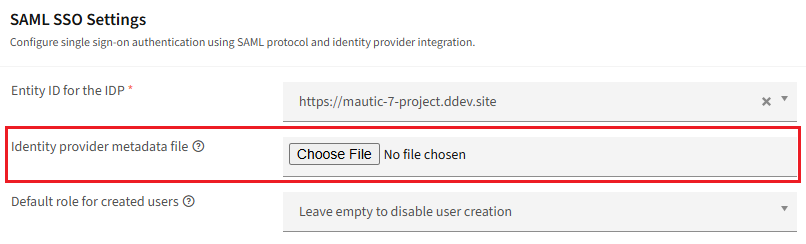
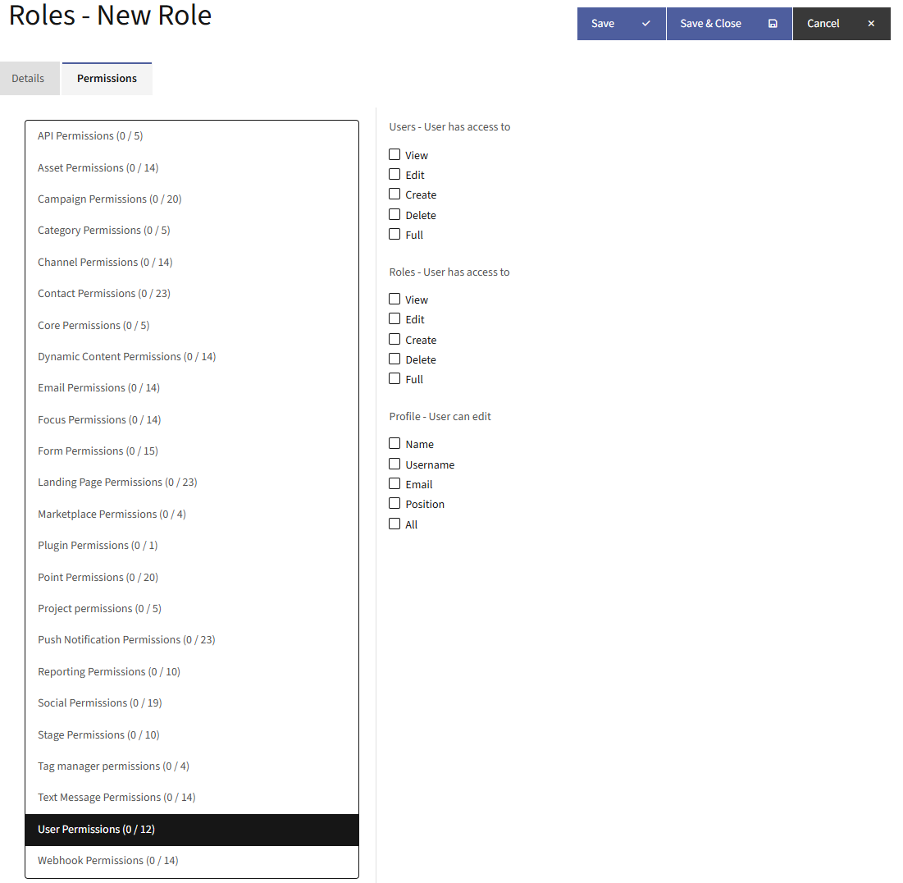
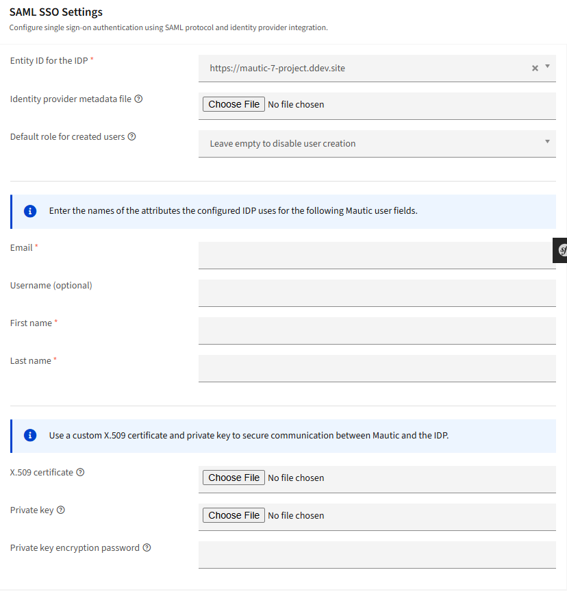

认证
##############

Mautic 为用户提供基本认证，同时也支持与 SAML 单点登录（SSO）提供商集成。

.. vale off

SAML 单点登录
*******************

.. vale on

SAML 是一种单点登录协议，允许通过第三方用户来源（称为身份提供商，IDP）在 Mautic 中实现单点登录和用户创建。

启用 SAML
===============
要在 Mautic 中启用 SAML 支持，您首先需要 IDP 提供的元数据 XML。如果是 URL，请浏览到该 URL 并将内容保存为 XML 文件。

1. 点击右上角的设置齿轮图标，打开 **设置** 菜单。

2. 导航到 **配置** > **用户/认证** 设置。

3. 将此文件作为身份提供商元数据文件上传。

4. 建议创建一个非管理员角色作为已创建用户的默认角色。在"**已创建用户的默认角色**"下拉菜单中选择此角色。更多信息，请参见 :doc:`用户和角色</users_roles/managing_users>`。

配置 IDP
===================
IDP 可能会要求以下设置：

#. 实体 ID - 即站点 URL，显示在用户/认证设置顶部。将其原样复制到 IDP。

#. 服务提供商元数据 - 如果提供商要求提供 URL，请使用 ``https://example.com/saml/metadata.xml``。如需以文件而非 URL 的形式使用，请浏览到该 URL 并将内容保存为 XML 文件。

#. 断言消费者服务 - 使用 ``https://example.com/s/saml/login_check``。

#. Issuer - 此信息应来自 IDP，但通常可配置。如果是 URL，请确保 ``http://`` 和 ``https://`` 协议前缀不包含在其中。

#. 验证请求签名或 SSL 证书 - 如果 IDP 支持加密和验证从 Mautic 到 IDP 的请求签名，请生成自签名 SSL 证书。通过 Mautic 的配置 > 用户/认证设置中的"使用自定义 X.509 证书和私钥保护 Mautic 与 IDP 之间的通信"部分上传证书和私钥。然后将证书上传到 IDP。

#. 自定义属性 - Mautic 在 IDP 响应中需要三个自定义属性：用户邮件、名字和姓氏。用户名也受支持，但是可选的。在 Mautic 的配置 > 用户/认证设置中的"输入配置的 IDP 用于以下 Mautic 用户字段的属性名称"部分配置 IDP 使用的属性名称。

示例 - Azure SAML SSO
========================

1) 通过导航到 ``创建您自己的应用程序``，然后选择 ``集成任何未在库中找到的其他应用程序（非库）`` 来注册新的企业应用程序
2) 转到单点登录
3) ``标识符（实体 ID）`` - 即位于用户/认证设置顶部的站点 URL。将其原样复制到 IDP。
4) ``回复 URL（断言消费者服务 URL）`` - 使用 ``https://example.com/s/saml/login_check``
5) 从第 3 步 SAML 证书下载联合元数据 XML
6) 将下载的联合元数据 XML 上传到 Mautic
7) 不需要 X.509 证书
8) 对于自定义属性字段，使用以下内容：

邮件: ``http://schemas.xmlsoap.org/ws/2005/05/identity/claims/emailaddress``
名字: ``http://schemas.xmlsoap.org/ws/2005/05/identity/claims/givenname``
姓氏: ``http://schemas.xmlsoap.org/ws/2005/05/identity/claims/surname``
用户名（可选）: ``http://schemas.xmlsoap.org/ws/2005/05/identity/claims/emailaddress``

登录
==========

一旦与 IDP 以及 IDP 与 Mautic 配置完成后，Mautic 会将所有登录重定向到 IDP 的登录页面。``/s/login`` 仍然可用于直接登录，但您必须直接访问它。

登录到 IDP，然后 IDP 会将您重定向回 Mautic。如果交换成功，Mautic 会创建用户（如果尚不存在），并将用户登录到系统中。

关闭 SAML
================

要关闭 SAML，请点击身份提供商元数据文件标签右侧的删除链接。

