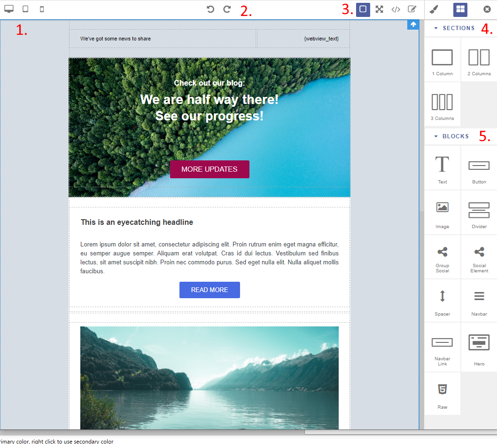
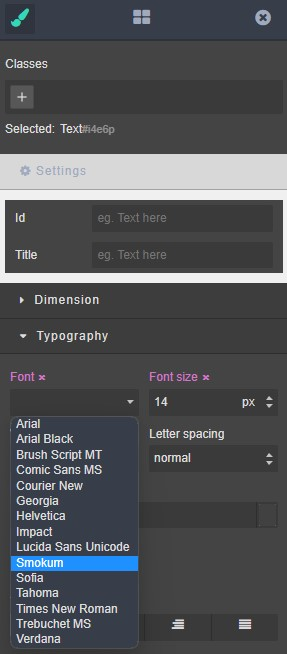

.. vale off

邮件和落地页构建器
############################

.. vale on

从 :xref:`Mautic 3` 开始，Mautic 已附带一个更新的现代化构建器，用于创建邮件和落地页。在 :xref:`Mautic 4` 中，它已成为默认构建器。

.. attention::
    要将现有模板用于新构建器，您需要在配置文件中添加一行。请继续阅读了解更多详情。

.. vale off

关于 GrapesJS
**************

.. vale on

:xref:`Webmecanik` 启动了新的邮件和落地页构建器作为 MVP。在使用开源 :xref:`GrapesJS` 框架进行开发和改进之后，:xref:`Aivie` 慷慨地将其提供给 Mautic 社区。

GrapesJS 是一个开源、多用途的 Web 构建器框架，它结合了不同的工具和功能，旨在帮助构建 HTML 模板而无需任何编码知识。

.. vale off

可用的最终用户功能
***************************

内置拖放区块
===========================

.. vale on

GrapesJS 附带一组内置区块，这样您可以更快地构建模板。如果默认集合不够用，您随时可以添加自己的自定义区块。

无限的样式能力
=================

GrapesJS 实现了简单而强大的样式管理器模块，可以对画布内的任何组件进行独立样式设置。还可以配置它使用任何 CSS 属性。

响应式设计
=================

GrapesJS 为您提供了所有必要的工具来优化模板，使其在任何设备上都能呈现出色的效果。这样，您就能提供各种不同的浏览体验。如果您需要更多设备选项，可以轻松地将它们添加到编辑器中。

始终可控的结构
==================================

您可以尽可能多地嵌套组件，但当结构开始增长时，层级管理器就非常方便了。它允许您极其快速地管理和重新排列元素，始终专注于结构的架构。

需要时随时可用的代码
==================================

您无需关心代码，但它始终在那里，可供您使用。完成后，您可以获取代码并在任何地方使用。开发人员也可以实现自己的存储接口在编辑器中使用。

资源管理器
=============

借助资源管理器，可以更轻松地组织您的媒体文件，只需双击图片即可更改。

关于构建器
*****************

启用构建器
====================

从 Mautic 3.3-RC1 开始，构建器可以在 Mautic 的插件部分中启用。点击右上角的齿轮图标进入设置 > 插件 > GrapesJS，然后点击 GrapesJS 图标。将滑块更改为是。

现在您需要 **清除 Mautic 缓存**（位于 ``var/cache`` 中）并刷新落地页，然后才能使用新的 GrapesJS 构建器。某些浏览器可能还需要您清除浏览器缓存。

默认情况下，Mautic 4 会激活新构建器。按照前面的步骤恢复到旧版构建器，记得清除缓存并重新加载落地页。

邮件构建器概览
**********************

邮件构建器的功能如下：

#. 您可以选择不同的屏幕尺寸预览您的邮件。

#. 您可以撤销和重做您的更改。

#. 编辑器功能从左到右：显示网格、全屏视图、导出 MJML / HTML 代码、编辑代码、显示自定义选项、显示区块、关闭编辑器。

#. 布局区域。这些对象作为您设计的基本结构。从区域创建您的邮件结构，然后拉入您想使用的不同区块。

#. 内容区块。您可以使用这些内容区块填充您的新闻通讯。每个区块都有特定的布局、设置和设计。

模板
*********

要将现有模板用于新构建器，您需要在模板文件夹的配置文件中添加一行：

``"builder": ["grapesjsbuilder"],``

如果您希望在多个构建器中使用该主题，可以使用以下语法：

``"builder": ["legacy", "grapesjsbuilder"],``

.. warning::

  此语法在 Mautic 3.3.* 和 Mautic 4 之间发生了变化，以支持多个构建器——如果您一直在 beta 阶段进行测试，您需要更新配置文件以避免 500 错误。

空白主题包含完整配置文件的示例：

.. code-block::

    {
      "name": "Blank",
      "author": "Mautic team",
      "authorUrl": "https://mautic.org",
      "builder": ["legacy", "grapesjsbuilder"],
      "features": ["page", "email", "form"]
    }

从 3.3 正式版发布开始，有三个支持 MJML 的邮件模板。

主题
*******

如果您搜索可用主题列表，新的 MJML 主题 ``Brienz``、``Paprika`` 和 ``Confirm Me`` 仅显示在新构建器中。

要了解更多关于创建主题的信息，请 :doc:`查看文档</builders/creating_themes>`。

自定义字体
************

从 Mautic 5.x 开始，您可以扩展样式管理器 > 排版 > 字体列表以包含自定义字体。

您可以在本地配置文件（通常位于 ``app/config/local.php`` 中）中将选项定义为 ``'editor_fonts'`` 数组的元素。字体应具有唯一的名称和有效的 CSS 样式 URL。请参见以下示例：

.. code-block:: php

    <?php
    // Example local.php
    'editor_fonts' => array(
        '0' => array(
            'name' => 'Smokum',
            'font' => 'Smokum, cursive',
            'url' => 'https://fonts.googleapis.com/css2?family=Smokum&display=swap'
        ),
        '1' => array(
            'name' => 'Sofia',
            'font' => 'Sofia, sans-serif',
            'url' => 'https://fonts.googleapis.com/css?family=Sofia'
        )
    ),

报告错误
***************

已知错误/问题
===================

请使用 :xref:`GitHub repository` 上的问题队列来查找最新更新并报告插件错误。请务必先搜索，以防有人已经报告了该错误。

切换回旧版构建器
************************************

如果您目前对插件不满意，可以轻松切换回旧版构建器（原始的 Mautic 构建器）。您可以很快地完成此操作：

#. 前往 Mautic 设置 > 点击右上角的齿轮图标

#. 打开插件目录 > 在菜单中点击"插件"

#. 找到 GrapesJS 插件并点击它 > 点击"否"，然后点击"保存并关闭"

#. 清除缓存并重新加载落地页——您可能还需要清除浏览器缓存。

卸载 GrapesJS 插件后，旧版构建器会重新激活。

致谢
******************

.. vale off

感谢每一位为本项目做出贡献的人。特别感谢来自 :xref:`Aivie` 的 Adrian Schimpf 在领导项目方面的辛勤工作，感谢 :xref:`Webmecanik` 启动了这款出色的新构建器，感谢来自 :xref:`Friendly Automate` 的 Joey 向社区捐赠了三个邮件主题。额外贡献者：来自 :xref:`hartmut.io` 的 Alex Hammerschmied、Dennis Ameling。

.. vale on

当然，还要非常感谢所有为这个项目达到今天这个阶段提供帮助的贡献者。