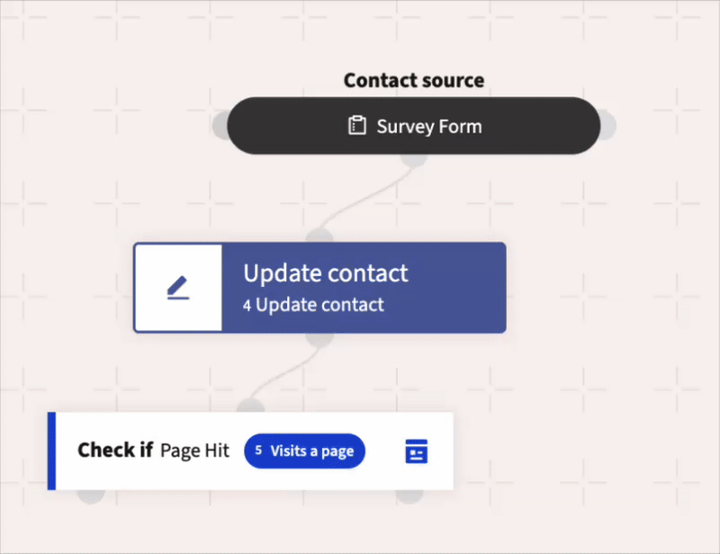

.. vale off

使用营销活动构建器
##########################

.. vale on

营销活动构建器提供了一个空白画布，您可以在其上构建营销活动工作流。营销活动构建器支持使用条件、决策和操作。您可以通过将各种决策、操作和条件拖放到画布上，轻松创建简单的工作流。

要构建营销活动，请执行以下步骤：

#. 点击新营销活动向导中的 **启动营销活动构建器**。联系人来源菜单将显示，如下图所示。

   |
   
   .. image:: images/campaign_sources.png
      :width: 400
      :align: center
      :alt: 显示联系人来源的营销活动构建器截图

   |

   在此步骤中，您指定要纳入营销活动的联系人。当联系人加入分组、提交表单或两者结合时，可以触发营销活动。

#. 选择营销活动从何处获取联系人：

   * **联系人分组**：如果您希望将营销活动发送给具有特定属性（例如“位于美国”或“访问过产品A”）的特定联系人组，并且这些联系人已基于此条件存在于现有分组中，请选择此选项。

   请注意，分组选择仅显示公共分组。如果您创建标记为私有的分组，则该分组将无法在营销活动中使用。

   * **联系人表单**：如果您希望在联系人完成指定表单时启动营销活动，请选择此选项。表单是收集联系人信息的主要途径。您可以根据表单字段中提交的值在营销活动中执行操作。

   您可以为营销活动混合选择两种类型的联系人来源。要同时使用两者，请点击 **联系人来源** 框左侧或右侧的灰色选择器按钮，以添加您最初未选择的来源类型。

   |

   .. image:: images/multi_source_campaign.png
      :width: 600
      :align: center
      :alt: 显示选择了多个来源的营销活动构建器截图

   |  

#. 选择一个或多个联系人来源后，点击灰色选择器按钮向营销活动添加至少一个事件。营销活动事件由操作、决策和/或条件的组合构成，如下图所示：

   |

   .. image:: images/campaign_events.png
      :width: 600
      :align: center
      :alt: 显示可用营销活动事件的营销活动构建器截图

   |

  有关营销活动操作、决策和条件的更多信息，请参阅以下主题。

操作
-------

营销活动操作是您在联系人上或联系人记录上发起的事件。这些操作可以代表向联系人发送通信，也可能自动执行运营任务以保持营销活动运行。单个营销活动可以包含多个操作。创建营销活动时，您需要选择其中一个操作来启动工作流。

Mautic 在营销活动中提供的操作包括：

.. vale off

.. list-table::
   :header-rows: 1
   :widths: 30, 70

   * - 操作
     - 描述
   * - **添加请勿联系**    
     - 将联系人添加到请勿联系（DNC）列表
   * - **添加到公司积分**
     - 为与联系人关联的所有公司的积分增加或减去指定数量的积分。
   * - **添加公司操作**  
     - 将联系人关联到一家公司，并将该公司设置为联系人的主公司。
   * - **调整联系人积分**  
     - 增加或减少联系人积分总数或分组中的积分。
   * - **更改营销活动**  
     - 将联系人从现有营销活动中移除，将其移至另一个营销活动，重新启动当前营销活动，或进行上述操作的组合。在重新启动营销活动之前，您必须先将联系人从该营销活动中移除。
   * - **更改联系人的阶段**  
     - 将联系人移动到指定的阶段。
   * - **删除联系人**  
     - 永久删除联系人记录以及关于该联系人的所有信息，包括关于该联系人的营销活动事件日志记录。请参阅 :doc:`分组文档</segments/manage_segments>` 了解如何使用此操作删除分组中的所有联系人。
   * - **跳转到事件**  
     - 将联系人从营销活动中的一个点移动到另一个点，而无需重建事件。使用此操作将联系人发送到营销活动中的不同路径。
   * - **修改联系人的分组**
     - 将联系人添加至分组或从分组中移除。通过营销活动操作从动态（基于筛选条件的）分组中移除联系人时，即使联系人再次满足筛选条件，也不会被重新添加到该分组。
   * - **修改联系人的标签** 
     - 覆盖或附加联系人记录上的标签。您可以在同一操作中添加或删除标签，或同时进行。
   * - **推送联系人至集成** 
     - 将联系人记录发送到选定的集成，在所选的集成中创建新联系人，或更新已关联的联系人记录。
   * - **移除请勿联系**  
     - 将联系人从请勿联系（DNC）列表中移除。
   * - **发送 Webhook** 
     - 向定义的 URL 发送 Webhook，支持 GET、POST、PUT、PATCH 或 DELETE 方法。标头和数据可自定义，并支持使用令牌，例如联系人字段和联系人的 IP 地址。例如：``{contactfield=firstname}``
   * - **发送电子邮件**   
     - 向选定的联系人发送事务性电子邮件或营销电子邮件。您可以多次向联系人发送事务性电子邮件。您只能跨多个来源向联系人发送一次营销电子邮件。如果联系人已从其他来源或当前营销活动收到此电子邮件，则不会再次向其发送该电子邮件，并且联系人将继续在营销活动中前进。
   * - **发送电子邮件给用户** 
     - 向联系人以外的实体发送电子邮件。这可能是 Mautic 用户、联系人的所有者或非用户。使用此操作发送的电子邮件不会生成任何联系人或电子邮件的统计数据。
   * - **发送营销消息**
     - 使用联系人的首选渠道发送消息。
   * - **更新联系人**
     - 使用指定的值更新现有联系人的字段。您可以将静态值与 Mautic 变量（如 ``{contactfield=firstname}``）以及日期/时间变量（如 ``now``、``now+3hours`` 用于日期/时间字段，或 ``{datetime=now}`` 用于文本字段）结合使用。
   * - **更新联系人的主公司**
     - 使用指定的值更新现有联系人的主公司字段。请参阅 :doc:`公司文档 </companies/companies_overview>`。
   * - **更新联系人所有者**
     - 更新联系人的所有者。

.. vale on

.. vale off

关于营销活动操作的说明
~~~~~~~~~~~~~~~~~~~~~~~~~

.. vale on

#. 作为营销活动的第一步，您通常向您的分组发送电子邮件。当您在营销活动中添加电子邮件时，您可以选择潜在的交货 **延迟**，如下图所示。

   |

   .. image:: images/send_email_delay_options.png
      :width: 600
      :align: center
      :alt: 显示电子邮件发送延迟选项的营销活动构建器截图

   |

   当将操作附加到决策的 **非操作** 发起的决策路径时，延迟变为联系人在营销活动沿着非操作路径前进之前必须采取行动的时间。图片展示了营销活动非操作决策路径上的延迟操作。

#. 删除联系人操作也会删除关于该联系人的营销活动事件日志记录。因此，尽管此操作在营销活动详细信息概览上可能始终显示 0% 的进度，但它可能已经删除了一些联系人。

   .. note::
  
      删除联系人操作不允许与其他营销活动事件连接。由于触发此操作后联系人将不复存在，因此在此点之后不能存在营销活动事件。
   
添加操作后，您可以在营销活动中放置一个决策。

决策
---------

营销活动决策是您的联系人发起的操作。下载资源、打开电子邮件或访问着陆页都是决策的例子。这些决策可以是直接发起的，也可以根据非操作行为推断。可用决策选项会根据您选择的营销活动操作而变化。

决策通常有两条路径，由决策树上的红色和绿色图标表示。

绿色路径
~~~~~~~~~~~

绿色路径表示积极或肯定的操作。

如果联系人执行了直接操作（例如打开电子邮件或提交表单），则联系人会走这条路径。当联系人执行操作时，绿色路径上跟随的操作会立即执行——或者如果后续操作设置了延迟，则立即安排执行。

红色路径
~~~~~~~~~

红色路径表示未执行操作。

如果联系人尚未执行该操作，则联系人会走这条路径。使用操作的延迟设置来定义营销活动应在何时将联系人发送到此路径上的后续步骤。

根据是否满足决策的标准，联系人会走决策树中的绿色或红色路径。例如，考虑一个决策是访问着陆页的情况。可能有两种结果。如果联系人选择访问着陆页，则绿色决策路径连接到营销活动工作流中的下一个操作。然而，如果联系人没有访问着陆页，则红色决策路径连接到一个不同的操作——例如，延迟 7 天，然后营销人员可以发送一封后续电子邮件。

|

以下是 Mautic 在营销活动构建器中提供的决策：

.. vale off

.. list-table::
   :header-rows: 1
   :widths: 30, 70

   * - 决策
     - 描述
   * - **设备访问**    
     - 设置选项以跟踪您的联系人是否从特定设备类型、品牌或操作系统访问您的资源。
   * - **下载资源**    
     - 设置选项以跟踪您的联系人是否下载了指定的一个或多个资源。
   * - **请求动态内容**    
     - 如果您有一个网页或着陆页并希望添加动态内容，请设置选项以推送基于营销活动的动态内容。
   * - **提交表单**    
     - 设置选项以跟踪联系人是否提交了任何 Mautic 表单。您也可以限制此决策仅跟踪特定表单。
   * - **访问页面**    
     - 指定您希望联系人访问的一个或多个页面。可以是 Mautic 着陆页或您网站上的页面。
   * - **电子邮件相关决策**    
     - 仅在选择发送电子邮件营销活动操作时，营销活动构建器中的某些决策才可用。

.. vale on

以下是电子邮件相关的决策：

.. list-table::
   :header-rows: 1
   :widths: 30, 70

   * - 决策
     - 描述
   * - **打开电子邮件**    
     - 跟踪联系人是否打开了电子邮件。
   * - **点击电子邮件**    
     - 跟踪联系人是否点击了已发送电子邮件中的链接。这推断联系人打开了电子邮件。
   * - **回复电子邮件**    
     - 跟踪联系人是否回复了您发送的电子邮件。有关更多信息，请参阅联系人回复。	

条件
----------

营销活动条件根据联系人的数据执行不同的操作。例如，如果联系人拥有有效的电子邮件地址则执行一个操作，如果没有则执行其他操作。

条件有两条路径，如前所述，由红色和绿色图标表示。

以下是 Mautic 在营销活动构建器中提供的不同条件：

.. list-table::
   :header-rows: 1
   :widths: 30, 70

   * - 条件
     - 描述
   * - **联系人营销活动**    
     - 检查联系人是否是另一个营销活动的成员。
   * - **联系人设备**    
     - 检查联系人是否从特定的设备类型、品牌或操作系统与您的营销活动进行了交互。
   * - **联系人字段值**    
     - 检查信息是否与联系人记录、联系人的主公司或 UTM 标签上的选定条件匹配。
   * - **联系人所有者**    
     - 检查选定的用户是否是联系人的所有者。
   * - **联系人分组**    
     - 检查联系人是否是选定分组的成员。
   * - **联系人标签**    
     - 检查联系人记录上是否存在指定的标签。
   * - **联系人积分**
     - 检查联系人是否拥有特定数量的积分或分组积分。
   * - **表单字段值**    
     - 检查在选定表单的选定字段上提交的值是否与指定的条件匹配。
   * - **有活跃通知**    
     - 检查联系人是否有活跃的 Web 通知。	
   * - **有有效的电子邮件地址**    
     - 检查联系人的电子邮件地址是否具有有效的语法，例如 name@example.com，不包含空格、其他无效字符或格式。	
	
关于延迟条件和日期的说明
~~~~~~~~~~~~~~~~~~~~~~~~~~~~~~~~~~~~~

Mautic 会尊重条件本身设置的延迟，然后再传递到任何连接操作的延迟。例如，如果您是从“打开电子邮件”的否定路径过来的，您可以在否定路径上设置一个“有活跃通知”的条件，其相对日期为 1 天，然后跟随一个相对日期为 2 天的“发送电子邮件”。Mautic 会在 1 天后检查是否有活跃通知；如果没有，则将电子邮件安排在两天后发送。

使用自定义日期字段触发营销活动
~~~~~~~~~~~~~~~~~~~~~~~~~~~~~~~

在基于联系人字段值的条件中，选择所需的日期字段。然后选择“日期”作为运算符，并从下拉列表中选择所需的值。

在“周年纪念日”选项中，您只能输入日和月值。

Mautic 会立即评估营销活动条件，因此如果字段中的日期与条件匹配，Mautic 将执行肯定操作。如果日期不匹配，Mautic 将执行否定操作。联系人不会等待条件变为 TRUE。

要基于特定日期运行营销活动（联系人今天可能被“包含”也可能不“包含”），您可以：

* 创建一个使用筛选条件为日期字段 = ``TODAY`` 的分组。
* 基于该分组启动营销活动。
* 随着联系人进出该分组，营销活动会随之运行。
* 由于分组每天都在变化，您可以消除该条件。

这对“周年纪念日”选项 **不起作用**。

如果联系人在稍后的某个日期因为日期值发生变化而再次出现在该分组中，则该联系人只会通过营销活动一次，因此不会再被包含在该营销活动中。

智能事件安排
~~~~~~~~~~~~~~~~~~~~~

对于发送电子邮件、营销消息、推送联系人至集成和发送 Webhook 操作，Mautic 提供了一个智能事件安排选项。此功能可根据个人联系人行为动态优化事件执行的时机，从而提高参与的可能性。

**工作原理：**

#. **交互数据检索**：系统检索联系人的交互数据，包括电子邮件读取、着陆页点击和表单提交，以分析联系人的参与模式。

#. **最少交互要求**：联系人必须拥有最少次数的交互，系统才能计算最佳时机。每种交互类型——电子邮件打开、网站访问、表单提交——每小时仅计数一次。当联系人没有足够的交互数据时，默认小时范围和日期将调整为联系人的首选时区。

#. **最佳时间计算 - 在 24 小时内执行事件**：基于联系人的交互数据，系统会考虑联系人历史参与模式，计算执行营销活动事件的最佳时间。
    
    * 如果联系人此刻处于最佳窗口内，事件将立即执行。
    * 如果当前时间早于今天的最佳窗口，事件将安排在该窗口的第一个小时执行。
    * 如果当前时间晚于今天的最佳窗口，事件将安排在明天最佳窗口的第一个小时执行。

#. **最佳日期计算 - 在 7 天内执行事件**：系统像上一选项一样计算最佳时间，并额外确定一周中的最佳日期。默认情况下，一个联系人可能有多个最佳日期。
    
    * 如果联系人在此刻处于最佳窗口内，事件将立即执行。
    * 如果当前时间和日期早于最佳窗口，事件将安排在下一个最佳日期的第一个最佳小时执行。

.. vale off

触发营销活动事件
--------------------------

.. vale on

Mautic 中的操作和决策需要一个 :doc:`Cron 作业</configuration/cron_jobs>`，该作业按所需间隔执行以下命令：

.. code-block:: shell

   php /path/to/mautic/bin/console mautic:campaigns:trigger

如果您希望以不同的间隔为特定营销活动执行此命令，可以将 ``--campaign-id=ID`` 选项传递给该命令。

如果您希望忽略特定营销活动，可以将 ``--exclude=ID`` 选项传递给该命令。传递多个选项将忽略多个营销活动。

.. vale off

克隆营销活动事件
-----------------------

.. vale on

自 Mautic 5.1 起，营销活动构建器包含一项功能，允许用户克隆（复制并粘贴）营销活动事件，从而更容易地在不同营销活动中复制复杂的工作流或重用特定的操作、决策或条件。此功能支持在同一营销活动内以及不同营销活动之间克隆事件。

要克隆事件：

#. 将鼠标悬停在您要克隆的营销活动事件上，然后点击复制图标按钮，将该事件存储在剪贴板中。

   |

   .. image:: images/clone_campaign_event.png
      :width: 300
      :align: center
      :alt: 悬停在营销活动事件上以显示克隆选项的截图

   |

#. 点击您想要插入克隆事件之后的事件的锚点。这将打开一个模态窗口。

#. 在模态窗口中，点击“插入”按钮以粘贴已存储的事件。

   |

   .. image:: images/paste_cloned_event_modal.png
      :width: 600
      :align: center
      :alt: 显示插入选项以粘贴克隆事件的模态窗口截图

   |

现在，克隆事件已插入到营销活动工作流中。