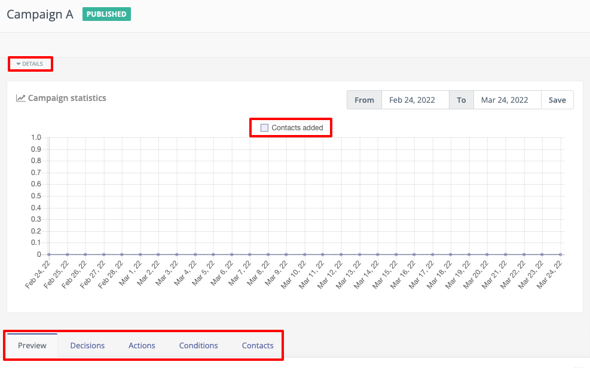

.. vale off

管理营销活动
##################

.. vale on

您可以通过营销活动概览页面管理您的营销活动。

在营销活动列表中点击任意营销活动名称，即可进入该营销活动的概览页面。每个标签页都会显示营销活动的详细信息，包括已添加至该营销活动的联系人数量、已发送的邮件数量、由该营销活动带来的页面浏览量等。

其他信息包括营销活动中可用决策和操作的快速概览，以及营销活动中所有联系人的网格布局概览。

下图展示了一个示例营销活动概览及其高亮面板：

**详细信息**下拉菜单提供了营销活动最重要信息的快速概览。这些信息包括创建该营销活动的用户名称、营销活动类别、创建日期和时间、激活日期和时间、营销活动中的联系人分组等。

**营销活动统计**面板以图形格式显示指定时间段内添加至营销活动的联系人数量。要指定时间段，请使用"从"和"到"日期选择器，然后点击"应用"。

**预览**标签页以图表形式展示营销活动的预览。

**决策**标签页以表格形式列出您已添加至营销活动的所有决策。

**操作**标签页以表格形式列出您已添加至营销活动的所有操作。

**条件**标签页以表格形式列出您已添加至营销活动的所有条件。

**联系人**标签页以网格视图显示您已添加至营销活动的所有联系人。

右侧的**最近活动**面板显示营销活动中近期发生的活动。

.. vale off

营销活动重新激活行为
******************************

.. vale on

当您停用后重新激活营销活动时，Mautic 提供了对具有相对延迟的定时事件（例如"加入后 5 天发送邮件"）应如何表现的控制。此功能使您能够根据具体用例灵活管理营销活动的时间安排。

.. note::

   此设置仅影响使用相对延迟（基于时间间隔的调度）的事件。具有绝对日期的事件不受此设置影响。

配置重新激活行为
==================================

您可以在两个级别配置重新激活行为：

1. **全局默认** - 在**配置** > **营销活动设置** > **营销活动重新激活行为**中设置。除非被覆盖，否则此设置适用于所有营销活动。
2. **每个营销活动** - 在创建或编辑营销活动时设置。此设置会覆盖该特定营销活动的全局默认设置。

重新激活行为选项
==============================

关于定时事件在重新激活后应如何表现，共有三个选项可供选择：

无论激活状态如何均计算延迟
------------------------------------------

这是默认行为。Mautic 使用原始的触发日期，非活跃时间不会影响调度。

**示例场景：**

.. vale off

* 营销活动触发日期：1 月 1 日
* 事件延迟：10 天
* 计算后的事件日期：1 月 11 日
* 营销活动停用：1 月 5 日
* 营销活动重新激活：1 月 7 日

.. vale on

**结果：**事件仍按原计划在 1 月 11 日执行。

**适用时机：**此选项保持原有的定时安排，将营销活动的激活状态视为与延迟计算无关。当您希望与原计划保持一致，或临时停用营销活动不应影响事件执行时间时，可使用此选项。

重新激活时重新开始
-----------------------

当您重新激活营销活动时，延迟计数器完全重置。

**示例场景：**

.. vale off

* 营销活动触发日期：1 月 1 日
* 事件延迟：10 天
* 原始计算后的事件日期：1 月 11 日
* 营销活动停用：1 月 5 日
* 营销活动重新激活：1 月 7 日

**结果：**Mautic 将事件重新安排为重新激活后 10 天执行，即 1 月 17 日。

.. vale on

**适用时机：**当您希望确保所有联系人在营销活动发生任何变更后都能获得完整的预期延迟时，此选项非常有用。例如，如果您停用营销活动以进行重大更新，并希望每个人都体验到完整的更新后工作流时序。

仅在活跃期间计算延迟
-----------------------------

只有营销活动处于活跃状态时，事件才会计数天数。非活跃期不计入延迟。

**示例场景：**

.. vale off

* 营销活动触发日期：1 月 1 日
* 事件延迟：10 天
* 原始计算后的事件日期：1 月 11 日
* 营销活动停用：1 月 5 日 - 已活跃 4 天
* 营销活动重新激活：1 月 10 日 - 已非活跃 5 天

**结果：**Mautic 将事件重新安排到 1 月 16 日。1 月 1 日至 1 月 5 日的 4 天活跃状态计入 10 天延迟。在 1 月 10 日重新激活后，系统添加剩余的 6 天，将新事件日期设为 1 月 16 日。

.. vale on

**适用时机：**当您希望精确控制联系人在活跃营销活动状态中实际花费的时间时，此选项是理想选择。可用于合规场景、试用期，或当您需要暂停营销活动而不影响预期的互动时间线时。

查看最后激活日期
============================

.. vale off

营销活动详情下拉菜单显示**最后发布日期**，表示您最近一次激活营销活动的日期。Mautic 将此日期用作**重新发布时重新开始**选项的参考点，以重新计算计划事件的时间。

.. vale on

.. vale off

激活和停用营销活动
=================================

.. vale on

当您激活或停用营销活动时，Mautic 会显示一条确认消息，其中包含当前的重新激活行为设置。这有助于您在确认操作前了解定时事件将如何处理。

.. vale off

例如："所有定时事件将根据重新激活行为设置执行。当前设置为：无论激活状态如何均计算延迟"。

.. vale on

.. warning::

   当您停用营销活动时，所有联系人和营销活动事件的处理（包括定时事件）会立即停止。定时事件会保留在队列中，但在您重新激活营销活动之前不会执行。

.. note::

   Cron 作业在评估营销活动事件日志时重新计算定时事件，而非在您重新激活营销活动的那一刻。如果在评估时重新计算的触发日期仍为过去，则事件立即执行。如果日期落在未来，Cron 作业会相应地重新安排事件。

跟踪重新安排的事件
===========================

Mautic 会在 ``campaign_lead_event_log.metadata`` 列中记录所有对定时事件触发日期的更改。此审计跟踪使您能够调查系统重新安排事件的时间和原因，提供透明度并有助于故障排除。

您可以在联系人的时间线中的**营销活动事件已安排**条目下查看此信息，其中重新安排的事件会显示更新后的触发日期以及更改原因。