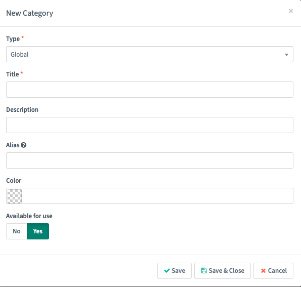
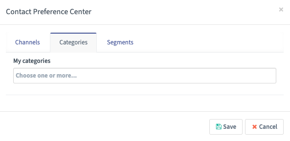

.. vale off

分类
##########

.. vale on

分类是一种组织 Mautic 元素的方式。分类可用于资源、营销活动、邮件、焦点项目、表单、页面、积分、社交监控和阶段。使用分类有两种方式：

1. 创建特定元素专属的分类，例如仅用于资源、邮件或表单。
2. 为所有 Mautic 元素创建全局分类。

.. vale off

创建和管理分类
********************************

.. vale on

要创建新分类，请前往 Mautic 右上角的设置菜单，然后选择"分类"。

.. vale off

创建新分类时，您可以选择类型、标题、描述、别名、颜色和可用状态。在 Mautic 的其他区域查看时，颜色有助于快速按对应分类找到 Mautic 元素。

使用分类管理联系人
******************************

.. vale on

除了组织各种 Mautic 元素之外，分类还可以帮助您组织联系人。在联系人详情中，使用偏好菜单打开联系人偏好中心。

Mautic 允许在分组和动态内容过滤器中使用联系人类别。

