邮件
######

Mautic 使营销人员能够通过营销活动自动地向某个分组中的联系人群体发送邮件，或者进行一次性发送。邮件提供了一种与潜在客户、客户和联系人直接互动的方式。

邮件类型
***********

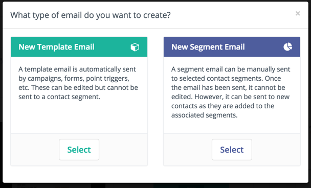

邮件分为两种类型：模板邮件和分组（广播）邮件。

.. vale off

模板邮件
===============

.. vale on

模板邮件默认为事务性邮件。它们用于营销活动、表单提交操作、积分触发器等。可以向同一联系人多次发送模板邮件。您不能在其他 Mautic 组件之外向联系人发送模板邮件，除非直接向联系人发送邮件——在这种情况下，Mautic 会克隆内容。

.. note::
    因此，直接发送给联系人的模板邮件不与模板邮件本身关联，因此不会针对其跟踪统计数据。

.. vale off

分组（广播）邮件
==========================

.. vale on

分组邮件默认为营销邮件。创建时，营销人员需要为邮件分配分组。这决定了哪些联系人会收到通信。请注意，每个联系人只能接收一次该邮件——原理与邮件列表相同。

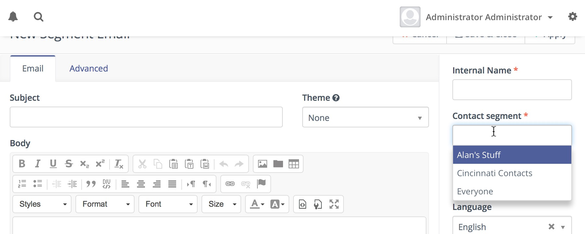

此输入字段支持多选，允许您在必要时选择多个分组。

.. vale off

排除分组
==================

.. vale on

有一个多选字段允许排除属于特定分组的联系人。

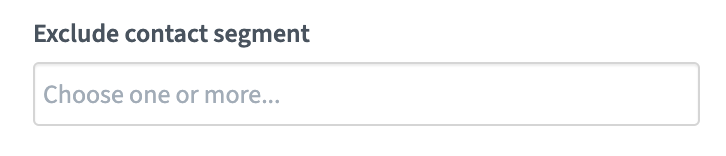

Mautic 通过 :doc:`/configuration/cron_jobs` 来启动这些邮件的发送——请参阅"发送已调度的广播"部分（例如分组邮件）了解更多详情。

邮件格式
*************

在 Mautic 中，可以创建完整 HTML 格式以及纯文本格式的邮件——根据联系人的邮件客户端支持情况来传递。通过以正确的格式提供相关信息，这是与联系人建立牢固关系的重要组成部分。

.. vale off

管理邮件
***************

.. vale on

邮件概览
==============

邮件概览页面可让您一目了然地了解特定邮件的成功或失败情况。您可以快速查看关于打开、退信、成功点击率和其他重要统计数据的相关信息。

.. vale off

邮件草稿
============

创建草稿邮件
----------------------

.. vale on

Mautic 允许使用邮件编辑器中的"保存为草稿"按钮来创建邮件草稿。

此功能需要通过将配置参数 ``email_draft_enabled`` 添加到您的 ``local.php`` 配置文件中来启用，详情如下。

.. code:: php

  'email_draft_enabled' => 1

启用后，"保存为草稿"按钮会出现在邮件编辑界面上。

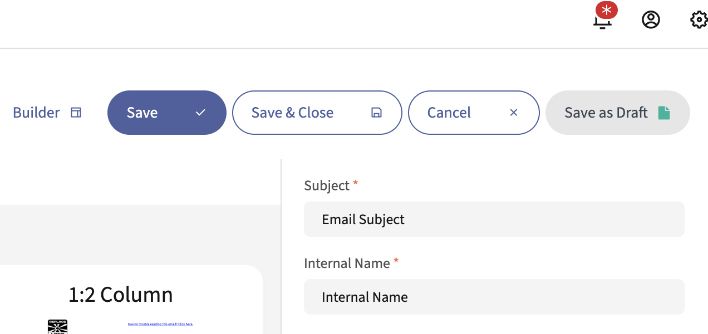

任何给定邮件一次只能存在一个草稿。当使用草稿时，"保存为草稿"按钮会改为显示两个按钮，"应用草稿"和"丢弃草稿"。

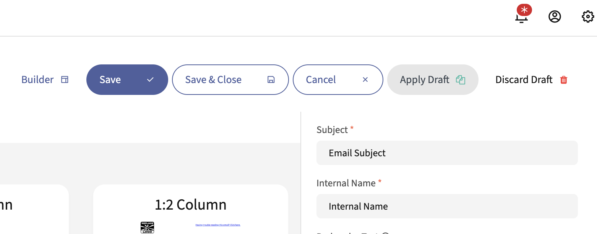

邮件草稿仅允许更改邮件的内容。对主题、内部名称、所选分组等的更改即使在编辑草稿版本时也会应用于原始邮件。草稿内容独立于原始邮件存在。

.. vale off

预览草稿邮件
------------------------

.. vale on

可以通过在邮件预览 URL 末尾添加 ``/draft`` 来预览邮件草稿。如果某封邮件有草稿版本，在邮件详情页面上的常规预览 URL 下方会显示一个草稿预览 URL。

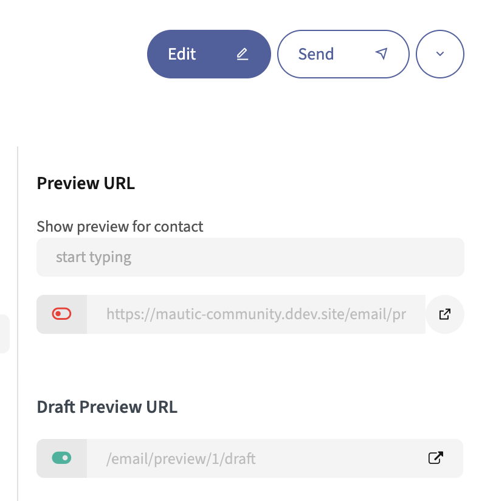

翻译
============

创建邮件时，可以选择分配语言和翻译父级。通过选择翻译父级，当前项目即被视为该父级项目在所选语言中的翻译。如果联系人设置了偏好语言，他们会收到以其偏好语言存在的翻译版本。否则，他们会收到默认语言的父级版本。

也可以创建 A/B 测试变体的翻译。

从 Mautic 5.1 起，可以预览 A/B 测试和翻译变体：

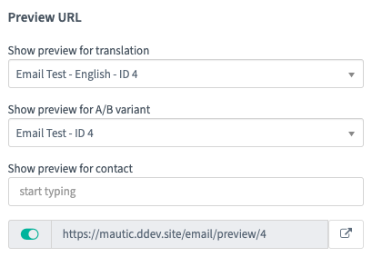

Base64 编码图片
=====================

可以将邮件文本中的所有图片编码为 base64。这会将图片附加到邮件正文内部。这有几个影响：

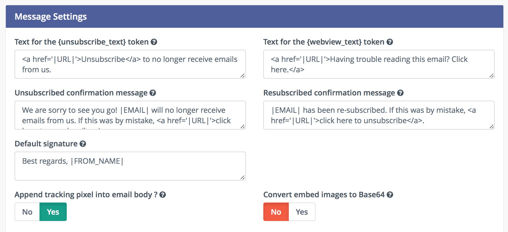

- 此选项的主要目的是大多数邮件客户端会直接显示图片，而无需用户手动允许图片加载。
- 某些邮件客户端（如 GMail）需要用户批准才能显示 Base64 编码的图片，因为跟踪像素也是一张图片，因此不会显示 Base64 编码的图片。请参阅下一段了解可能的解决方案。
- 如果邮件包含许多和/或大尺寸的图片，邮件正文会显著增大。一些邮件客户端（如 GMail）会"截断"此类消息，不会直接显示。

令牌
======

Mautic 允许在邮件中使用令牌，让营销人员能够将多个联系人字段集成到您的邮件中。这些令牌可以轻松地放置在您的邮件中，并在发送时自动替换为相应的文本。

从 Mautic 5.1 起，还可以使用来自 :doc:`/contacts/custom_fields` 的令牌覆盖邮件中的"发件人"字段。

请查看 :doc:`/configuration/variables` 文档，了解所有可用的默认字段列表。

默认值
-------------

令牌可以有一个默认值，用于联系人字段值未知的情况。您必须在 ``|`` 字符后指定默认值，例如：

.. code-block:: php

    Hello {contactfield=firstname|friend}

``|friend`` 告诉 Mautic，如果联系人字段中没有名字，则使用"friend"。

编码值
-------------

可以使用以下语法对令牌中使用的值进行编码：

.. code-block:: php

    Hello {contactfield=firstname|true}

``|true`` 告诉 Mautic 对使用的值进行编码，例如在 URL 中。

日期格式
------------

要在令牌中使用自定义日期字段，请使用以下格式：

.. code-block:: php

    {contactfield=DATEFIELDALIAS|datetime}
    {contactfield=DATEFIELDALIAS|date}
    {contactfield=DATEFIELDALIAS|time}

日期会以人类可读的格式输出，该格式在您的全局配置 > 系统设置中的"仅日期的默认格式"和"仅时间的默认格式"下配置。

下拉和布尔字段的标签修饰符
--------------------------------------------

对于下拉和布尔字段类型，您可以使用 ``|label`` 修饰符来显示人类可读的标签而不是存储的值：

.. code-block:: php

   {contactfield=select_alias|label}
   {contactfield=bool_alias|label}

这在字段包含技术值但您想在邮件中显示用户友好的标签时特别有用。例如：

* 存储 ``us`` 的国家选择字段可以显示为 ``United States``
* 存储 ``1`` 的布尔字段可以显示为 ``Yes``

此修饰符也适用于公司字段：

.. code-block:: php

   {contactfield=company_select_alias|label}
   {contactfield=company_bool_alias|label}

联系人回复
===============

要使用联系人回复监控功能，您必须能够访问 **Google 或 Yahoo 以外的** IMAP 服务器，因为它们会覆盖返回路径，导致此功能无法正常工作。

.. note::
  要使用邮件监控功能，您必须启用 PHP IMAP 扩展——大多数主机已经默认启用了此扩展。

#. 配置所有 Mautic 发件人/回复邮件地址，将副本发送到一个单一的收件箱——大多数邮件提供商在其配置面板中支持此功能。

.. note::
  最好专门为此目的创建一个邮件地址，因为 Mautic 会读取在给定文件夹中找到的每条消息。

#. 前往 Mautic 配置，设置用于监控回复的收件箱。

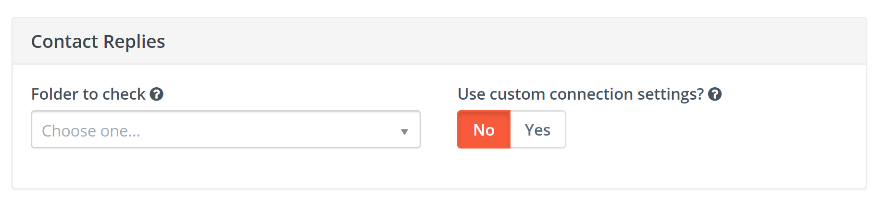

#. 要获取并处理回复，运行以下定时任务命令：

``php path/to/mautic/bin/console mautic:email:fetch``

用法
------
营销活动中，联系人回复作为邮件发送操作之后的决策来使用，根据联系人是否已回复邮件来采取进一步行动。Mautic 会尝试读取收件箱，解析消息，并查找来自指定联系人的回复。当联系人匹配到传入的回复时，会在检测到回复后立即沿着"是"路径继续。

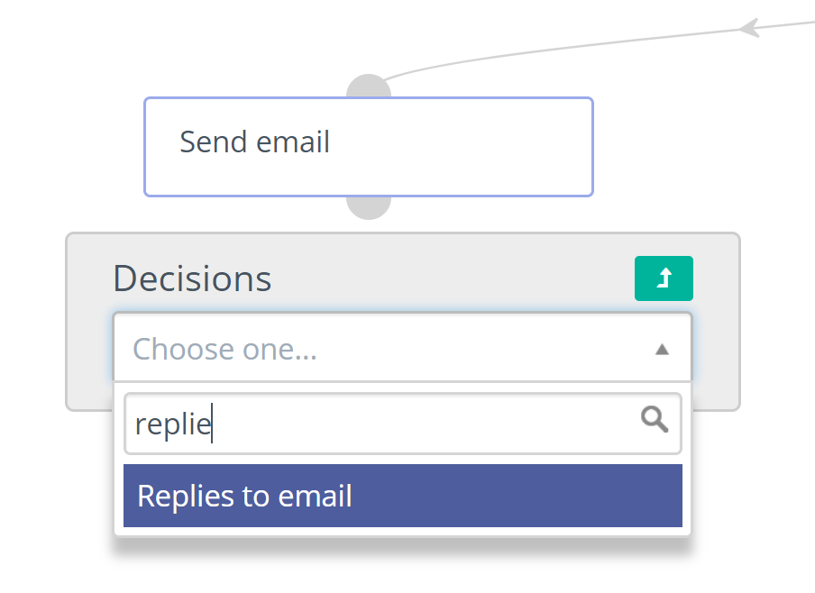

.. vale off

邮件发送者即所有者
***************

.. vale on

此功能允许 Mautic 自动个性化发送给已分配所有者（Mautic 用户）的联系人的邮件。此功能通过将默认设置更改为 Mautic 联系人所有者的用户设置来更改发件人邮件、发件人姓名和签名。

.. vale off

使用联系人所有者发送
==============================

.. vale on

#. 点击右上角的齿轮图标打开管理员菜单。
#. 选择配置菜单项。
#. 选择邮件设置选项卡。
#. 将"邮件发送者即所有者"切换为是。
#. 保存配置。

覆盖邮件发送者即所有者设置
======================================
可以为单封邮件覆盖全局设置。

在邮件的高级设置下有一个开关，允许您决定是否采用全局邮件发送者即所有者设置，还是使用指定的发件人地址。

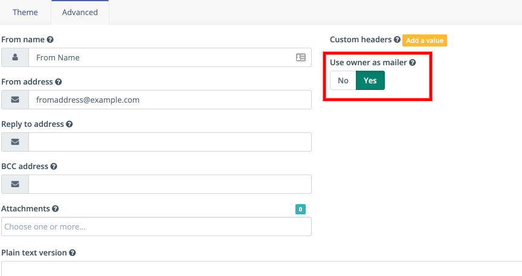

如果设置为是，全局设置优先。

如果设置为否，Mautic 使用邮件"发件人"字段中提供的地址和姓名。

签名
**********

签名的设置有两个地方：

#. 默认签名在配置 > 邮件设置选项卡中。默认文本为

.. code-block:: html

  Best regards, |FROM_NAME|.

Mautic 会将 ``|FROM_NAME|`` 令牌替换为同样在邮件设置选项卡中定义的姓名。

如果联系人没有分配所有者，Mautic 默认使用此签名。

#. 每个 Mautic 用户可以在其账户设置中配置自己的签名。如果联系人分配了所有者，Mautic 默认使用此签名。

.. note::
  有一些例外情况不使用联系人所有者的签名，即当用户直接从联系人的资料发送邮件时。在这种情况下，Mautic 使用当前登录用户的签名，以及邮件发送表单中指定的发件人姓名和邮件地址，而不是联系人所有者的。所使用的值会预先填充当前登录的 Mautic 用户的值。

  无论联系人是否分配了其他所有者或根本没有所有者，此规则都适用。

  此外，发送测试邮件时也是如此。

.. vale off

使用邮件签名
=========================

.. vale on

营销人员可以使用 ``{signature}`` 令牌将签名放入邮件中。

.. vale off

跟踪邮件打开
**********************

.. vale on

Mautic 会自动为每封邮件添加一个跟踪像素图片。这使 Mautic 能够在联系人打开邮件时进行跟踪并相应地执行操作。请注意，此技术存在局限性——联系人的邮件客户端需要支持 HTML 和自动加载图片，并且不能阻止像素的加载。如果邮件客户端不加载图片，Mautic 就无法知道邮件的打开状态。

默认情况下，Mautic 在邮件末尾、``</body>`` 标签之前添加跟踪像素图片。如果需要，可以在正文内容令牌中使用 ``{tracking_pixel}`` 变量将其放置在其他位置。请注意，不应直接将其放在开头的 ``<body>`` 标签之后，因为这会阻止某些邮件客户端正确显示预头部文本。

如果您不需要使用跟踪像素，可以在全局设置中完全关闭它。

.. vale off

跟踪邮件中的链接
========================

.. vale on

Mautic 会跟踪邮件中每个链接的点击，统计数据会显示在每封邮件详情视图底部的 ``点击次数`` 选项卡下。

您可以通过添加 ``data-mautic-disable-tracking="true"`` HTML 属性来关闭特定链接的跟踪。

例如：

.. code-block:: html

  <a href="https://mautic.example.com/" data-mautic-disable-tracking="true">非跟踪链接</a>

.. note::

   请对所有新邮件和模板使用 ``data-mautic-disable-tracking="true"``，因为 Mautic 已弃用 ``mautic:disable:tracking`` 属性。

退订
*************

Mautic 内置了一种允许联系人退订邮件通信的功能。您可以在邮件中插入各种令牌，在您所需的位置提供退订选项：
- ``{unsubscribe_text}``：插入一句话，其中包含指示联系人点击退订的链接。
- ``{unsubscribe_url}``：在偏好中心激活时插入偏好中心的 URL，否则插入退订页面的 URL。
- ``{resubscribe_url}``：无论是否使用偏好中心，都插入重新订阅页面的 URL。它会重新订阅联系人。适用于双重退出的营销活动。
- ``{dnc_url}``：在您激活偏好中心时，插入退订所有营销消息的 URL。

退订 URL 令牌将 URL 插入到您自定义编写的说明中。

例如：

.. code-block:: html

        <a href="{unsubscribe_url}" target="_blank">管理您的邮件偏好设置</a>
        <a href="{dnc_url}" target="_blank">退订所有邮件</a>

您可以在全局设置中找到退订文本的配置。

在线版本
**************

Mautic 还支持托管已发送邮件的在线版本。要使用该功能，只需在 URL 或文本中添加以下内容以生成在线版本链接 ``{webview_url}``。

例如：

.. code-block:: html

    <a href="{webview_url}" target="_blank">在浏览器中查看</a>

退信管理
*****************

Mautic 提供了一个功能，允许监控 IMAP 账户以检测退信邮件和退订请求。

请注意，Mautic 使用"附加"邮件地址。返回路径或 list-unsubscribe 头部使用类似 ``youraddress+bounce_abc123@example.com`` 的格式。退信或退订让 Mautic 能够在通过 IMAP 检查收件箱时确定邮件的类型。``abc123`` 为 Mautic 提供了关于邮件本身的信息，例如发送给了哪个联系人、来源于哪个 Mautic 邮件地址等。

某些邮件服务会用账户的邮件地址覆盖返回路径头部（GMail、Amazon SES）。在这些情况下，IMAP 退信监控将无法工作。

Elastic Email、SparkPost、Mandrill、Mailjet、SendGrid 和 Amazon SES 支持用于退信管理的 Webhook 回调。详情请见下文。

.. vale off

监控收件箱配置
=============================

.. vale on

要使用邮件监控功能，您必须启用 PHP IMAP 扩展（大多数共享主机已经默认启用了此扩展）。前往 Mautic 配置，填写您要监控的收件箱的账户详细信息。

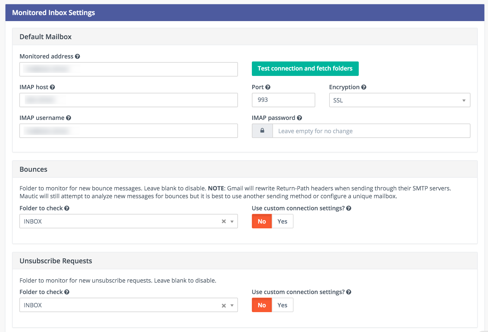

可以使用单个收件箱，也可以为每个监控器配置一个独立的收件箱。

要获取并处理消息，请运行以下命令：

.. code-block:: shell

  php /path/to/mautic/bin/console mautic:email:fetch

请注意，最好专门为此目的创建一个邮件地址，因为 Mautic 会读取在给定文件夹中找到的每条消息。

如果通过 GMail 发送邮件，邮件的返回路径会被自动重写为 GMail 地址。最好使用 GMail 以外的发送方式，尽管 Mautic 可以监控 GMail 账户以检测退信。

如果您选择了退订文件夹，Mautic 还会将邮件作为"List-Unsubscribe"头部的一部分附加。然后，它会解析在该文件夹中找到的消息，并自动为联系人退订。

Webhook 退信管理
=========================

从 Mautic 5 开始，所有邮件传输都使用相同的 Webhook（有时称为回调）URL：``https://mautic.example.com/mailer/callback``。请遵循您已安装的特定邮件传输的文档，以获取有关 Webhook 配置的更多信息。

.. vale off

创建退信邮件分组
=====================================

.. vale on

这不是必须的，但如果您希望能够轻松选择退信邮件的联系人——例如删除所有退信联系人——可以创建一个退信邮件分组。

1. 前往 分组 > 新建。
2. 输入分组名称。例如"退信邮件"。
3. 选择筛选器选项卡。
4. 创建新的"退信邮件 等于 是"筛选器。
5. 等待 ``bin/console mautic:segments:update`` 命令由定时任务自动触发，或手动执行它。
6. 所有退信邮件的联系人应出现在此分组中。

邮件故障排除
**********************

邮件打开跟踪
===================

Mautic 使用跟踪像素来跟踪邮件打开。这是 Mautic 发送的邮件消息源代码中的一个 1 像素 GIF 图片。

当联系人使用 Outlook、Thunderbird 或 GMail 等邮件客户端打开邮件时，客户端会尝试加载其中的图片。图片加载请求就是 Mautic 用来跟踪邮件打开操作的方式。

有些邮件客户端默认关闭了自动加载图片的功能，联系人需要在邮件消息中有选择地"加载图片"。有些邮件客户端则会在将邮件发送给联系人之前自动打开所有图片。

如果图片因此或其他原因未被加载，或者它们在将邮件转发给联系人之前被自动打开，Mautic 就无法得知打开操作。因此，邮件打开跟踪并不十分精确。

邮件链接跟踪
===================

在发送邮件之前，Mautic 会将邮件中的所有链接替换为包含唯一密钥的、指向 Mautic 的回调链接。如果联系人点击了这样的链接，该链接会将联系人重定向到 Mautic，Mautic 记录点击操作后将联系人重定向到原始位置。这个过程很快，因此联系人通常不会注意到额外的重定向。

如果邮件点击没有被跟踪，请确保：

1. 您的 Mautic 服务器在可访问的 URL 上。
2. 您通过营销活动或分组邮件将其发送给了现有的联系人。通过"发送示例"链接、从联系人资料直接发送的邮件或表单提交预览邮件不会将链接替换为可跟踪链接。
3. 确保 href 属性中的 URL 是绝对路径且有效。它应以 ``http://`` 或最好以 ``https://`` 开头。
4. 您在隐私浏览器中打开了链接（不是在您登录 Mautic 的同一会话中）
5. 检查 Mautic 是否已将邮件中的链接替换为跟踪链接。

退订链接无法使用
=============================
退订链接 **在测试邮件中无法使用**。

这是因为 Mautic 将测试邮件发送给 Mautic 用户，而不是 Mautic 联系人。

Mautic 用户无法退订，因此退订链接看起来像：``https://mautic.example.com/|URL|``。但是，当您将邮件发送给联系人时，链接 **确实** 正常工作。

最佳实践是创建一个包含少量联系人的分组来接收测试邮件——例如您自己——这样可以确保您能够完整测试退订行为等功能。