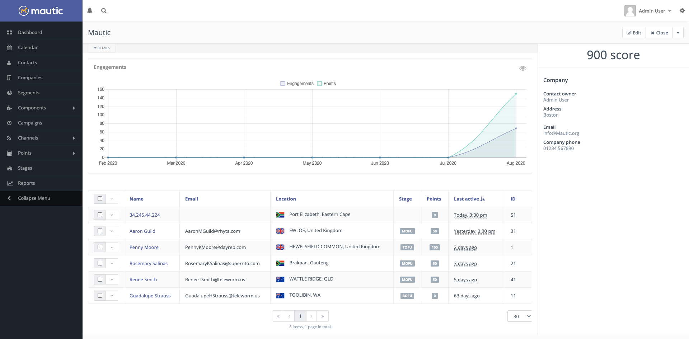
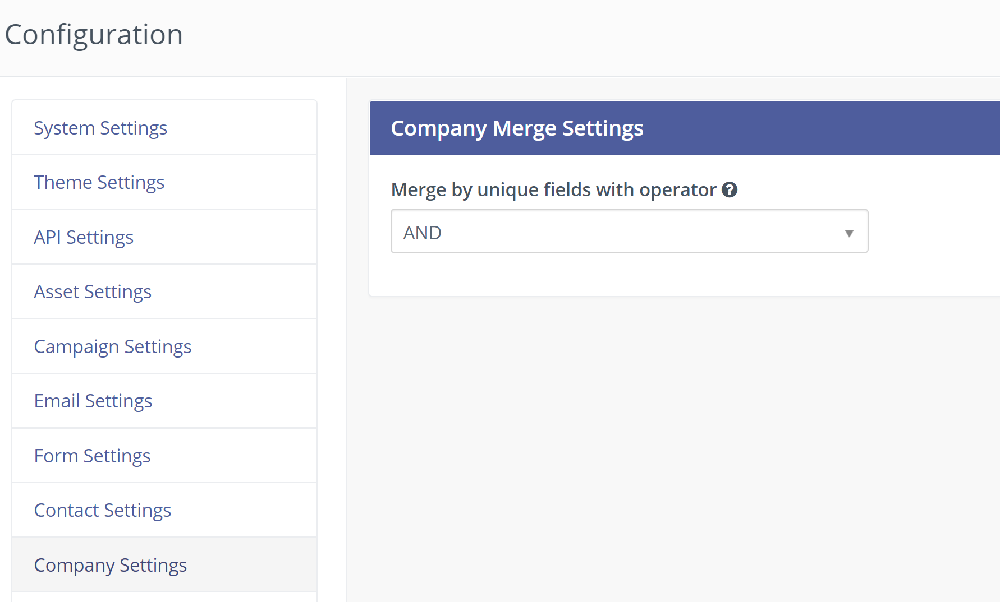
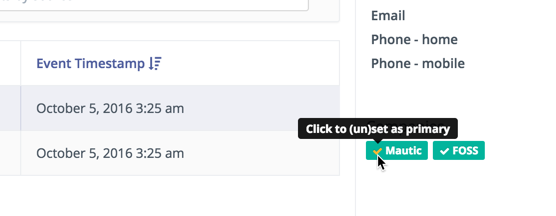

公司
#########

公司是一种根据与组织的关联来对联系人进行分组的方式。

互动/积分图表
*************************

图表中显示的互动包括联系人所做的任何已跟踪操作。例如页面访问、表单提交、邮件打开等。互动折线图显示公司联系人在过去 6 个月内的活跃程度。图表还显示了联系人获得的积分总和。

.. vale off

已分配联系人列表
*************************

.. vale on

您可以在已分配联系人列表表格中找到联系人列表，显示其最近活动日期，前面是公司信息（包括公司名称、地址和所有自定义公司字段）以及互动图表。这是了解您所知的该公司联系人近期活动的好方法。

公司重复项
*******************
公司名称字段默认是唯一标识符。您可以在 **自定义字段** 部分选择任何其他公司字段作为唯一标识符。

在 *配置 > 公司设置* 中，您可以选择合并具有多个标识符的公司时使用的运算符 —— 可以是 **AND** 或 **OR**。

这些设置允许 Mautic 在导入过程中、使用集成框架以及在 Mautic 的其他部分中查找和合并重复的公司。

公司操作
***************

.. vale off

合并公司
=================

.. vale on

在编辑公司时，您可以使用 **合并** 按钮将此公司合并到另一个现有公司中。

搜索您要合并到的公司，然后点击开始合并。与被合并公司关联的联系人现在将与保留的公司关联。

合并过程完成后，Mautic 会将您重定向到保留的公司，因为旧公司已不再存在。

.. vale off

公司自定义字段
*********************

.. vale on

默认情况下，公司有一组预设字段，但您可以根据需要自定义这些字段。

#. 转到 **自定义字段** 并创建一个新字段

#. 将下拉选择框从联系人对象更改为公司对象

#. 保存自定义字段

.. vale off

公司分组
****************

.. vale on

您可以基于公司记录创建分组。选择要筛选的任何公司字段及其匹配条件，Mautic 将列出与所选字段匹配的所有联系人。

.. vale off

识别公司
*********************

.. vale on

Mautic 严格通过基于 **公司名称**、**城市**、**国家或州** 的匹配条件来识别公司。如果城市或国家未作为识别字段提供以识别联系人，则公司无法匹配。

.. vale off

营销活动中的公司操作
****************************

.. vale on

可以基于营销活动操作将联系人添加到新公司。

.. vale off

创建和管理公司
*******************************

.. vale on

要创建或管理公司，请转到左侧导航栏中由建筑图标标识的公司菜单。在此区域中，您可以创建、编辑或删除公司。

.. vale off

将公司分配给联系人
*******************************

.. vale on

有多种方式可以将公司分配给联系人，如下所述：

联系人资料
===============

您可以在创建或编辑现有联系人时，在联系人资料中将联系人分配给公司。Mautic 将最近分配的公司视为联系人的主公司。

联系人列表视图
==================

您可以在联系人列表视图中批量将公司分配给选定的联系人。

.. vale off

通过营销活动
==============

.. vale on

您可以通过营销活动选择 **将联系人分配给公司** 操作来分配公司以识别联系人。

.. vale off

通过表单
==============

.. vale on

在通过表单识别联系人时，如果满足以下条件，您还可以关联现有公司或创建新公司：

- 表单包含公司名称作为表单字段 - 公司匹配/创建所必需，
- 表单包含城市作为表单字段 - 公司匹配/创建所必需，
- 表单包含国家作为表单字段 - 公司匹配/创建所必需，
- 表单包含州作为表单字段 - 公司匹配/创建可选。

公司评分
================

可以通过营销活动操作或表单操作来更改公司评分。使用这些操作时，需要先识别联系人，然后更改分配给该联系人的公司的积分。

#. 在表单或营销活动中选择 **更改公司评分** 操作
#. 一旦提交或触发，Mautic 将识别营销活动或表单中的公司并更改其积分。

.. vale off

设置主公司
===========================

.. vale on

您可以通过联系人详情界面设置主公司。

