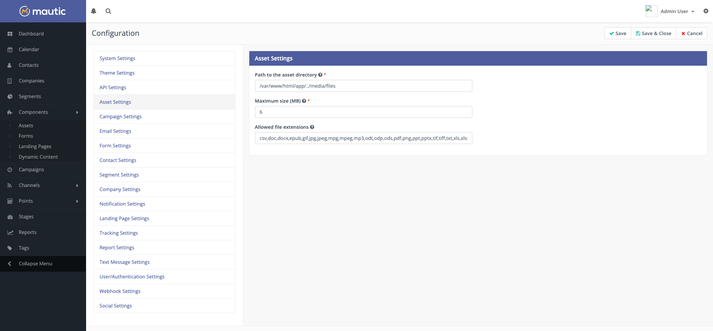
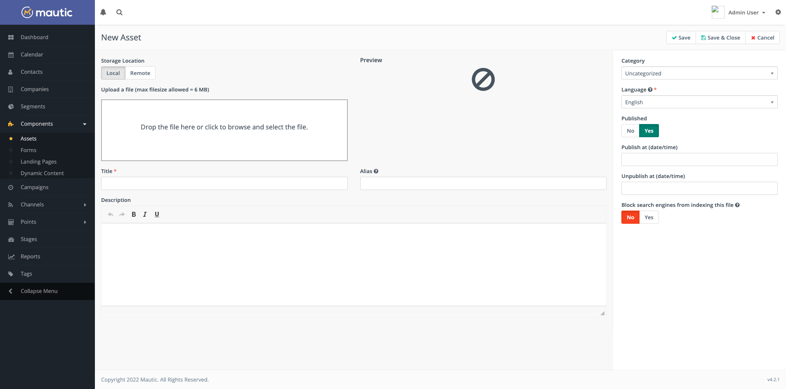

资源
######

资源是您希望提供给联系人访问的内容片段。您想跟踪和分析谁在查看或下载您的资源。您可能还想根据联系人与哪些资源进行了互动来个性化他们的旅程。您还可以根据与资源的互动进行评分。

.. vale off

管理资源
***************

资源分类
================

.. vale on

Mautic 允许您将资源组织到分类中，这有助于您轻松找到资源。要创建新分类，请查看 :doc:`/categories/categories-overview` 文档。

.. vale off

使用资源
===================

.. vale on

在创建资源之前，首先建立并发布所需的分类。不能将资源分配给未发布的分类。如果您希望使用集成（如 Amazon S3 插件）来托管您的文件，请在创建资源之前设置好。

.. vale off

创建新资源
====================

.. vale on

导航至 组件 > 资源。Mautic 会列出您之前创建的所有资源。点击新建开始创建资源。

您可以通过上传本地计算机上的资源来创建资源，或者从远程存储主机（如 Amazon S3）定位资源。由于服务器的设置，文件大小有相应的限制——任何此类限制可能会在文件上传部分显示为警告消息。

.. vale off

为资源添加 UTM 代码
~~~~~~~~~~~~~~~~~~~~~~

.. vale on

附加到下载链接的 UTM 参数意味着 UTM 数据可在资源下载报告中使用。

.. code-block:: php

  /asset/{id}:{name}?utm_source=test&utm_medium=test&utm_campaign=test&utm_id=test&utm_term=test&utm_content=test

.. vale off

上传资源
~~~~~~~~~~~~~~~~~~

.. vale on

要上传资源，将文件拖入方框，或点击方框打开文件上传窗口。选择文件后，文件会自动上传并显示在方框区域内。

默认情况下，Mautic 允许以下文件类型：

.. code-block:: php

  csv,doc,docx,epub,gif,jpg,jpeg,mpg,mpeg,mp3,odt,odp,ods,pdf,png,ppt,pptx,tif,tiff,txt,xls,xlsx,wav

如果您需要添加额外的文件类型、配置上传的最大大小或资源目录，请导航至 配置 > 资源设置。

提供以下字段：

- **标题** — 资源的标题
- **别名** — 用于创建下载 URL 的别名。如果未提供，则会根据标题自动生成。
- **描述** — 用于内部使用的描述，用于告知其他 Mautic 用户该资源是什么和/或在哪里使用。
- **分类** — 用于组织资源——有关更多信息，请参见 :doc:`/categories/categories-overview`
- **语言** — 此资源的语言——在多语言营销活动和报告用途中可能会有所帮助
- **已发布** — 资源是否可用（已发布）或不可用（未发布）

.. vale off

**发布时间（日期/时间）** — 这允许您定义此资源可用的日期和时间

**取消发布时间（日期/时间）** — 这允许您定义此资源停止可用的日期和时间

.. vale on

- **阻止搜索引擎对此文件进行索引** — 如果您不希望索引像 ``PDF``、``DOCx`` 等文件，将此开关设置为是会发送 ``X-Robots-Tag no-index`` HTTP 头部。如果设置为否，则不会发送该头部，您的文件可能会被搜索引擎索引。

根据上传的文件类型，上传完成后可能会显示预览。

.. vale off

使用远程资源
~~~~~~~~~~~~~~~~~~~

.. vale on

您可以不通过从计算机上传文件，而是提供指向云存储提供商上文件的链接，或者浏览您集成的云存储提供商（例如 Amazon S3 bucket）——通过选择远程选项卡而不是本地选项卡。

**可选的远程 URL 验证：**

您可以通过在 ``config/local.php`` 文件中添加 ``'validate_remote_domains' => true`` 来启用可选的远程 URL 验证。

启用此验证后，Mautic 仅允许 **配置 > 系统设置 > 杂项设置 > 允许的远程域名** 中列出的域名。该验证也认为您的 Mautic 实例的域名是有效的。

.. vale off

查看资源
================

.. vale on

上传资源后，您需要将其提供给联系人访问。使用 Mautic 中资源部分的下载 URL，您可以跟踪哪些联系人正在下载或查看资源。

复制链接并将其粘贴到您的网站、落地页或邮件中的链接。

.. note::
    在 Mautic 邮件或落地页中，在 URL 末尾附加 ``?stream=1`` 以在新标签页中打开资源。

资源是下载还是在新标签页中打开取决于联系人的浏览器设置。要通过要求联系人在下载前提交一些信息来限制对资源的访问，您可以设置一个表单提交操作来下载资源。

为了确保联系人为高价值资源提供有效的邮件地址，请将资源附加到邮件中，使用发送邮件表单的提交操作，而不是立即下载资源。

.. vale off

编辑资源
================

.. vale on

您可以通过在查看资源时点击"编辑"按钮，或选择资源复选框旁边的箭头并选择"编辑"来编辑资源。编辑页面与查看页面相同，已保存的内容已经填充在字段中。

.. vale off

删除资源
=================

.. vale on

可以通过在查看资源时点击"删除"按钮，或选择资源复选框旁边的箭头并选择"删除"来删除资源。Mautic 会显示一个确认页面，提示您确认是否要删除该资源。

.. warning::
    一旦删除，您将无法找回资源，与该资源的下载次数相关的统计数据也将不再可用。因访问该资源而累积的联系人积分仍然保留。建议尽可能将不再使用的资源取消发布——将来可能会有归档功能。

直接在浏览器中显示资源
======================================

默认情况下，Mautic 支持以下文件类型直接在浏览器中显示：

.. vale off

- gif
- jpg
- jpeg
- mpg
- mpeg
- mp3
- pdf
- png
- wav

.. vale on

如果您想更改此默认行为，可以在 ``local.php`` 文件中修改，为 ``streamed_extensions`` 参数设置一个扩展名数组。