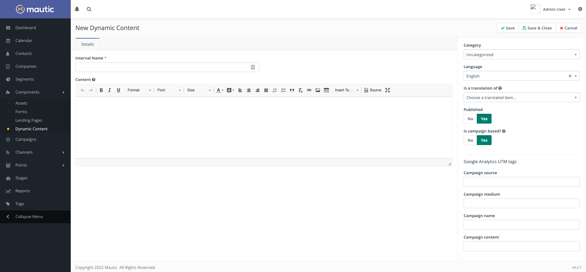
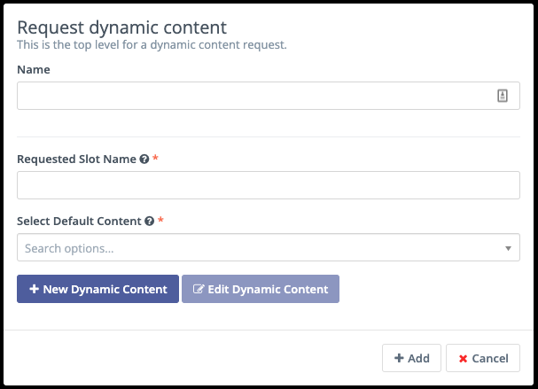
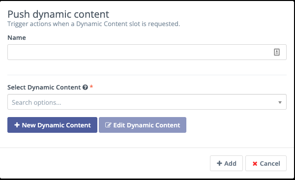
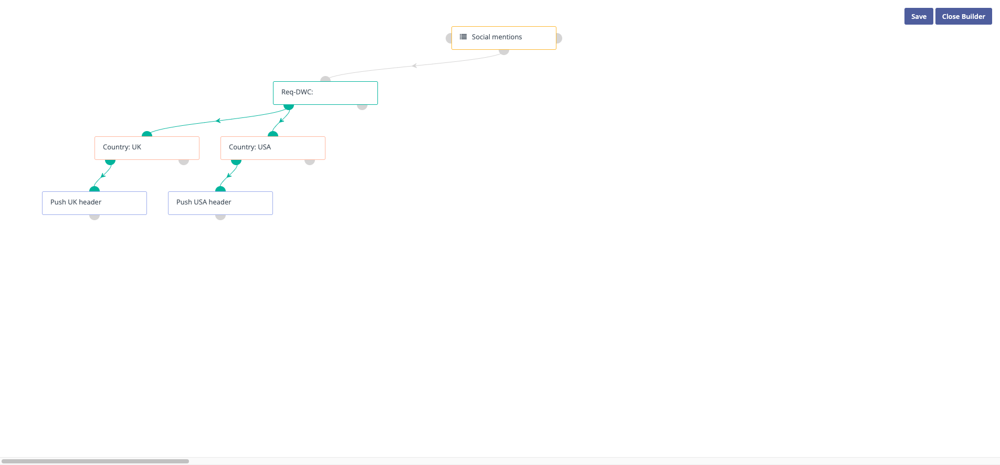

.. vale off

动态网页内容
###################

.. vale on

动态网页内容是 Mautic 用来为联系人个性化网络体验的几种方法之一。营销人员可以在网页的特定区域向不同的人显示不同的内容。Mautic 用户可能希望根据收集到的关于网站访客的数据来个性化内容。即使匿名联系人也可以看到动态内容，只要您收集了关于他们的任何信息——例如位置数据。

准备工作
***********

在考虑使用动态网页内容之前，请考虑：

- 在您的网站上，您会在哪里加入个性化内容？
- 您计划为哪些受众个性化内容？
- 您是否收集了以这种方式准确筛选联系人所需要的信息？

网站配置
*********************

一旦决定在网站上的哪个位置显示内容，您必须创建一个区域来添加内容。Mautic 与平台无关——您可以将插槽添加到您创建的任何网站中。为此，请创建一个 HTML 插槽来显示动态网页内容。

将 ``data-param-slot-name="myslot"`` 中的 ``myslot`` 更改为您的动态网页内容项目的请求插槽名称：

.. code-block::

    

    <h1>myslot 的动态网页内容</h1>
    

您可以在 ``
`` 标签之间添加自己的默认内容，以确保在筛选条件不匹配时显示内容——例如对于新的匿名访客或不符合您指定标准的联系人。

Mautic 的内容管理系统插件也有特定的嵌入内容方式，例如：

- **Joomla** — ``{mautic type="content" slot="slotname"} 插入默认内容 {/mautic}``
- **WordPress** — ``[mautic type="content" slot="slotname"] 插入默认内容 [/mautic]``

Mautic 配置
********************

.. warning::
    在使用动态网页内容时，确保正确配置 CORS 设置非常重要——如果未设置，您的内容将不会显示。请阅读 :ref:`CORS 设置` 了解更多。

.. vale off

创建动态网页内容插槽
==================================

.. vale on

Mautic 提供基于营销活动和基于筛选器的动态网页内容。要创建任一类型：

#. 导航至 组件 > 动态内容 部分
#. 点击新建以创建新插槽

提供以下值：

- **内部名称** — 这是插槽在您的动态网页内容插槽列表中的显示方式。您应该包含有关您正在个性化什么的信息——例如国家——以及插槽中的内容——例如美国。如果您正在为美国的人群创建个性化插槽，可以将插槽命名为"国家 - 美国"。如果您计划在网站的多个位置为相同的受众设置个性化内容插槽，请包含页面标题或该特定插槽的其他标识信息。

.. vale off

#. **内容** — 使用所见即所得编辑器创建动态网页内容插槽。您可以包含图片和视频。如果您偏好 HTML，请点击工具栏中的 ``</> 源代码`` 图标切换到代码视图。Mautic 的动态网页内容像落地页或邮件一样支持令牌。要添加令牌，开始输入 ``{`` 字符，可用的令牌就会显示出来。这些包括：

   *  联系人字段：{contactfield=字段别名}
   *  落地页链接：{pagelink=ID#}
   *  资源链接：{assetlink=ID#}
   *  表单：{form=ID#}
   *  焦点项目：{focus=ID#}

.. vale on

**分类** — 分配一个分类来帮助您组织动态网页内容项目。有关更多信息，请参见 :doc:`/categories/categories-overview`。

- **语言** — 此动态网页内容的语言——在多语言营销活动和报告用途中可能会有所帮助

- **是……的翻译** — 如果您正在创建第二语言的翻译插槽——例如用在多语言网站上——请选择您正在翻译的原始基础语言动态网页内容项目。同一插槽会根据营销活动或设置的筛选器显示适当的语言，但如果访客以不同的浏览器语言查看页面，Mautic 会显示翻译后的内容。

- **已发布** — 动态网页内容项目是否可用（已发布）或不可用（未发布）

- **基于营销活动** — 如果设置为是，Mautic 会通过营销活动将此动态网页内容推送给联系人。当设置为否时，您可以指定访客看到内容的筛选条件。

- **请求插槽名称** — 如果使用非基于营销活动的动态网页内容，此选项允许您指定联系人在您网站上看到内容的插槽名称。

.. vale off

**发布时间（日期/时间）** — 这允许您定义此动态网页内容项目可向联系人显示的日期和时间

**取消发布时间（日期/时间）** — 这允许您定义此动态网页内容项目停止可向联系人显示的日期和时间。

.. vale on

**UTM 标签** — Mautic 可以将 UTM 标签附加到任何链接和表单提交。有关更多信息，请参见 :doc:`/channels/utm_tags`。

.. vale off

基于营销活动的动态网页内容
**********************************

.. vale on

创建请求
====================

使用"请求动态内容"的营销活动决策来使用基于营销活动的动态内容。营销活动决策检查营销活动成员是否访问了带有动态内容插槽的页面。访问带有动态内容插槽的页面的访客会收到动态内容。

提供以下字段：

- **名称** — 营销活动事件。以类似 ``Req-DWC:`` 的内容开头，这样当您查看营销活动报告时，可以看到事件类型。

- **请求插槽名称** — Mautic 检查插槽名称。您可以看到有多少联系人到达了您正在检查其访问是否请求该插槽的营销活动事件。

举例来说，这两个字段在联系人历史记录中可能看起来像：``Req-DWC: Country-Header``。请求插槽名称是 Mautic 在页面上查找的插槽。如果它在第三方页面上，它将位于您用于将动态内容插槽添加到页面的代码中。如果它在 Mautic 落地页上，请在落地页上定义插槽名称。

- **选择默认内容** — 选择向不满足营销活动下一步设置条件的访客显示的内容。用户可能先看到默认内容，然后 Mautic 再推送动态内容。

创建筛选器
====================

创建后，您可以在"是"路径上添加筛选器，以确定哪些联系人看到不同的变体。这通过条件来实现——请在 :doc:`/campaigns/creating_campaigns` 中了解更多。

举例来说，您可以使用 ``国家 = 美国`` 的条件来仅筛选位于该国家的人群。

推送动态网页内容
===============================
一旦相关的筛选器到位，您可以添加"推送动态内容"的营销活动操作，这会触发 Mautic 向匹配筛选器的联系人发送相关内容。

所有这些就位后，它可能看起来像这样：

您可能希望为您的营销活动决定一个命名规范，例如在推送动态网页内容时使用 ``DWC:`` 前缀。

.. vale off

基于筛选器的动态网页内容
********************************

.. vale on

筛选器通常更容易使用，也可能更可靠，因为它们不依赖于营销活动定时任务的触发。

创建筛选器
================

#. 在创建动态网页内容项目时，将"基于营销活动"开关选择为否，这会显示筛选器选项卡。

#. 使用筛选器配置联系人必须满足才能看到动态网页内容插槽的条件。

#. 在文本编辑器区域中提供插槽的内容。当筛选器匹配时，Mautic 会显示此内容。

.. vale off

实现动态网页内容
********************************

.. vale on

默认内容
===============

当访客不匹配任何筛选条件，或者访客不是已跟踪/已识别的联系人时，Mautic 会显示默认内容。在默认内容中有一些内容非常重要，而不是空白区域。

对于基于营销活动的动态网页内容，您在配置"请求动态内容"决策时指定默认内容。在基于筛选器的动态网页内容中，您在插入插槽的页面上创建默认内容，如果筛选器匹配，Mautic 会用动态内容替换它。

.. note::
    如果您使用焦点项目作为动态网页内容，且只向特定受众显示特定的焦点项目，则不需要有任何默认内容，因为焦点项目不会在您的页面上实际占用空间。

.. vale off

