表单
#####

Mautic 订阅者使用表单进行潜在客户生成和数据收集。通过 Mautic 表单，营销人员可以将匿名网页访客转化为已知联系人，并通过渐进式画像构建联系人的档案。您在不显得侵扰或烦人的情况下能收集到的数据越多，您的个性化策略就越有效。

.. vale off

创建新表单
*******************

.. vale on

要创建新表单，前往 **组件 > 表单** 并点击 **新建**。

.. note::
    Mautic 中的所有表单都可以触发营销活动，并可以使用全部的表单操作。您可以在营销活动中将表单用作联系人来源，以便在联系人提交表单时触发工作流。

提供以下字段：

- **分类** — 分配一个分类来帮助您组织表单。

- **已发布** — 表单是否可用（已发布）或不可用（未发布）。当您使用 JavaScript 添加表单时，未发布的表单将不可见。如果您使用了手动方式复制和粘贴表单的 HTML，表单仍然可见，但访客 **无法** 提交它——如果他们尝试提交未发布的表单，会显示一条错误消息阻止他们。

- **发布时间（日期/时间）** — 这允许您定义此表单可提交的日期和时间。

- **取消发布时间（日期/时间）** — 这允许您定义此表单停止可提交的日期和时间。

- **禁止搜索索引** — 如果是，Mautic 通过发送 ``noindex`` http 头部来防止搜索引擎在搜索结果中找到并显示该表单。

- **Kiosk 模式** — 如果是，Mautic 会关闭对通过表单创建的联系人的跟踪，这样表单就不会生成 cookie 或将任何 IP 地址与联系人记录关联起来。营销人员可能称其为"数据录入模式"。它非常适合在会议或活动中使用，因为在这些场合可能会有多个联系人使用同一台设备输入他们的信息，这可以防止将设备上的活动关联到联系人。

- **使用主题样式** — 如果是，表单将以所选 Mautic 主题或表单字段属性选项卡中的样式显示。当为否时，表单会采用其嵌入位置的样式。

- **主题** — 选择一个包含表单样式的 Mautic 主题。当"渲染样式"为是时，这决定了表单添加到外部网站或应用时的样式。

.. note::
    并非所有主题都包含表单样式。请检查主题管理器中主题列表的"功能"列，查看哪些主题包含表单样式。

.. vale off

配置表单
*****************

.. vale on

创建新表单后，您还有一些额外的选项需要设置。

详情
=======

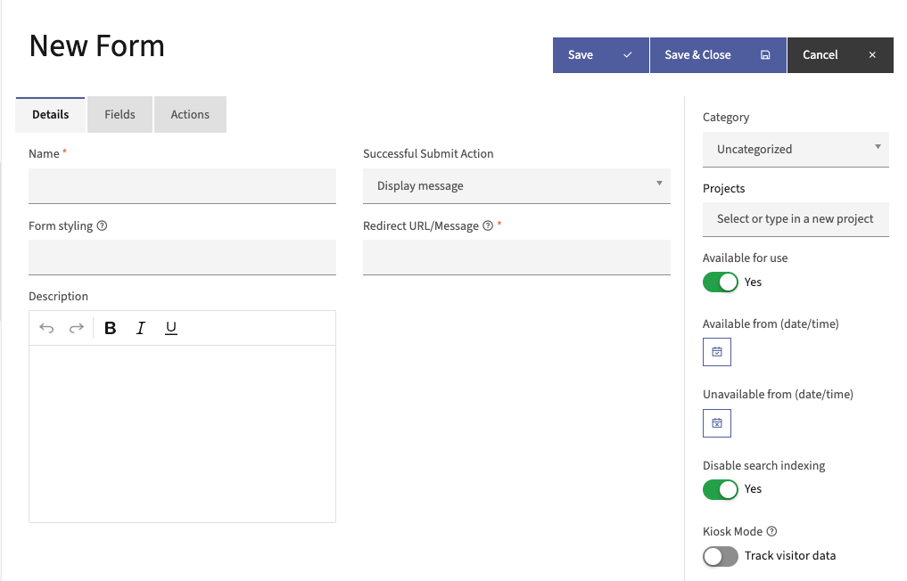

可用的详情字段有：

* **名称** — 表单的标题，包括您可能想要用来搜索表单的任何术语。
* **描述** — 描述表单目标的描述。在其中包含表单出现的位置等信息可能会有所帮助。
* **成功提交操作** — 选项包括：

   .. vale off

   * **留在表单** — 联系人停留在同一页面，表单重置，允许再次提交或继续浏览
   * **重定向 URL** — 在联系人点击提交后将其发送到不同的网站或特定的 Mautic 落地页
   * **显示消息** — 在联系人提交表单后在屏幕上显示确认或感谢消息

   .. vale on

* **重定向 URL/消息** — 如果您决定使用 **成功提交操作**：

   * **重定向 URL**：粘贴您想要将提交者定向到的 URL
   * **显示消息**：输入要显示的消息

  对于这些选项，您可以使用占位符来为您的联系人个性化体验。当联系人提交表单时，Mautic 会自动用具体细节替换这些占位符：

  .. vale off

  .. list-table::
   :widths: 25 25 50
   :header-rows: 1

   * - 占位符
     - 替换为
     - 如何找到值
   * - ``{contactfield=ALIAS}``
     - 将 ``ALIAS`` 替换为联系人的字段值。
     - 请参阅 :doc:`/contacts/custom_fields` 在自定义字段中查找别名。
   * - ``{formfield=ALIAS}``
     - 将 ``ALIAS`` 替换为表单的 **匹配字段**。
     - 如果尚未设置，点击字段卡片上的铅笔图标进行编辑，然后从 :ref:`映射字段 <Mapped field>` 选项卡下的 **匹配字段** 下拉菜单中选择一个字段。
       更新后，在 **字段** 选项卡中，查看字段卡片底部。使用 **contact:** 后面显示的文本的小写版本作为 ``ALIAS``。例如，如果卡片显示 ``contact: Timezone``，则使用 ``timezone``。
   * - ``{pagelink=ID}``
     - 将 ``ID`` 替换为 Mautic 落地页的 ID。
     - 前往 **组件 > 落地页** 并查看 **ID** 列。

.. vale on

字段
======

控制表单上显示的最大字段数：

- **一次最多显示的字段数** — 此设置跨多个表单应用渐进式画像。选择在单个表单上显示的最大字段数。

要向表单添加新字段：

#. 点击添加新字段下拉菜单，选择您要使用的字段类型。可用字段包括：

   - **验证码（CAPTCHA）** — 一种基本的垃圾邮件防护工具，要求表单提交者回答问题，或在提交垃圾邮件的机器人试图提交数据到隐藏的验证码字段时进行检测——有时被称为蜜罐。建议在每张表单上使用某种类型的验证码。还可以通过第三方插件支持 reCAPTCHA 和其他工具。

   - **复选框组** — 此字段允许访客使用复选框从列表中选择一个或多个选项。此字段类型还可以提供单个复选框——例如获取同意使用 cookie 并向联系人发送营销邮件或其他消息。

   .. note::
      您可以将复选框组字段与 *布尔型* 和 *下拉-多选* 字段关联，但不能与 *下拉* 字段关联。

   - **日期** — 此字段允许访客使用日历选择器选择日期。日期的格式应用您配置中的默认设置。

   - **日期/时间** — 与日期字段类似，此字段允许访客使用日历选择器同时选择日期和时间。

   - **描述** — 一个基本的标题字段，最常用于为表单提供视觉标题。标题字段充当字段名称或标签。描述区域——在属性选项卡下访问——是一个自由文本所见即所得编辑器，您可以在其中添加对表单的描述。默认情况下，描述会以段落文本格式显示在标题字段的正下方。

   - **邮件** — 此字段要求访客提供使用预期邮件地址正确语法的有效邮件地址——``name@domain.com``。建议在您的表单上至少有一个邮件字段，因为默认情况下邮件字段是 Mautic 中联系人的默认标识符。

   - **文件** — 这允许访客在表单上上传文件。

   .. warning::
      使用文件上传字段时，使用相同文件名提交的次数限制为 1,000 次。请注意，您可以在"发送表单结果"操作中附加已提交的文件。

   - **HTML 区域** — 此字段允许营销人员向表单中添加自定义 HTML。

   - **隐藏** — 此字段在表单上不可见，但包含默认值，会随表单提交一起保存，用于报告或内部标记目的。

   - **下拉：国家** — 这会填充 Mautic 默认的、不可编辑的国家列表。要使用自定义列表，您应该使用下拉字段类型并手动输入您想要包含的国家。

   - **分页符** — 这允许营销人员将表单分成多个部分或字段分组。

   - **数字** — 此字段验证输入的值是否为数字。该字段允许小数和负数，但不允许其他非数字值——包括逗号。在移动设备上，当访客点击此字段时，键盘会切换到数字键盘。

   - **密码** — 这允许访客创建密码。如果表单创建账户并且 Mautic 将结果发送到另一个系统/表单，请使用此字段。出于安全原因，您不得将输入的字段值保存到联系人的资料中。

   - **电话** — 此字段默认映射到电话字段，并使用国际电话号码格式验证号码。验证要求包含国家代码——例如美国为 +1，英国为 +44。

   - **单选按钮组** — 此字段提供一组带有单选按钮的单选选项，有时称为选项按钮组。

   - **下拉：单选或多选** — 此选项显示一个下拉列表，访客可以在其中选择一个选项。此字段还允许多选，这会更改显示为一个列出选项的框。在移动设备上，单选框会显示一个带有单选按钮的对话框，多选字段则显示复选框。

   - **滑块** — 此字段提供一个交互式滑块控件，允许访客通过沿轨道拖动滑块来从预定义范围中选择数值。滑块在每一端显示最小值和最大值，并在访客移动滑块时显示当前选定的值。

   - **社交登录** — 这允许访客将其 Twitter、Facebook 或 LinkedIn 资料与联系人记录关联。在使用此字段之前，您必须先配置相应社交网络的插件。

   - **文本：短答案** — 此字段显示一个文本框，可用 255 个字符。常见用途包括指定访客的名字、姓氏、城市等。

   - **文本：段落** — 类似于文本字段，但没有 255 个字符的限制。文本区域字段的字符限制为 65,535 个字符。

   - **URL** — 此字段验证输入是否为 URL 的预期格式，包括 ``https://`` 或 ``http://``

字段选项
=============

根据所选字段，Mautic 在字段编辑器界面中显示各种选项卡。可用的选项卡有：

- :ref:`常规`
- :ref:`映射字段`
- :ref:`验证`
- :ref:`属性`
- :ref:`属性设置`
- :ref:`行为`

常规
~~~~~~~

- **标签** — 这是您字段的标题，告诉访客您希望他们在字段中输入什么。默认情况下，标签显示在表单字段之前。

- **显示标签？** — 当设置为否时，Mautic 不会在表单上显示标签。

- **保存结果** — 当设置为否时，Mautic 不会将表单中输入的数据保存到表单提交表中。当设置为是时，提交内容可在表单提交结果中访问。如果映射到联系人字段，Mautic 仍会将数据保存到该字段。

- **默认值** — 这允许营销人员为字段提供默认值。默认值在将某个值设置为隐藏字段时，或当您预期访客输入某个值时非常有用。如果字段可见，联系人在填写表单时可以更改默认值。

- **帮助消息** — 这允许营销人员为访客添加关于应在字段中输入什么或为什么应提供信息的信息。

- **输入占位符** — 这允许营销人员在表单字段内添加文本，让访客了解他们应该输入什么。当访客点击进入字段时，文本会立即消失，而默认值则不会。这在您需要特定格式的数据时，特别有助于提示访客，例如 Twitter 账号使用 ``@Twitter``，包括 ``@`` 符号。

映射字段
~~~~~~~~~~~~

映射字段选项卡允许营销人员将字段与 Mautic 中现有的联系人或公司字段连接。这允许来自表单提交的数据自动填充到映射的字段中。没有映射，这些信息将不会保存到联系人资料中。

表单字段的数据类型应与映射字段的数据类型匹配。例如，日期/时间字段应映射到使用日期/时间字段的联系人或公司字段。

验证
~~~~~~~~~~

验证选项卡允许您设置字段是否为必填。如果字段是必填的且访客未填写，表单将显示错误，访客会看到一条消息，告知他们必须在提交表单之前完成该字段。

将滑块切换为 ``是`` 以使该字段成为必填字段。

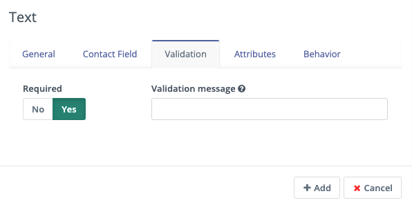

还可以添加特定于此字段的验证消息，在访客提交表单但未填写此字段时给予提示。

属性
~~~~~~~~~~

属性选项卡不会在每个字段类型上都显示。不同的字段类型有不同的关联属性需要配置。

验证码（CAPTCHA）
-------

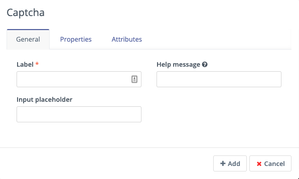

对于验证码字段，如果您将其用作蜜罐来捕获垃圾邮件提交，答案字段应为空。这会隐藏该字段，而垃圾邮件机器人会尝试向该字段填充数据。

Mautic 会识别蜜罐验证码字段中是否有数据，并理解这不可能是人类在提交表单。

要让人类回答一个基本问题或陈述——例如 ``2+2 是多少`` 或 ``在此输入 'CAPTCHA'``——您可以在答案字段中输入预期的输入，在此例中是 ``4`` 或 ``CAPTCHA``。字段的标签应为问题，或者您可以使用标签 CAPTCHA，然后将问题作为输入占位符。

自定义错误消息允许您显示一些内容，告知人类他们是否输入了错误的信息。默认消息是 ``"{label}"的答案不正确。请重试``。

复选框组、单选按钮组和下拉
--------------------------------------

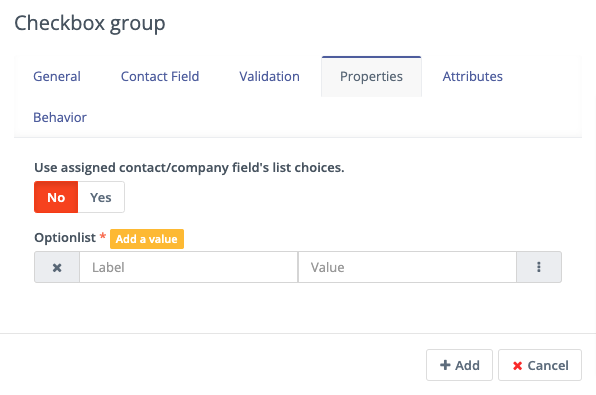

对于复选框、单选按钮和下拉字段，属性选项卡允许您选择访客可以选择的选项。

如果您已将表单字段映射到 Mautic 中的自定义字段，还有一个选项可以使用自定义字段中提供的值，而不是单独列出它们。这有助于防止表单选项中的重复和错误。

如果您更倾向于创建自己的字段选项，``选项列表`` 允许您添加带有标签和值对的选项。

标签字段控制填写表单的访客看到的字段显示，值字段控制保存到数据库并存储在联系人记录中的数据。虽然它们通常匹配，但可能并非总是如此。例如，对于 GDPR 复选框，标签可能是 ``是的，我接受我可能会收到来自此公司的邮件通信``，而保存到数据库的值可能是 ``是`` 或 ``1``。

在下拉字段中，有两个额外设置，允许设置空值——其目的与输入占位符相同，不会保存到数据库——以及确定是否允许多个值，这会将字段从 ``下拉`` 更改为 ``下拉-多选``。

描述区域
----------------

使用描述字段属性选项卡中的文本输入字段来输入您想要随表单一起显示的信息——例如访客为什么应该填写表单。通常这些信息可能显示在网站上，但您也可以通过此字段将其包含在表单本身中。

文件
----

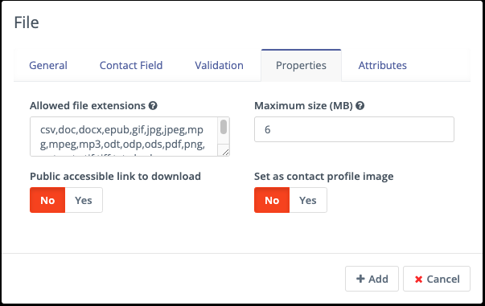

在表单中上传文件时，属性选项卡下有以下几个选项：

- 允许的文件扩展名：可以通过提供逗号分隔的列表来设置允许的文件扩展名。
- 最大文件大小：附件的最大大小——也受服务器设置的限制。
- 公共可访问的下载链接：您能通过公共链接访问文件吗？
- 设置为联系人资料图片：将上传的图片设置为联系人的头像

属性设置
~~~~~~~~~~

   属性设置是更改特定表单样式的 CSS 标签。

.. note::
   将表单上的渲染样式设置为否意味着 Mautic 会忽略这些字段中的样式设定。

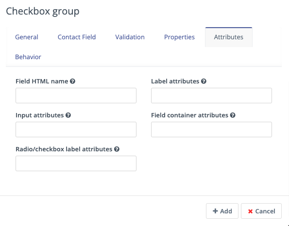

- **字段 HTML 名称**：这是字段的机器名称，会根据标签自动填充。如果标签很长，您可以自定义此字段。您在将 Mautic 表单连接到其他表单时，或使用自托管功能手动将表单添加到您的网站或应用程序时，会引用此字段。
- **标签属性**：此字段更改标签文本的显示方式。您应使用格式 ``style="属性: 描述符"`` 来更改样式。例如，要将标签更改为红色，使用 ``style="color: red"`` 或 ``style="color: #ff0000"``。
- **输入属性**：更改表单字段内任何文本的显示方式。这适用于输入占位符文本、提交表单的访客输入的文本，以及"允许多选"为是时的下拉字段选项——包括列表-国家。
- **字段容器属性**：这更改表单字段。使用此设置来更改框的大小、填充颜色、圆角或实际字段的任何其他属性。
- **单选/复选框标签属性**：类似于输入属性，此字段在可用时允许您自定义单选按钮和复选框的显示方式。

行为
~~~~~~~~

文本
----

行为选项卡帮助营销人员改善访客填写表单的体验。它还帮助营销人员实施渐进式画像，从联系人那里收集更多数据，有助于优化个性化。

- **值存在时显示**：如果 Mautic 认识该联系人并且他们已被跟踪，当字段的值存在时，如果此设置为否，Mautic 会隐藏该字段。这可以防止联系人多次回答相同的问题。当您希望确保拥有关于联系人的最新信息时，即使已经知道，您可能仍想显示该字段。
- **在 X 次提交后显示**：这允许营销人员仅在联系人提交表单指定次数后才显示某些字段。输入一个介于 ``1`` 和 ``200`` 之间的值。当未定义时，该字段在联系人每次查看表单时都会显示。目标是尽量减少向联系人显示的字段数量，因此如果没有必要验证值，建议隐藏字段。
- **自动填充数据**：这允许您为已知联系人预先填充联系人资料中存在的信息。自动填充适用于 Mautic 落地页，将表单放在其他任何地方时数据不会预先填充。即使您隐藏了此字段，您可能仍想开启自动填充以确保将信息与表单提交一起保存。
- **只读**：激活此设置以锁定具有现有联系人信息的自动填充字段，防止联系人进行任何编辑。这确保随表单提交的数据保持准确和一致，特别是对于像邮件地址这样的关键细节。将此选项与自动填充数据一起启用以阻止联系人在表单提交期间更改基本信息。

字段顺序
-----------

要更改表单上字段的顺序：

#. 点击您要移动的字段
#. 将字段拖动到新位置

.. vale off

渐进式画像
*********************
.. vale on

渐进式画像是一种强大的功能，用于通过隐藏所有已知的字段来缩短表单的长度。这可以防止您的联系人因为海量表单而感到不知所措，甚至可以缩短填写表单所需的时间——如果某些字段对您的 Mautic 实例已知，则对该联系人隐藏。

渐进式画像的配置
======================================

有两种方式可以配置表单字段仅在询问的值未知时才显示。

首先，选择您要用于渐进式画像的表单。转到表单字段并打开您要用于渐进式画像的字段配置。切换到行为选项卡。在这里，您可以配置字段的行为。

.. note::
  始终建议使用邮件字段，即使它已知，因为 Mautic 使用邮件作为联系人的唯一标识符。此外，确保提交按钮字段始终可见。否则，联系人无法提交表单。

1. **值存在时显示**：
如果设置为"否"，Mautic 会检查数据库中是否存在此字段的值，或者之前的表单提交是否提供了该值。如果找到，Mautic 不会在表单中显示该字段。如果设置为"是"，无论字段中是否存在值，Mautic 都会显示该字段。此选项的默认配置为"是"。

2. **仅在第 X 次提交后显示字段**：
如果您有一个想要多次使用的表单，随着联系人填写次数的增加出现更多字段，同时仍然只使用单个表单，那么"仅在第 X 次提交后显示字段"选项就是您要找的。顾名思义，该字段仅在表单收到 X 次提交后才出现。此功能与在值已知时隐藏字段的功能配合使用效果很好。

例如，在首次填写表单时，它要求提供联系人的邮件、名字和姓氏。当联系人第二次填写表单时，它隐藏名字和姓氏字段，而是提示联系人填写他们的公司和电话。

.. vale off

渐进式画像的局限性
===============================
.. vale on

**搜索历史限制**

不使用渐进式画像的 Mautic 表单能多快就多快。表单的 HTML 渲染一次，被存储，Mautic 在下次加载表单时使用这个"缓存"的 HTML。当为任何表单字段开启渐进式画像时，表单的 HTML 对每个联系人可能不同。它甚至可能在每个联系人每次提交后都发生变化。其影响是您不能使用表单缓存，且渐进式画像表单的加载时间较慢。

Mautic 强制要求从最多 200 次提交中搜索现有的表单值。此限制旨在防止可能的表单加载时间过长，或在联系人有数千次表单提交时达到服务器时间或内存限制。超过此限制可能导致 Mautic 为联系人显示/隐藏错误的字段。

**嵌入类型限制**

如果您将表单嵌入为静态 HTML，渐进式画像表单无法正常工作。但是，它们在表单预览、表单公共页面、通过 JS 嵌入的表单和通过 iframe 嵌入的表单中可以正常工作。

**Kiosk 模式限制**

当您将表单切换到 Kiosk 模式时，渐进式画像功能会被关闭。在 Kiosk 模式下，表单在每次提交时都会创建一个新的联系人，并且不会跟踪提交表单的设备。

表单操作
************

您可能希望在表单提交后立即触发某些操作——这就是表单操作的用途。这可能包括与联系人的通信、跟踪、内部通知或其他联系人管理任务。

- **增加公司积分**：如果与 Mautic 中公司记录关联的联系人提交了表单，您可以增加或减少公司总分的积分。Mautic 中的公司积分不会汇总其所有关联联系人的积分。任何想要贡献给公司积分的操作都必须明确设置。如果您想基于提交表单的联系人减去公司积分，负数也是有效的。如果联系人未被跟踪，且表单不包含映射到公司或公司名称（公司对象上）的字段，则不会向公司奖励积分。

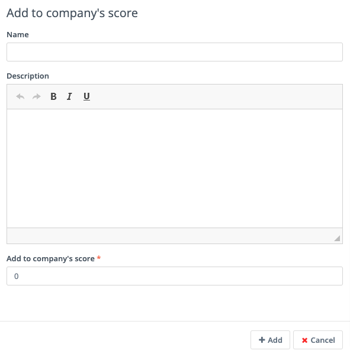

- **调整联系人积分**：此操作允许您对联系人的积分进行加、减、乘、除。选择运算符和变更积分的量——例如：加 10、减 5、乘以 3、除以 2。如果表单收集的信息不能识别联系人，Mautic 会将积分保存到匿名联系人记录中。如果该匿名联系人记录基于某个识别事件（如表单提交）转化为已知联系人记录或与之合并，积分将保留在联系人身上。

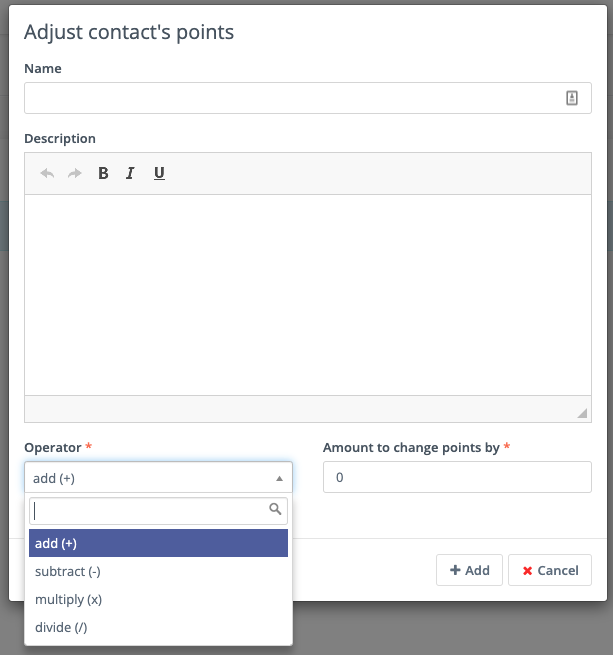

- **修改联系人的分组**：此操作允许您在联系人提交表单时更改其分组成员资格。输入要添加或移除联系人的分组名称。您可以同时使用这两个字段，并可以在任一或两个字段中包含多个分组。

基于筛选器的动态分组会根据联系人记录中的信息自动更新——您不需要在表单操作中将它们添加到分组中。

通常您会使用表单操作来填充静态分组——不设置任何筛选器的分组。您可能想要在表单操作中将联系人从分组中移除的一个例子是活动注册。您可以构建一个基于筛选器的分组用于邀请营销活动，但一旦联系人提交了注册表单，就将他们从该分组中移除并添加到活动参与者的分组中，这样他们就不会再收到邀请邮件。

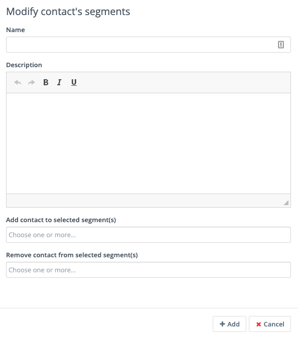

- **修改联系人的标签**：如果您在 Mautic 中使用标签，您可能希望在表单提交后添加或移除联系人的标签。要添加或移除之前使用过的标签，请从点击进入字段时显示的列表中选择标签。要查找标签，开始在框中输入名称。要添加新标签，输入完整名称并按 Enter 键保存标签。

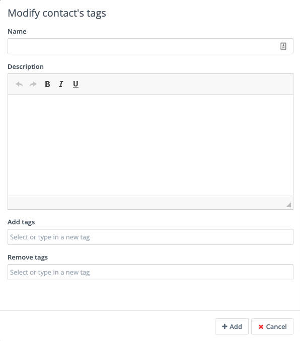

- **记录 UTM 标签**：如果您表单所在的页面上有 UTM 标签，无论是 Mautic 落地页还是外部网站，Mautic 都可以记录这些 UTM 标签并将其保存到联系人记录中用于报告。这对于您想要对新联系人和表单提交的来源进行分析时非常有用。

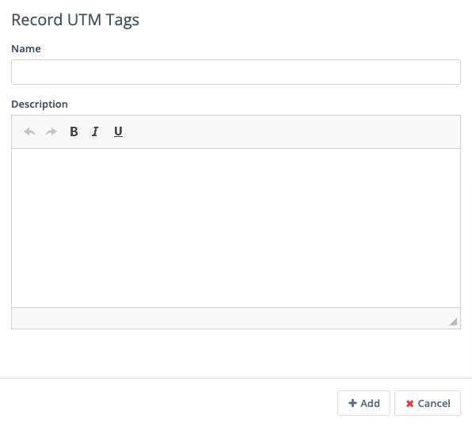

.. vale off

- **从不联系列表中移除联系人**：此表单操作允许您在联系人提交表单时将其从不联系列表中移除。如果联系人曾在某个时候退订了您的邮件列表，并且通过填写表单，他们重新授权您向他们发送邮件，请使用此功能。

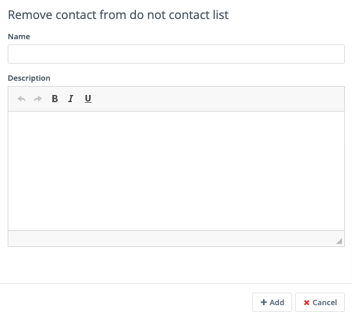

.. vale on

- **下载资源**：此选项在联系人提交表单时触发立即下载选定的文件。如果您使用分类来组织资源，您可以选择让他们下载所选分类中最新发布的资源。如果您愿意，也可以链接到特定的资源。

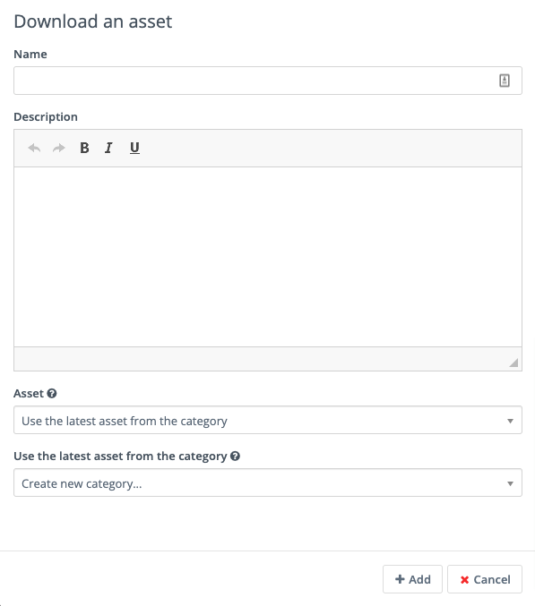

- **POST 结果到另一个表单**：使用此选项将您的 Mautic 表单与某个其他表单连接起来。您可能在其他工具有用于跟踪和报告的表单，或者是触发软件实例创建的后端表单。

输入表单应 POST 到的 URL，以及任何应收错误通知的人的邮件地址。如果您要 POST 到的表单位于防火墙后面，还要输入授权头。如果任何字段的别名（机器名称）不匹配，输入另一个表单为 Mautic 表单上的任何字段使用的别名。

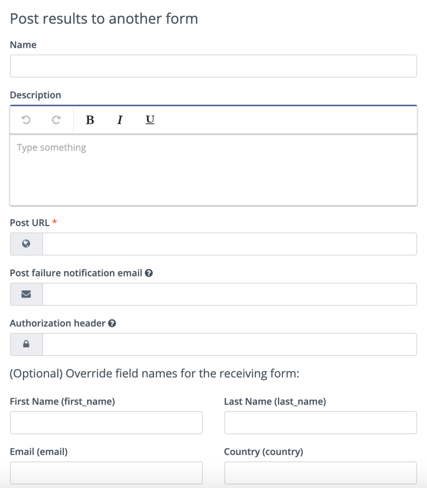

- **推送联系人到集成**：一旦联系人提交了表单，您可能需要将其推送到您用于联系人管理的另一个软件中——例如 CRM。确保您要用于推送联系人的插件已经配置并发布，然后在下拉字段中选择它。

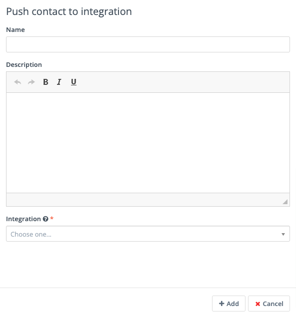

- **向联系人发送邮件**：要在联系人提交表单后直接向其发送邮件，请使用此选项。从列表中选择一个模板邮件，或点击"新建邮件"来构建一个新邮件。选择邮件后，您还可以在弹窗中编辑邮件并预览邮件。

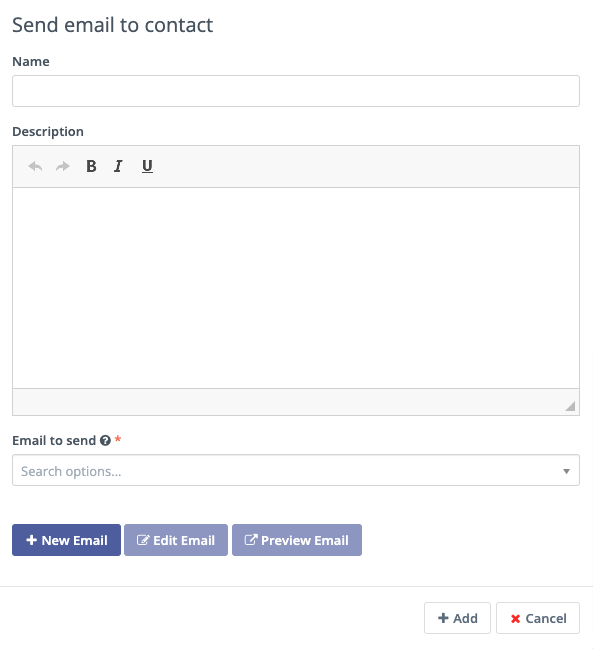

- **向用户发送邮件**：在联系人提交表单后向 Mautic 的内部用户发送邮件。从下拉菜单中选择 Mautic 用户。与向联系人发送邮件选项类似，选择模板邮件或创建一个新的。Mautic 会用来自联系人的数据，而不是用户的数据，替换显示中的任何令牌。

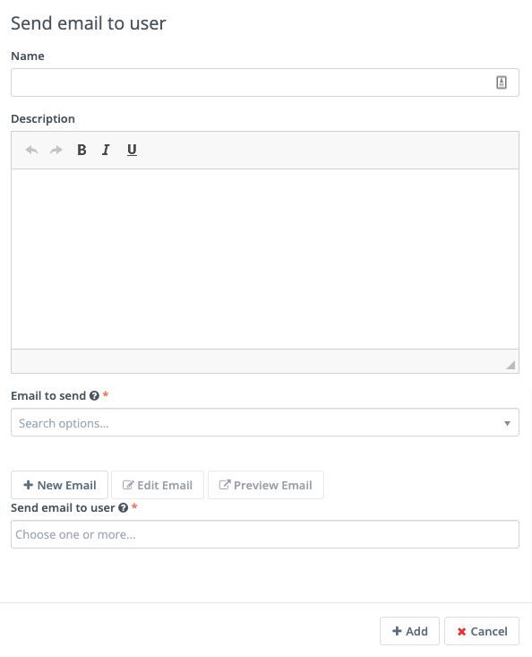

- **发送表单结果**：此功能通常用于在联系人提交表单时发送通知。它还可以向联系人发送所提供数据的通知。请务必自定义主题行以说明该提交涉及哪个表单。回复给联系人选项将 ``reply-to`` 地址设置为联系人的地址，这样如果通知发送给您的团队，回复将自动发送给联系人。

如果您在 Mautic 中设置了联系人所有者，您也可以将通知直接发送给联系人的所有者。还可以向联系人发送该邮件的副本。

您可以随意设计消息本身的样式，并且可以点击插入提交的表单值（使用令牌）。您必须在创建操作之前将字段添加到表单中。如果在创建表单操作后添加新字段，编辑表单操作并将新令牌添加到邮件中。

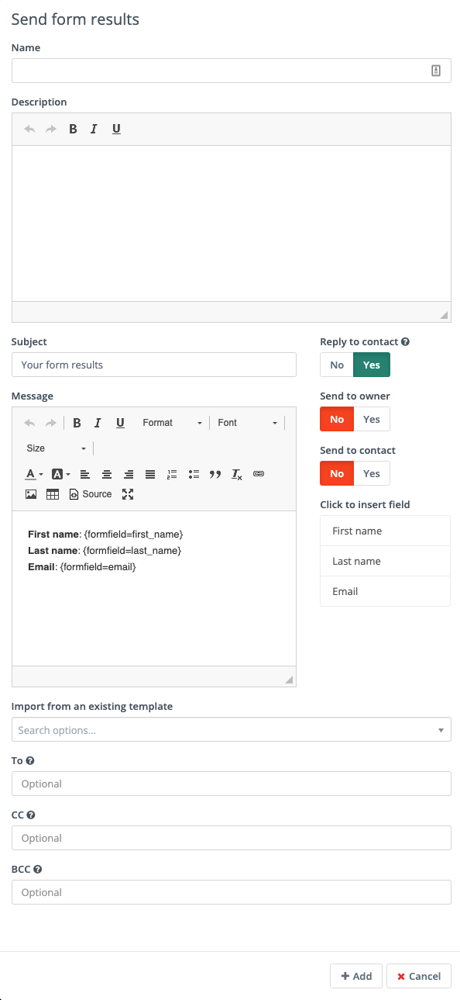

.. vale off

将表单添加到页面
*********************

.. vale on

有多种方式可以将您的 Mautic 表单添加到落地页或网站。

.. vale off

短代码
==========

.. vale on

在处理 Mautic 落地页或常见的内容管理系统（CMS）包括 **Drupal**、**Joomla!** 或 **WordPress** 时，您可以使用短代码。在每种情况下，将 ``ID#`` 替换为 Mautic 表单的 ID 号，该 ID 号可在表单列表中或查看/编辑表单时找到——ID 位于 URL 的末尾。此选项使用 JavaScript，这意味着您嵌入的表单始终与您在 Mautic 表单中所做的任何更改保持同步。

- **Mautic 落地页**：``{form= ID#}``
- **Drupal 7.x**：``{mauticform id =ID# width=300 px height=300 px}`` — 请务必将宽度和高度更改为适合您网站的适当大小。

.. warning::
  此短代码不适用于 Drupal 8.x — 建议改用嵌入选项。

- **Joomla!**：``{mauticform ID#}``
- **WordPress**：``[mautic type="form" id=ID#]``

嵌入
==============

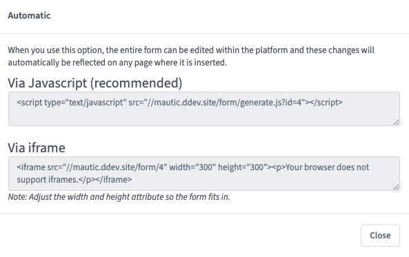

Mautic 表单的嵌入选项使用 JavaScript，并确保您网站上的表单始终与您在 Mautic 中的设置保持最新。如果您在 Mautic 中更改表单，您不必担心在您使用表单的每个地方重新复制表单代码。自动填充和渐进式画像等功能 **仅** 在嵌入选项下工作。

.. note::
  在复制嵌入 Mautic 表单的代码之前，请确保您在正确的域名上——例如不是测试环境或内部引用——因为表单嵌入代码引用了 URL。

通过 JavaScript
~~~~~~~~~~~~~~

除了使用 CMS 插件的短代码外，这是嵌入 Mautic 表单的推荐方法。复制框中的代码行，并将其粘贴到您网站上您希望表单显示的位置。

.. vale off

通过 IFrame
~~~~~~~~~~

.. vale on

IFrame 可能更难使用，浏览器阻止的可能性更大，但有时使用 IFrame 更为可取。请务必调整宽度和高度以适应表单所需的空间。访客可能需要在 IFrame 内滚动，具体取决于其浏览器的分辨率。可以通过编辑 ``
`` 和 ``
`` 标签之间的文本来在访客的浏览器不支持 IFrame 时显示错误消息，然后再复制代码并将其粘贴到您的网站中。

自托管
===========

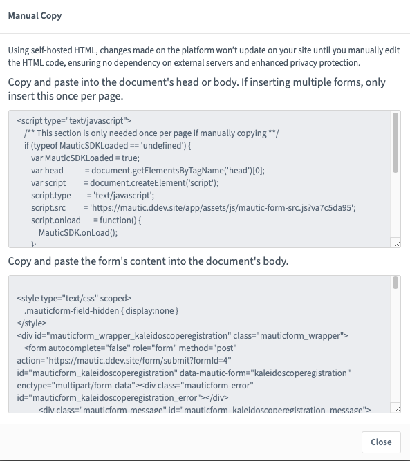

自托管选项确实提供了更大的灵活性，可以使用 JavaScript 片段和自定义样式扩展表单，但这是一个手动过程，在复制代码后在 Mautic 内所做的任何更改不会自动反映在您的网站上，除非您重新复制并粘贴新的 HTML 代码。

.. note::
  在复制嵌入 Mautic 表单的代码之前，请确保您在正确的域名上——例如不是测试环境或内部引用——因为表单嵌入代码引用了 URL。

#. 复制第一个框中的 JavaScript 代码，并将其粘贴到您页面的头部或正文中。如果您在同一页面上有多个 Mautic 表单，只需添加一次。
#. 复制第二个框中的 HTML 代码，并将其粘贴到您希望显示表单的位置。
#. 如果您在表单中将渲染样式设置为是，则代码包含样式。如果您将渲染样式设置为否，则代码不包含样式，表单样式来自您网站的 CSS。

.. vale off

创建条件表单字段
********************************

.. vale on

Mautic 允许您在表单中创建条件字段。这使您能够管理字段之间的一组依赖关系，使字段仅在特定条件下显示。

要创建条件字段，您必须首先创建任何 :doc:`/contacts/custom_fields` 并在表单中使用这些字段。

.. vale off

创建自定义字段
======================

.. vale on

使用一个示例，想要根据制造商显示特定型号的汽车，您会创建以下自定义字段：

- **汽车制造商**：此字段应为下拉数据类型。在此示例中，此字段的选项是 Ford、Nissan、Peugeot 和 Fiat。
- **Ford 汽车**：此字段应为下拉-多选数据类型。在此示例中，此字段的可用选项是 Focus、Mustang、Fiesta 和 Galaxy。

向 Mautic 表单添加条件字段
==========================================

创建必要的自定义字段后，如前文所述将父字段添加到表单中，并在选项卡中添加相关信息。

.. note::
  使用条件字段时，只有 ``下拉``、``下拉-多选`` 和 ``布尔型`` 字段类型可作为父字段。

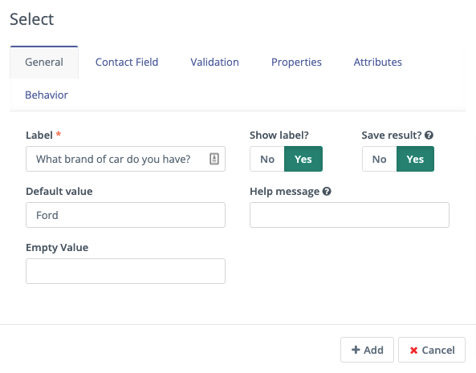

如果您已在自定义字段中定义了值，将第一个开关切换为是以使用这些值。否则，在属性选项卡中创建标签和值。您也可以在适当的情况下将表单字段与联系人字段关联。

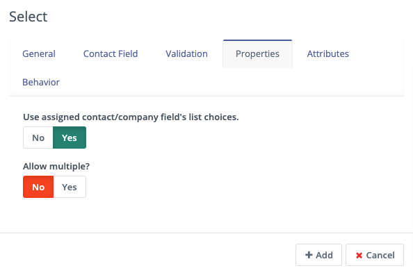

保存后，会显示一个添加条件字段的选项。

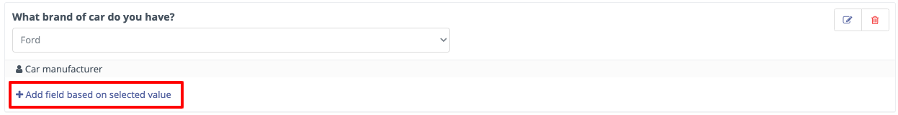

在此示例中，选择 ``复选框组`` 选项，并在条件选项卡下，选择 ``including`` 和 ``Ford``。

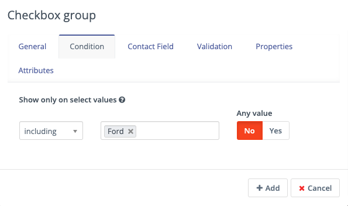

这意味着当访客选择 Ford 时，表单会显示此字段。

有两个选项：

- **including**：如果您希望子字段仅在表单上为父字段所选的值 **匹配** 指定的值时出现
- **excluding**：如果您希望子字段仅在表单上为父字段所选的值 **不匹配** 指定的值时出现

可以将任意值设置为是，这样子字段会在父字段的任何值下都显示。这会移除选择选项的筛选器。

根据情况将字段映射到联系人字段，并在属性选项卡下，选择使用自定义字段中的选项，或指定标签和选项。

保存后，表单会将条件字段嵌套显示在父字段下方。

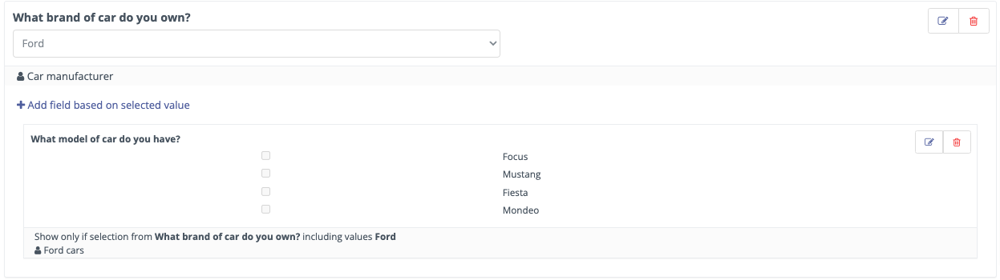

阻止来自指定域的表单提交
************************************************

有时有必要阻止某些域提交表单——例如限制对专有内容的访问并减少不合格联系人的数量。

配置阻止的域
===========================

要配置全局阻止的域——应用于您的 Mautic 实例中的所有表单——前往 :doc:`/configuration/settings` 中的表单部分。

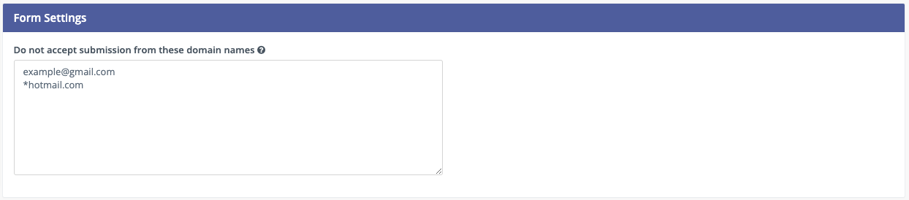

每行一个指定域，使用完整的邮件地址或使用域名前的星号作为通配符来阻止整个域。确保保存您的更改。

向表单应用域名筛选
========================================

要在 Mautic 表单上应用域名筛选，向表单添加一个邮件字段——在上一步设置域名排除后——并在验证选项卡下，将域名提交筛选器开关设置为是。

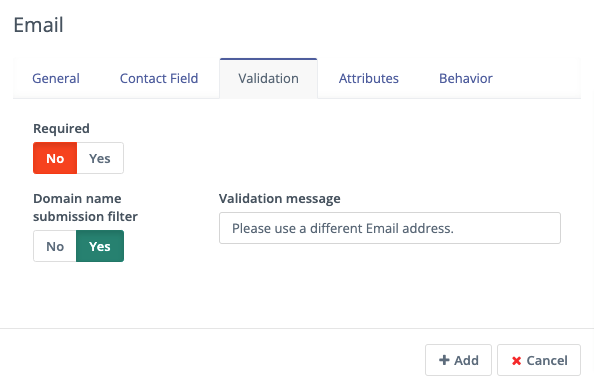

建议提供一条有帮助的消息，在访客尝试使用来自被阻止域的邮件地址时显示，以帮助他们理解问题所在。