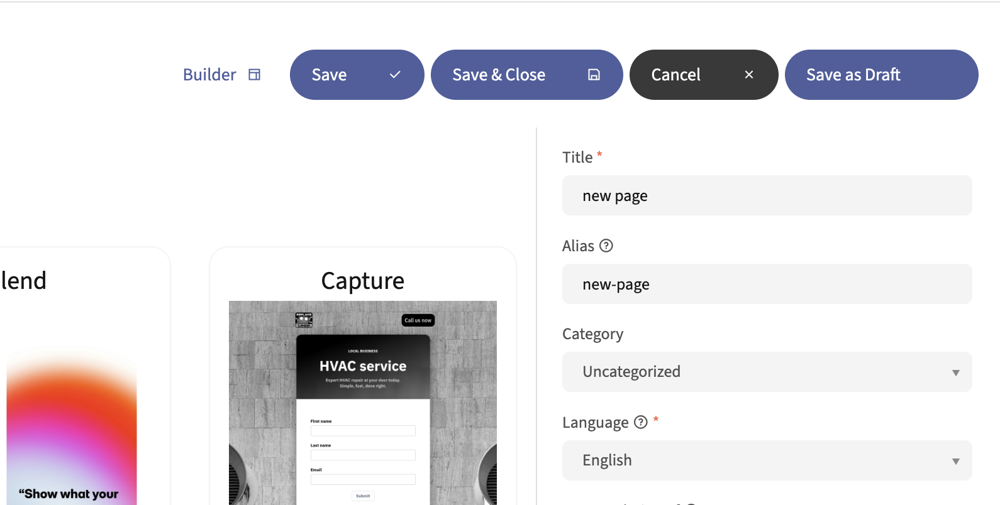
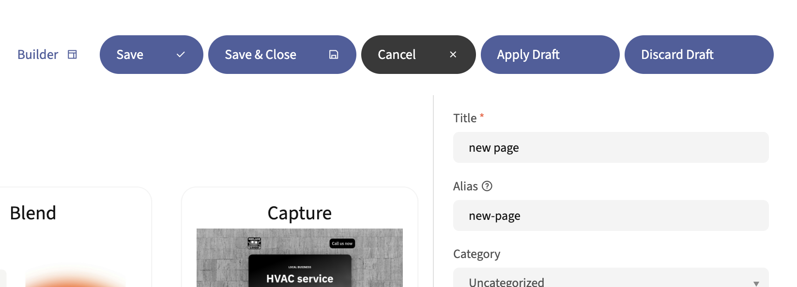
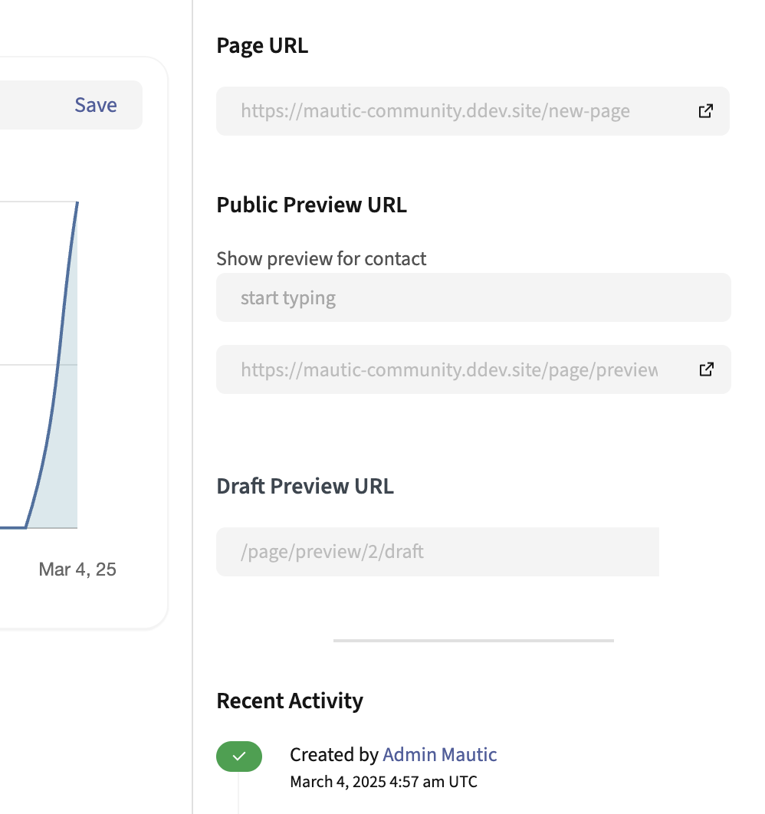

落地页
#############

.. vale off

自定义偏好中心
*********************************

.. vale on

.. vale off

落地页草稿
*******************

创建草稿落地页
=============================

.. vale on

Mautic 允许使用落地页编辑器中的"保存为草稿"按钮来创建落地页草稿。

此功能需要通过将配置参数 ``page_draft_enabled`` 添加到您的 ``local.php`` 配置文件中来启用，详情如下。

.. code:: php

  'page_draft_enabled' => 1

启用后，"保存为草稿"按钮会出现在落地页编辑界面上。

任何给定落地页一次只能存在一个草稿。当使用草稿时，"保存为草稿"按钮会改为显示两个按钮，"应用草稿"和"丢弃草稿"。

您只能在草稿状态下更改落地页本身的内容。对主题、内部名称、所选分组等的更改即使在编辑草稿版本时也会应用于原始落地页。草稿内容独立于原始落地页存在。

.. vale off

预览草稿落地页
===============================

.. vale on

您可以通过在落地页预览 URL 末尾添加 ``/draft`` 来预览落地页草稿。如果某个落地页有草稿版本，在落地页详情概览页面上的常规预览 URL 下方会显示一个草稿预览 URL。

