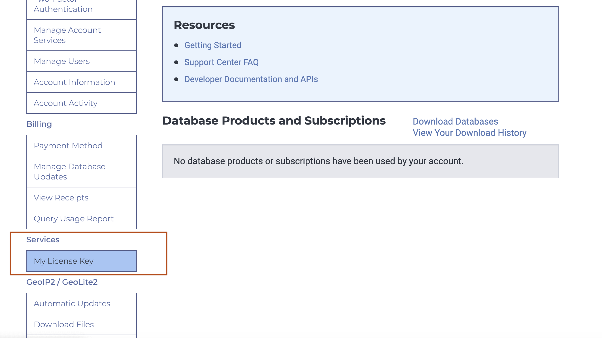
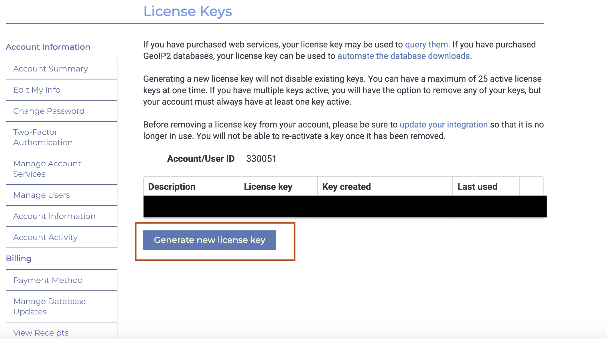
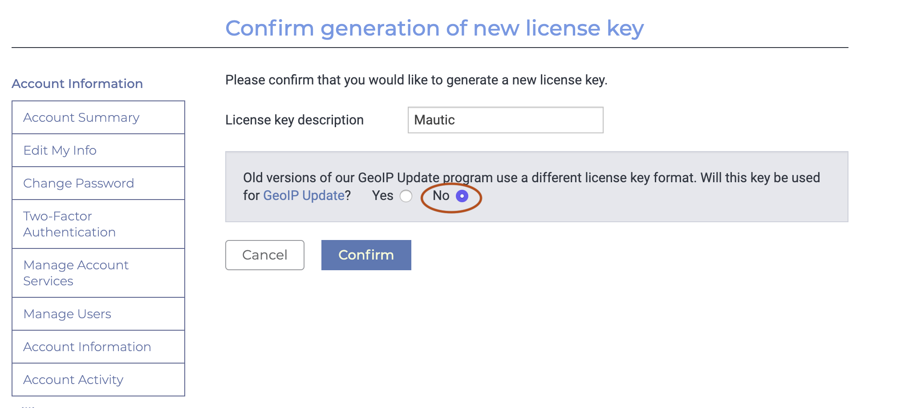
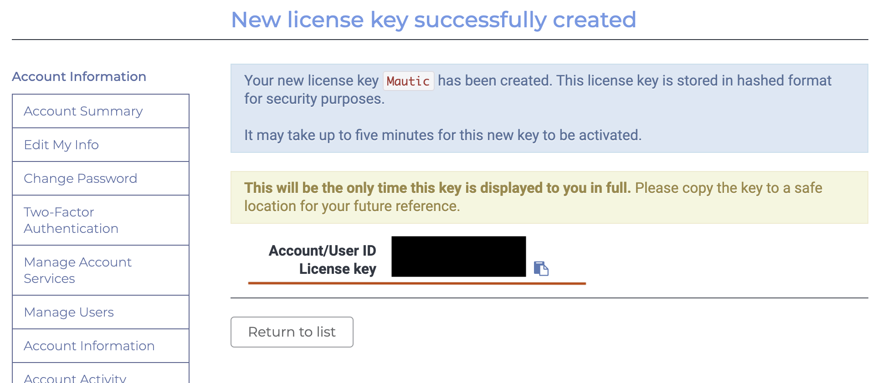
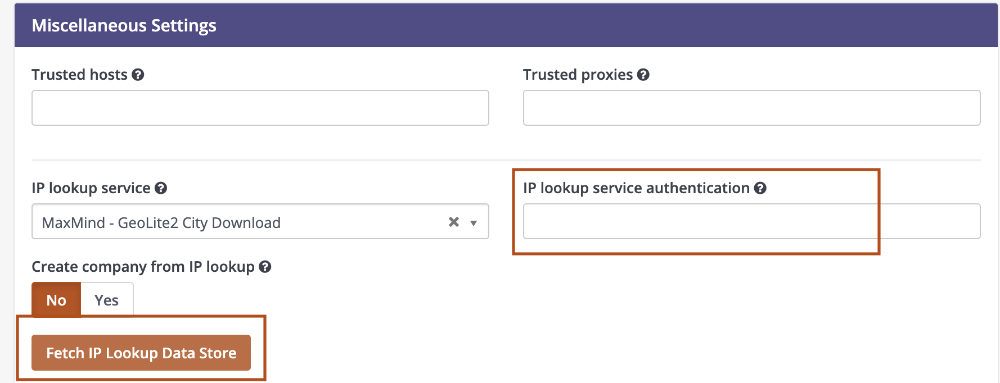

MaxMind 许可证
###############

从 :xref:`2.16 release` 开始，Mautic 支持使用许可证密钥访问 MaxMind IP 查询服务。

.. danger:: 

    从 3.2 版本开始，许可证密钥的格式必须为 ``AccountID:Licensekey``。您可以在许可证密钥表之前找到账户 ID。

按照以下步骤配置您的 Mautic 实例以使用许可证密钥。

1. 前往 :xref:`MaxMind Signup` 创建一个 MaxMind 账户。

2. 注册后，验证您的电子邮件并按照步骤访问您的 :xref:`MaxMind Account`。

3. 点击菜单右上角的联系人图标登录。

4. 登录后，在服务项下，点击左侧菜单中的 ``我的许可证密钥``。

5. 然后，点击 ``生成新的许可证密钥``。

6. 对 ``此密钥是否用于 GeoIP 更新？`` 回答“否”并确认。

7. 复制屏幕上显示的许可证密钥，并记下许可证密钥表之前的账户 ID。

8. 转到 Mautic > 设置 > 配置 > 系统设置 > 杂项设置，在“IP 查询服务认证”**字段中**以 ``AccountID:Licensekey`` **格式**输入许可证密钥。

9. 点击 ``获取 IP 查询数据存储``。这将把 IP 查询数据库下载到您的 Mautic 实例中。

10. 设置 :ref:`cron 任务` 以定期下载最新副本。