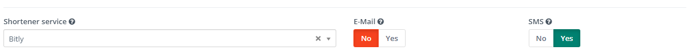

URL 缩短服务
#####################
.. attention::

    Mautic 5 引入了一项新的缩短功能，取代了之前在设置中使用的旧版缩短系统。如果您在 Mautic 4 中使用了缩短服务，在升级到 Mautic 5 后，请按照以下步骤重新配置。

新的 URL 缩短服务允许开发人员为任何缩短服务创建插件，并支持任意类型的授权。默认情况下，Mautic 不提供 URL 缩短服务插件；您必须通过市场或手动方式安装。

配置 Bitly 插件示例
=============================

1. 通过市场或使用 Composer 安装 Bitly 插件包：

.. code-block:: bash

    composer require webmecanik/mautic-bitly-bundle

2. 从 :xref:`Bitly API settings` 获取访问密钥，并设置/启用 Bitly 插件。

3. 导航至 配置 > 系统设置 > 缩短服务，然后将 Bitly 指定为默认的缩短服务。

