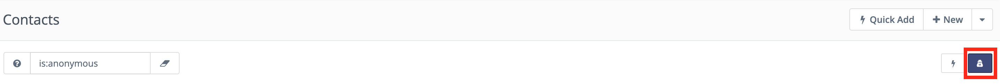

联系人
#########

联系人是营销自动化平台的核心因素。

所有访问过您的网站或以某种方式与您互动过的个人都属于联系人。

联系人类型
**************

联系人分为两种类型：

访客 - 原"匿名线索"
=======================================

尚未填写表单或以其他方式与您的网站互动的未识别访客。

Mautic 会追踪这些联系人，但通常将其隐藏，以免干扰您的视图。

追踪访客是有价值的，因为他们可能是未来的客户。在访客产生任何互动之前进行追踪，您可以记录其网站访问日志，从而了解他们与您互动前的活动情况。

您可以在联系人列表顶部的搜索栏中使用 ``is:anonymous`` 命令来筛选并仅显示访客。

**所见内容** - 切换到匿名联系人视图时，将显示使用 Mautic 追踪代码跟踪的落地页访客的 IP 地址。 
如果您在 **设置 > 系统设置 > 杂项设置** 中 :ref:`配置了<杂项设置>` IP 查询服务，Mautic 会显示联系人的大致位置。Mautic 默认使用 :xref:`MaxMind's` 的 Geolite2 City 数据库。MaxMind 根据联系人的互联网服务提供商进行位置估算，可能并非联系人的确切位置。

**单个联系人** - 点击 IP 地址可显示联系人的记录，与已知联系人类似。如果匿名联系人存在任何信息，您可以在此处查看。这些数据可能包括：

* 联系人访问过的落地页

* 已提交的表单

* 积分

* 表单中的数据 - 不包括唯一标识符，因为那会使联系人变为已知状态

.. note:: 

    * 在 **设置 > 配置 > 追踪设置** 中，您可以启用 **匿名联系人的不追踪404错误** 选项，以禁止追踪任何被追踪代码记录的 404 错误页面的访问。该选项有助于防止追踪您不感兴趣的页面，并避免用机器人活动填满联系人日志。参见 :ref:`追踪设置<追踪设置>`

    * 匿名联系人的数据不可用于分组或报告。一旦识别为已知联系人，数据即可使用，这适用于非基于营销活动的动态网页内容筛选器。

.. vale off

标准联系人
=================

.. vale on

第二种类型的联系人是已知联系人。这些联系人已通过表单或其他来源识别身份。您可能还拥有他们此前互动的更多信息，或来自客户关系管理（CRM）工具等第三方系统的数据。

因此，这些联系人通常带有姓名、电子邮件地址及其他标识信息。

这些联系人可能最初是访客，但在某个时点提供了姓名、电子邮件地址、社交网络账号或其他标识特征，从而让您能够将网站活动与已知个体关联起来。您可以通过 Mautic 营销自动化平台培育这些联系人，深入了解他们的行为，并据此采取特定行动。

切换视图
*****************

默认情况下，Mautic 使用**列表视图**，但您也可以选择切换到**卡片视图**（也称为**网格视图**），该视图使用头像以卡片形式直观展示联系人。

按下键盘上的 **V** 键可在列表视图和卡片视图之间切换。

:ref:`管理联系人<管理联系人>` 部分提供了关于如何在 Mautic 中操作联系人的更多信息。