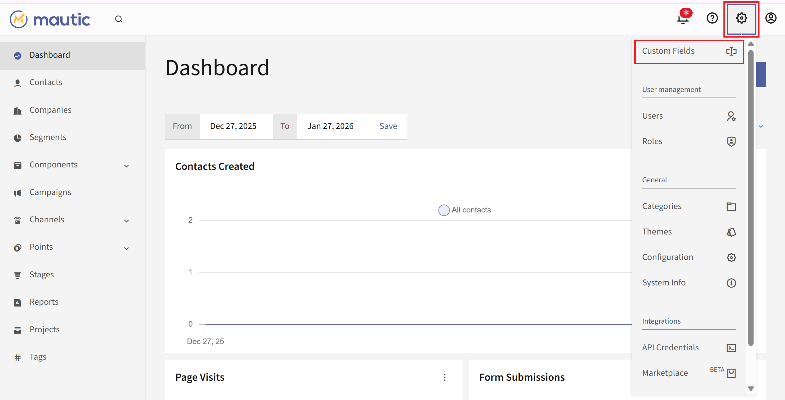
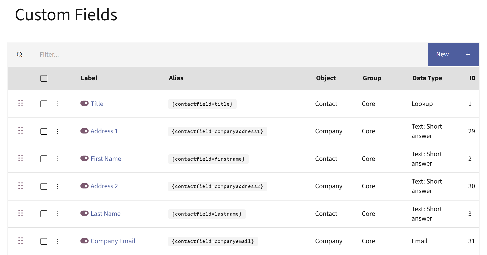
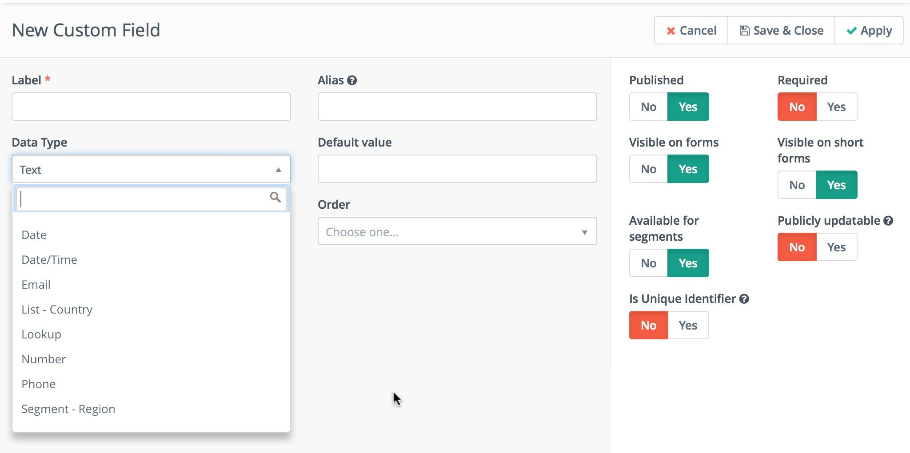

.. vale off

管理自定义字段
####################

.. vale on

您可以通过管理菜单管理自定义字段 - 点击 Mautic 右上角的齿轮图标。

|

自定义字段
*************

**自定义字段** 页面允许您查看所有现有的联系人字段以及您创建的任何自定义联系人字段。

|

您会注意到分组列显示了联系人资料中的具体字段。在最后一列中，您可能会看到几个图标，分别表示字段的不同属性：

|

1. **锁图标** - 核心安装使用这些字段，您无法删除它们。

2. **列表图标** - 您可以将这些字段用作分组的筛选条件。

3. **星号图标** - 这些是填写联系人表单时的必填项。

4. **地球图标** - 您可以通过 :doc:`跟踪像素</configuration/variables>` URL 查询公开更新这些字段，详见 :doc:`联系人监控</contacts/manage_contacts>`。

需要注意的是，从 Mautic 5 开始，您将无法编辑用于标识联系人或公司的任何字段的默认值，包括：

* 邮箱

* 公司

* 名字

* 姓氏

* 社交资料

* 唯一标识符字段

* 公司名称

* 公司邮箱

* 公司网站

* 州/省

* 国家

* 城市

已发布字段
*************

在每个标签标题前都有一个切换开关。您可以在整个 Mautic UI 中找到这种用于发布和取消发布项目的开关。

.. only:: html

   .. figure:: images/unpublish-fields.gif

|

.. vale off

添加新自定义字段
*************************

.. vale on

您可以创建额外的自定义字段并定义该字段要保存的数据类型。除了数据类型外，您还需要为该字段选择分组。这将决定该字段在联系人编辑和详情视图中的显示位置。

|

通过命令创建自定义字段
************************************

当您在 Mautic 中为联系人或公司创建新自定义字段时，系统会向数据库添加一个新列。对于大型 Mautic 实例，此操作可能会变慢，并且表在运行期间会被锁定。因此，在系统创建字段之前，您无法进行任何更改。``HTTP`` 请求可能会超时，导致用户界面报告该列已存在，即使联系人/公司更新可能因该列仍然缺失而失败。

有一种方法可以解决此问题，即将字段创建处理配置为后台运行。

自 :xref:`Mautic 3` 起，您可以在 ``app/config/local.php`` 文件中设置一个选项：``'create_custom_field_in_background' => true``。

如果您配置了此选项，新自定义字段将在自定义字段列表中可见。该自定义字段保持未发布状态，直到您运行命令 ``bin/console mautic:custom-field:create-column``。此命令会在表中创建实际列并发布字段元数据。

类似地，如果您已启用 ``create_custom_field_in_background`` 配置选项，命令 ``bin/console mautic:custom-field:delete-column`` 会删除表中的实际列。该列会被软删除并从用户界面中移除，但数据仍保留在数据库中，直到您运行命令删除该列。

此配置有助于防止 **http** 请求超时，因为它将创建新表列的长耗时 SQL 查询作为后台任务处理。

为缓解表锁问题，建议每天仅在您知道大多数受众离线时运行一次该命令。流入 Mautic 的流量越少，遇到问题的可能性就越低。

分析自定义字段以优化表
******************************************

自 Mautic 5.1 起，有一个命令允许您分析自定义字段并优化表。当您拥有大量自定义字段并希望优化 VARCHAR 字段的大小时，此命令非常有用。

使用此命令可以优化 VARCHAR 列，这样如果您达到了 Leads 表的硬限制无法再创建更多字段时，仍能创建更多自定义字段。

使用命令：

.. code-block:: bash

    bin/console mautic:fields:analyse -t

使用 -t 参数可在控制台中以表格形式查看输出。

使用以下命令将数据导出到文件：

.. code-block:: bash

    bin/console mautic:fields:analyse > path/to/file.csv

本地定义的国家和地区
*************************************

自 Mautic 5.1 起，可以通过本地托管的 JSON 文件定义自定义国家和区域。当您希望在 Mautic 实例中使用特定的一组国家或区域时，这非常有用。您可以在名为 ``upload_dir``（默认为 ``media/files``）的目录下定义的 ``countries.json`` 或 ``regions.json`` 文件中进行定义。以下是示例代码片段：

.. code-block:: json

  [
  "中土世界",
  "费洛瑞"
  ]

.. code-block:: json
  
  {
  "中土世界": [
    "夏尔",
    "魔多"
  ],
  "费洛瑞": [
    "白堡",
    "余烬之墓"
  ]
  }