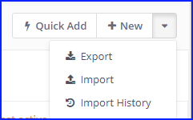
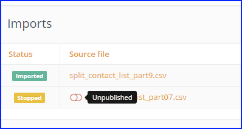
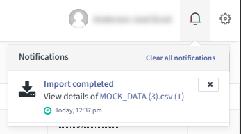
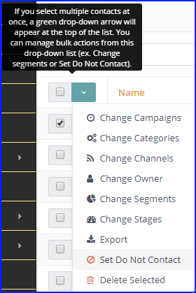

```rst
导入联系人
###############

通过 Mautic 的用户界面可以导入联系人。对于大批量导入，建议通过 cron 后台任务在后台完成。

自 Mautic 2.9 起，当导入任务创建或更新联系人时，Mautic 会在联系人的事件历史中显示相关信息。

导入文件要求
************************

* CSV 文件必须使用 UTF8 编码。其他编码可能导致导入失败。请查阅电子表格程序的文档，了解如何将电子表格导出为 UTF8 格式。Google Sheets 会自动编码为 UTF8，Libre/Open Office 允许在导出前选择编码。

* 对于布尔值字段（如 ``doNotEmail`` 或自定义布尔字段），请使用 ``true``、``1``、``on`` 或 ``yes`` 作为真值，Mautic 会将其他所有值视为假值。
* 若要为一个联系人导入多个标签，请使用 ``|`` 分隔，例如 ``tag-a|tag-b|tag-c``。
* 日期/时间值请使用 ISO8601 格式，即 ``YYYY-MM-DD hh:mm:ss``。其他格式可能也能使用，但可能会出现问题。

  * 示例：``2019-01-02 19:08:42``。
    
    其他格式可能也能使用，但可能会出现问题。

提示
====

* 使用表头行，并且列名应与 Mautic 联系人自定义字段名称匹配。这样 Mautic 会自动为您预选映射。例如，如果您将名字列命名为 ``firstname``，Mautic 会自动将其映射到 ``{contactfield=firstname}``。

* 设置映射时，您可以选择在联系人记录中已有值的字段上跳过导入。此设置可让您避免擦除 Mautic 联系人中已存在的数据。

* 如果您的 CSV 包含数千个以上的联系人，请将文件分割成几个较小的 CSV 文件，以避免内存问题和导入速度缓慢。

.. tip:: 
  如果使用 Linux 系统，请参考 ``GNU`` parallel 命令 ``sudo apt install parallel``。
  
  ``cat big_contact_list.csv | parallel --header : --pipe -N 1000 'cat > split_list_part{#}.csv'``
  
  这将生成文件：``split_list_part1.csv ...split_list_part9.csv, split_list_part10.csv``。

导入类型
***************

浏览器导入
==============

您必须分批导入较大的 CSV 文件，以避免达到服务器（PHP）内存和执行时间限制。在浏览器中导入时，您的浏览器控制着分批。当一批完成时，JavaScript 会启动新的一批。这意味着浏览器窗口必须始终保持打开并连接到互联网。

仅在别无选择时使用浏览器导入方法。您应默认使用后台导入。

后台导入
=================

后台导入任务（手动触发或通过 cron 任务触发）具有宽松时间限制的优势。CSV 后台导入不会每批都重新开始（默认情况下，1 批 = 100 行），Mautic 会保存最后导入的行，下一批从该点继续。后台导入总是比浏览器导入更快、更可靠。

.. warning:: 

  后台导入需要命令 ``php /path/to/mautic/bin/console mautic:import`` 定期运行。请将其添加到您的 :doc:`cron 任务</configuration/cron_jobs>` 中。

:doc:`后台任务</configuration/cron_jobs>` 的成功结果如下所示：

.. code-block:: shell

  $ bin/console mautic:import
  48/48 [============================] 100%
  48 lines were processed, 0 items created, 48 items updated, 0 items ignored in 4.78 s

如果队列中没有等待的导入，则不会有任何消息。您也可以使用 ``--quiet`` 来阻止消息显示。

自动导入类型配置
-----------------------------------

在 Mautic 全局配置 > 联系人设置 中，有一个选项可以定义浏览器导入与后台导入的最佳限制。

如果您输入 500，这意味着如果少于 ``500`` 行，则使用浏览器导入；如果超过 500 行，Mautic 会将其加入队列，等待后台导入 cron 任务下次运行时处理。

默认值为零，这意味着会显示两个导入按钮而不是一个，您必须在每次导入时决定使用哪种导入选项。

并行导入
----------------

导入可能需要几分钟时间。当您开始另一个导入时，可能正有一个导入在运行。有一个可配置的选项 ``parallel_import_limit`` 可以防止服务器资源耗尽。默认情况下，一次只运行 1 个导入。您可以通过将其添加到 ``app/config/local.php`` 文件来更改此选项。

导入任务列表
***************

您可以通过进入联系人区域，单击联系人表格右上角的操作菜单，然后选择“导入历史”选项来访问导入列表。



|

.. tip:: 

  直接 URL 是 ``https://example.com/s/contacts/import/1``

该表格向您显示：

* 所有导入的基本统计信息
* 其 :ref:`当前状态<导入任务状态>`
* 原始 CSV 文件名
* 创建导入的用户
* 创建日期
* 后台任务上次更新统计信息的时间

还有一个切换开关，使您能够 :ref:`停止和启动<启动和停止导入>` 已排队或**进行中**的导入。

导入任务状态
=================

导入任务有几种可能的状态：

* **已排队** - Mautic 已将导入加入后台处理队列。它正在等待后台任务开始导入。

* **进行中** - 后台任务已开始导入，尚未完成。您可以在导入列表中查看进度。

* **已导入** - 导入已成功处理。

* **失败** - 导入因某种原因失败。最常见的原因可能是上传的 CSV 文件不再存在、Mautic 没有读取权限，或者导入超过 2 小时无响应。

* **已停止** - 当导入处于**已排队**或**进行中**状态时，用户停止了导入。

* **手动** - 用户选择在浏览器中“手动”导入。类似于“进行中”。

* **已延迟** - 后台任务想要开始导入，但导入进程无法启动。因此延迟至以后。可能发生这种情况的原因是达到了并行导入限制。导入会在条件允许时立即开始。

导入任务详情
=================

单击文件名会打开导入任务详情页面。

主要内容区域显示被忽略的行（如果有）的信息。表格告诉您 CSV 文件中的行号以及原因，以便您修复这些行并 :ref:`重新开始导入<如何开始导入>`。

有两个图表：

1. 饼图显示已创建、已更新和失败行的比例。

2. 折线图显示每分钟添加的联系人数量。

单击*详细信息*可查看更详细的统计信息和导入任务配置。这包括导入速度、字段映射和任务时间戳。

启动和停止导入
*****************************

如何开始导入
======================

1. 转到**联系人**。

2. 在联系人页面右上角，打开操作子菜单，然后选择**导入**选项。

.. tip:: 

  直接 URL 是 ``https://example.com/s/contacts/import/new``

3. 选择包含要导入联系人的 CSV 文件。

4. 如果您的文件使用非标准分隔符或 :ref:`编码<导入文件要求>` 等，请调整 CSV 设置。

5. 上传您的 CSV 文件。

6. 应显示字段映射页面。第一组选项允许您选择要全局分配给所有导入联系人的所有者、分组和标签。第二组选项允许您将 CSV 文件中的列映射到 Mautic 联系人 :ref:`自定义字段<管理自定义字段>`。第三组选项允许您将 CSV 文件中的列映射到特殊的联系人属性，例如*创建日期*等。

7. 当字段映射准备就绪后，单击前面描述的其中一个导入按钮。

如何停止后台导入
===============================

1. 转到*联系人*。

2. 在联系人页面右上角，打开操作子菜单，然后选择 :ref:`导入历史<导入任务列表>` 选项。

3. 停用您要停止的导入任务。导入的 :ref:`状态<导入任务状态>` 将变为“已停止”。它完成当前批次的导入后会停止。

4. 要重新开始导入，请激活它，后台任务将在下一次 :doc:`cron 任务执行</configuration/cron_jobs>` 时继续。



|

当后台任务完成（无论是成功还是失败）时，您会收到 Mautic 通知区域的通知。



|

常见问题
***

问：导入超时了，该怎么办？

答：使用后台任务导入，或者将批次限制更改为小于 100 的数字。

问：导入的*请勿联系*值会怎样处理？是存储为退回还是“取消订阅”？

答：它存储为“手动取消订阅”。这与在联系人页面上将联系人标记为“请勿联系”相同。


```