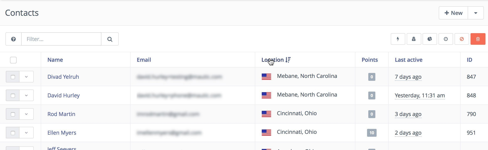
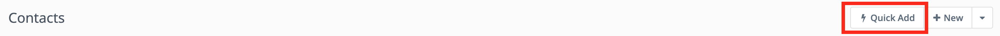
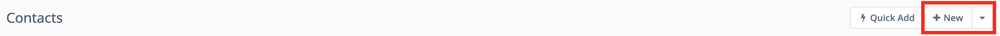
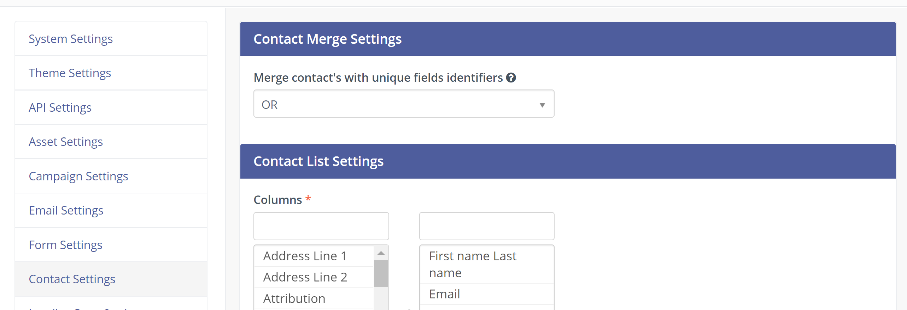
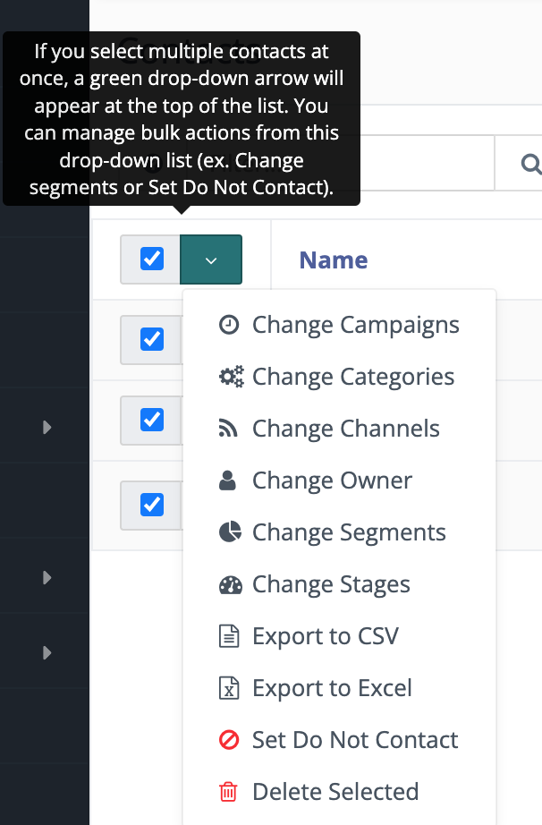
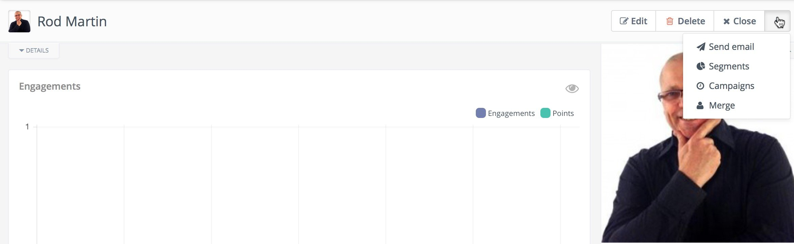

```markdown
.. vale off

管理联系人
#################

.. vale on

管理联系人页面是主要的界面，您可以在此查看并与联系人（包括访客和标准联系人）进行交互。

.. vale off

搜索联系人
**********************

.. vale on

您可以使用列表顶部的搜索框在分组内进行搜索，或者通过点击相应的表格标题来排序联系人。



|

搜索框支持多种搜索类型，并遵循与其他所有搜索布局相同的搜索流程和变量。

.. vale off

处理联系人
*********************

.. vale on

快速添加
=========



|

快速添加是一个包含您认为最重要字段的简短表单。要在 **快速添加** 表单中显示字段，请使其在自定义字段配置中的短表单中可用。

您可以通过新建联系人表单添加联系人并包含更多详细信息，但对于快速录入，这是将联系人添加到系统的最简便快捷的方式。

.. vale off

添加新联系人
===============

.. vale on



|

这将打开新联系人界面，您可以在其中输入您所拥有的关于该联系人的所有信息。在创建新联系人时，它也会显示所有可用的联系人字段。

使用顶部的选项卡填充现有的自定义字段和社交网络资料。

.. note:: 

    在开始添加联系人之前，您可能需要添加 :doc:`自定义字段</contacts/custom_fields>` 以捕获您需要的所有信息。

.. vale off

导入联系人列表
=======================

.. vale on

Mautic 支持通过 CSV 文件从其他来源导入联系人——如果您需要一次性导入大量联系人，这是快速启动运行的好方法。

阅读更多关于在 :doc:`/contacts/import_contacts` 中导入联系人的信息。

.. vale off

导出联系人列表
=======================

.. vale on

Mautic 支持以 CSV 和 Excel 格式导出联系人列表。

* **导出为 CSV** - 将包含联系人列表 CSV 文件的可下载链接发送到您 Mautic 用户资料中的电子邮件地址。

.. note:: 

    此功能目前最多支持导出 100 万个联系人。点击电子邮件中的链接后，用户必须通过登录页面登录 Mautic。用户必须使用接收电子邮件的同一授权用户登录，之后文件下载将开始。下载后，用户可以与其他非 Mautic 用户共享该文件。

* **导出为 Excel** - 直接从系统将联系人列表导出为 Excel。

.. vale off

编辑联系人
================

.. vale on

要编辑联系人，请单击联系人的姓名——如果访客是匿名的，则单击其 IP 地址——以打开联系人界面。

在此界面中，您可以查看最近的事件以及为该联系人保存的任何备注。

要编辑联系人，请单击右上角菜单中的“**编辑**”按钮。

管理重复项
===================

当 Mautic 跟踪联系人的操作（例如页面访问或表单提交）时，联系人会根据其唯一标识符自动合并，这些标识符包括：

* 电子邮件 - *或您标记为唯一标识符的任何其他联系人字段*

* Cookie

Mautic 将所有操作合并到具有相同 Cookie 的联系人，如果知道唯一的 ``device_id``，则会创建一个新的 Cookie。

如果联系人提交包含电子邮件地址的表单，则会将提交内容与具有相同电子邮件地址的联系人合并。即使 IP 地址或 Cookie 与另一个联系人匹配，也会发生这种情况。

因此，Mautic 会处理由事件跟踪创建的重复联系人。但是，您仍然可能通过 Mautic 管理界面创建重复联系人。从 Mautic 2.1.0 开始，如果已经存在具有相同唯一标识符的联系人，Mautic 会通知您。

``AND`` 是用于按唯一标识符查找重复项的默认运算符。您可以在联系人合并 :doc:`设置配置</configuration/settings>` 中选择使用 ``OR`` 运算符。



|

批量操作
=============

要同时更新多个联系人，请选中这些联系人，然后单击复选框列顶部的绿色箭头。

当您单击某个操作时，会显示一个模式窗口，其中包含更多配置详细信息。

您可以使用此功能快速更新大量联系人，但如果需要一次更改超过几百个联系人，使用营销活动操作可能更好——例如，将您需要更新的所有联系人添加到一个分组中，并使用营销活动来触发更改。



|

目前可用的批量操作如下：

* **更改营销活动** - 允许您将选中的联系人添加/移出营销活动。

* **更改类别** - 允许您将选中的联系人添加/移出全局类别。

* **更改渠道** - 允许您为选中的联系人订阅/取消订阅通信渠道（电子邮件、短信等），并定义频率规则。

* **更改所有者** - 允许您为选中的联系人分配/取消分配所有者（Mautic 用户）。

* **更改分组** - 允许您将选中的联系人添加/移出分组。请注意，如果您手动将联系人添加或移出分组，则分组筛选器将不适用于该特定分组中的这些联系人。

* **更改阶段** - 允许您将选中的联系人添加/移出指定阶段。

* **导出** - 允许您将选中的联系人导出为 CSV。

* **设置请勿联系** - 此操作将所有选中的联系人设置为电子邮件渠道的“请勿联系”，并允许您提供自定义消息作为 Mautic 用户手动取消订阅联系人的“原因”。

* **删除选中项（批量删除）** - 联系人表中的批量删除操作允许一次最多删除 100 个联系人。此限制是出于性能考虑，因为一次删除更多联系人可能导致性能下降问题。

如果您需要删除大量联系人，请访问 :doc:`分组文档</segments/manage_segments>`，其中解释了如何轻松删除数千个联系人。

.. vale off

单个联系人的详细信息
**************************

.. vale on

每个联系人都有一个详细信息页面，您可以在其中查看 Mautic 所了解到的关于该联系人的信息。

互动图表
=================

互动折线图显示联系人在过去 6 个月内的活跃程度。互动是指联系人执行的任何操作。例如：页面访问、表单提交、电子邮件打开等。该图表还显示联系人获得的积分。

图像
=====

* **Gravatar** - 默认情况下，Mautic 从 Gravatar 拉取图像。如果存在与联系人电子邮件地址关联的 :xref:`Gravatar`，Mautic 会将 Gravatar 照片添加到联系人记录中。

* **自定义** - 要向联系人添加自定义图像文件，请编辑联系人记录，并在图像占位符下查找 **首选个人资料图像**。

* **社交** - 如果您已启用社交插件并且记录中包含社交资料，您将看到拉取个人资料图像的选项。

历史记录
=======

事件历史记录跟踪 Mautic 与联系人之间的任何互动。要查找特定事件类型，请在 **按来源包括事件** 文本框中搜索。要在查看历史记录时排除事件类型，请使用 **按来源排除事件**。

**通过 IP 访问** - 联系人打开或点击电子邮件、访问您跟踪的页面等所使用的 IP 地址。

**通过 API 添加** - 通过 API 创建的联系人。

**资源已下载** - 列出联系人从您的落地页或网站下载了哪些资源。将此信息与其他数据结合，有助于分析是什么促使联系人下载了该资源。

**已触发的营销活动操作** - 已发生的营销活动内的操作。

**已安排的营销活动事件** - 将在未来发生的营销活动内的操作。展开详细信息以查看事件的预定日期和时间。单击时钟图标重新安排事件，或单击 **X** 取消事件。警告图标表示首次尝试执行错误导致事件被重新安排。

**营销活动成员资格更改** - 联系人所属营销活动的更改。

**联系人已创建** - 这是第一个事件，显示联系人首次进入您的数据库的日期和时间——无论是已知联系人还是匿名联系人。

**按来源创建的联系人** - 联系人的来源。

**联系人已识别** - 联系人识别的日期和时间，将联系人从匿名联系人转变为已知联系人。

**按来源识别的联系人** - 联系人如何被识别。

**请勿联系** - 联系人从特定渠道取消订阅您的消息的日期和时间。

**已发送的动态内容** - 当联系人通过营销活动操作接收到动态内容槽时。

**电子邮件发送失败** - 如果发送给联系人的电子邮件因电子邮件地址无效或无法投递而退回，Mautic 会显示一个电子邮件发送失败事件，并显示该电子邮件的内部名称。

**电子邮件已读** - 特定电子邮件首次被阅读的日期和时间。如果联系人多次打开电子邮件，展开事件类型的详细信息将显示额外的打开记录。

.. note:: 

    为避免性能问题，Mautic 最多显示 1,000 条 **电子邮件已读** 事件详细信息。

**电子邮件已回复** - 如果联系人回复通过 Mautic 发送的电子邮件，则回复会以此事件类型显示在联系人记录中。要查看此信息，您必须在 **设置** > **配置** > **电子邮件设置** 中配置 **联系人回复** 收件箱。

**电子邮件已发送** - 当向联系人发送特定电子邮件时，Mautic 会列出该电子邮件的内部名称以及发送的时间和日期。

**表单已提交** - 除了显示表单提交的名称、时间和日期外，展开此事件类型的详细信息还会显示表单中收集的数据以及表单的位置（称为引荐来源）。

**已导入** - 所有包含该联系人的 CSV 导入的日期、时间和文件名。

**集成同步通知** - 有关与集成连接的信息。

**消息队列** - 当超过联系人对某个渠道的频率限制，并且稍后触发该渠道上的消息发送时，将显示一个消息队列事件，其中包含渠道和排队消息的 ID。展开详细信息将显示：

* 最初计划的发送日期
* 重新安排的发送日期
* 当前状态

如果消息是 ``待处理``，单击 X 按钮可取消它。

**页面访问** - 页面访问的时间和日期，以及如果是您网站上的跟踪页面，则为 URL；如果是 Mautic 落地页，则为内部名称。如果已跟踪，您可以通过展开此事件类型的详细信息来查看更多信息。

**已获得的积分** - 以下之一的 ID 编号：

* 全局积分操作（在 Mautic 的 **积分** 部分）

* 存在积分操作的营销活动，以及全局积分操作或营销活动的名称、添加或减去的积分数量，以及积分变更的时间和日期

**分组成员资格更改** - 当通过任何方法将联系人添加或移出分组时，这些更改会显示在事件历史记录中。

**阶段已更改** - 如果您在 Mautic 中使用 **阶段**，对这些阶段的更改会显示在事件历史记录中。

**收到的短信** - 此事件类型适用于 SMS 回复，如果您正在使用 SMS 并配置了 SMS 回复跟踪。外发短信显示为 ``已安排的营销活动事件`` 或 ``已触发的营销活动操作``。

**记录的 UTM 标签** - 如果您使用 UTM 标签并从表单提交、落地页访问等处记录它们，Mautic 会在此处显示它们。展开详细信息将显示记录的标签。

**视频观看事件** - 此事件类型中的详细信息包括潜在客户观看视频的时长、观看视频的百分比、显示视频的页面（称为引荐来源）以及视频文件的 URL。

某些插件包含特定事件。安装和配置插件后，这些事件会显示并可搜索。

备注
=====

可以使用 Mautic 作为基本的客户关系管理系统 (CRM)。您或您的团队成员可以为特定联系人撰写备注。可以标记具有特定用途的备注：一般、电子邮件、电话、会议。也可以定义会议或电话的日期。

社交
======

如果联系人记录包含社交资料，您可以在 **社交** 选项卡中看到它们。您必须先在 **设置** > **插件** 中设置相应的资料。

集成
============

如果联系人在其他工具中存在，并通过插件或 API 集成建立了连接，您将在此处看到这些信息。这有助于确定联系人的来源，或者联系人存在于哪些其他内部系统中。

地图
===

如果 Mautic 通过地理位置 IP 查找服务知道联系人的坐标，它将显示包含地图的第四个选项卡，以便您可以轻松查看联系人的位置。如果 Mautic 在联系人移动过程中知道更多位置，您将在此处看到所有位置。如果 Mautic 不知道任何位置，则该选项卡不会显示。

.. vale off

更改联系人分组
=======================

.. vale on



|

1. 单击联系人详细信息右上角的 **下拉框箭头**。

2. 选择 **分组**。将出现一个模式框，您可以在其中看到所有分组。绿色开关表示联系人属于该分组，橙色开关则表示相反。

3. 单击 **开关** 以将联系人添加/移出分组。

.. vale off

更改联系人营销活动
========================

.. vale on

1. 单击联系人详细信息右上角的 **下拉框箭头**。

2. 选择 **营销活动**。将出现一个模式框，您可以在其中看到所有营销活动。绿色开关表示联系人属于该营销活动，橙色开关则表示相反。

3. 单击 **开关** 以将联系人添加/移出营销活动。

.. vale off

合并两个联系人
==================

.. vale on

如果 Mautic 数据库中有 2 个联系人实际上是同一个人，您可以使用合并功能合并它们。

1. 单击联系人详细信息右上角的下拉框箭头，

2. 选择合并项目，将出现一个模式框。

3. 搜索要合并到当前联系人中的联系人。选择框会在您搜索时更新。

4. 选择正确的联系人，然后单击 **合并** 按钮。

.. vale off 

发送电子邮件给联系人
=====================

.. vale on

此选项允许用户发送单个电子邮件，可以是使用构建器手动创建的，也可以是从模板电子邮件创建的。**发件人名称** 和 **发件人电子邮件地址** 默认为发送个人消息的用户。

.. _联系人跟踪:

联系人跟踪
****************

监控联系人流量和活动的行为有时可能有些技术性且令人困惑。Mautic 使这种监控变得简单且易于配置。

网站监控
==================

可以通过加载 JavaScript 文件（推荐）或向资源添加跟踪像素，使用 Mautic 监控网站上的所有流量。需要注意的是，已登录的 Mautic 用户的流量不会被监控。要验证 JavaScript/像素是否正常工作，请使用隐身或隐私浏览窗口，或在测试前退出 Mautic。

请注意，默认情况下，Mautic 不会跟踪源自与自身相同 :xref:`private network` 的流量，但您可以通过在 ``app/config/local.php`` 中将 ``track_private_ip_ranges`` 配置选项设置为 ``true`` 并清除 :xref:`symfony cache` 来配置 Mautic 跟踪此内部流量。

.. vale off

跟踪脚本（``JavaScript``）
--------------------------------

.. vale on

自 Mautic 1.4 起，JavaScript 跟踪方法是网站跟踪的主要方式。要实现它：

1. 转至 Mautic > *设置*（单击右上角的齿轮图标） > *配置* > *跟踪设置*，找到为 Mautic 实例构建的 JS 跟踪代码

2. 将代码插入到要跟踪的网站的结束 ``<body/>`` 标签之前

或者，复制下面的代码并将 URL 更改为您的 Mautic 实例。

Mautic 设置有效期为 1 年的 Cookie，回访访客仅通过 Cookie 识别。如果尚不存在 Cookie，Mautic 会创建一个新联系人并设置该 Cookie。

确保按照 :doc:`CORS 设置</configuration/settings>` 中的说明正确输入您的网站 URL。

请注意，如果浏览器不接受 Cookie，这可能导致每次访问都会创建一个新访客。

.. code-block:: javascript

  <script>
      (function(w,d,t,u,n,a,m){w['MauticTrackingObject']=n;
          w[n]=w[n]||function(){(w[n].q=w[n].q||[]).push(arguments)},a=d.createElement(t),
          m=d.getElementsByTagName(t)[0];a.async=1;a.src=u;m.parentNode.insertBefore(a,m)
      })(window,document,'script','http(s)://example.com/mtc.js','mt');

      mt('send', 'pageview');
  </script>

*不要忘记将方案 (http(s)) 更改为 http 或 https，具体取决于您为 Mautic 使用的方案。另外，将 [example.com] 更改为您的 Mautic 运行的域名。*

JavaScript 跟踪的优点是跟踪请求——加载可能需要相当长的时间——是异步加载的，因此不会减慢被跟踪网站的速度。JavaScript 还允许您自动跟踪更多信息：

* **页面标题** 是 ``</title>`` 标签之间的文本

* **页面语言** 是浏览器中定义的语言。

* **页面引荐来源** 是联系人来到当前网站所来自的 URL。

* **页面 URL** 当前网站的 URL。

``mt() 事件``
~~~~~~~~~~~~~~~

mt() 支持两个回调，``onload`` 和 ``onerror``，作为第四个参数接受。``onload`` 方法在加载像素时触发。如果像素因任何原因失败，则会触发 ``onerror``。

.. code:: shell

     mt('send', 'pageview', {}, {
        onload: function() {
            redirect();
        },
        onerror: function() {
            redirect();
        }
    });

本地联系人 Cookie（第一方 Cookie）
~~~~~~~~~~~~~~~~~~~~~~~~~~~~~~~~~~~~~~~~~
.. _local-contact-cookies:

如果您已配置 CORS 以允许从嵌入 mtc.js 的域名进行访问，Mautic 会在同一域名上放置一个名为 ``mtc_id`` 的 Cookie。此 Cookie 的值是当前跟踪联系人的 ID，但不用于跟踪联系人。这使服务器端软件能够访问联系人 ID，从而提供与 Mautic 的 REST API 集成的能力。

CORS 的有效域必须包含完整的域名以及协议。例如，``http://example.com``，如果您提供安全和非安全页面，则应该同时包含 ``https://example.com`` 和 ``http://example.com``。所有子域也需要列出，例如，``http://example.com