偏好中心
#################

.. vale off

管理联系人偏好
**************

.. vale on

在 Mautic 中管理联系人时，您可以自定义其沟通偏好。要访问联系人的偏好中心，请按以下步骤操作：

1. 打开联系人资料 - 要访问联系人资料，请导航至 Mautic 中的"联系人"部分，然后点击所需联系人的姓名。

2. 访问偏好中心 - 查看联系人资料后，找到下拉菜单并点击 **偏好** 选项。将出现一个新的模态窗口，其中包含各种自定义选项。

在偏好中心中，您会看到三个主要选项卡：

* 渠道和频率 - 此选项卡允许您设置与联系人沟通的首选渠道以及接收消息的频率。如有需要，您还可以在指定时间段内暂停沟通。

* 类别 - 在此选项卡中，您可以选择将联系人添加至或移出电子邮件或其他营销材料中使用的全局类别。这有助于确保联系人只接收与其兴趣相关的内容。

* 分组 - 第三个选项卡使您能够将联系人添加至或移出所属的特定分组。这对于细化受众并根据联系人的行为、偏好或其他属性定位联系人非常有用。

.. vale off

首选渠道和频率
================

.. vale on

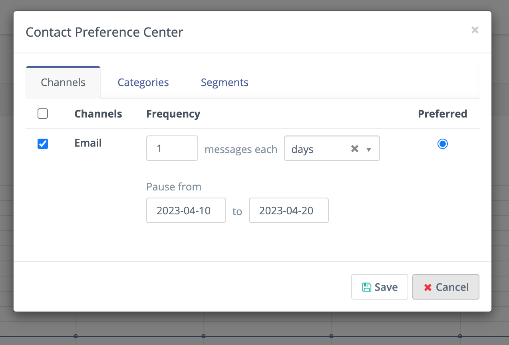

|

在此窗口中，您可以切换沟通渠道、设置每个已启用渠道的沟通频率，并将其中一个渠道设为首选渠道。

要阻止通过某个渠道进行沟通，请取消选中第一列中该渠道名称旁的选择框。这将仅为该渠道设置"禁止联系"条目。

选择渠道时，Mautic 会使用该渠道发送营销消息（前提是为所选任一渠道设置了消息）。您还可以设置沟通频率，例如本示例中将频率设为"每天发送两次电子邮件"，但在 2022 年 11 月 1 日至 2022 年 11 月 30 日期间暂停发送。电子邮件也被设为首选渠道，因此如果营销消息对电子邮件和短信都有相同的内容，则仅向所选联系人发送电子邮件版本。

.. vale off

联系人类别
==========

.. vale on

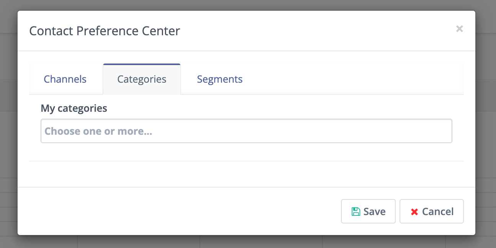

|

使用"类别"选项卡将联系人添加至或移出全局类别。Mautic 在电子邮件、短信和营销活动等区域中使用全局类别。结合"已订阅类别"分组筛选条件，联系人可以选择退出分类沟通。

.. vale off

联系人分组
==========

.. vale on

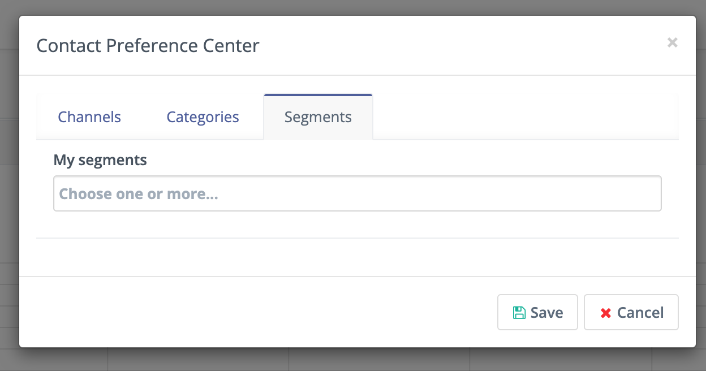

|

使用"分组"选项卡将联系人添加至或移出分组。分组既是启动营销活动的来源，也是发送电子邮件的来源。处于特定分组中的任何联系人都会自动成为以该分组为来源的营销活动的一部分。您还可以使用独立电子邮件手动向分组发送邮件。如果用户已选择退出某个分组，他们将不再收到针对该分组的营销活动操作或消息。

.. vale off

联系人的电子邮件退订偏好
=============================

.. vale on

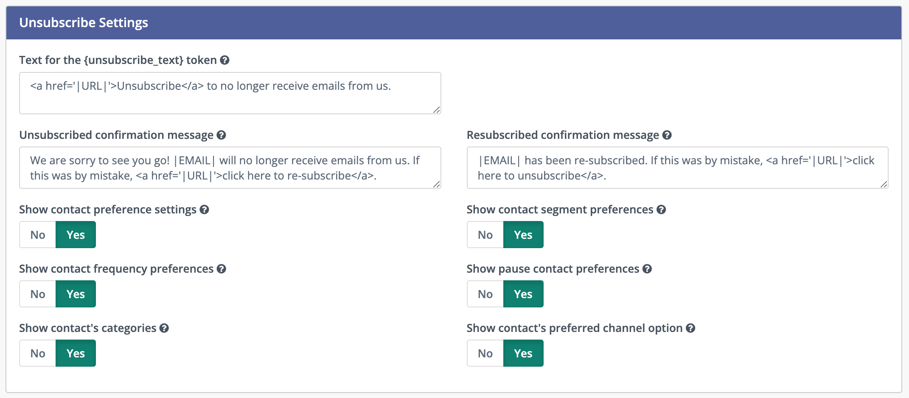

|

您可以通过调整 Mautic 中的电子邮件配置设置，自定义退订页面以显示联系人的偏好。这样，联系人在退订时可以管理其偏好，而不是直接退订。请按以下步骤操作：

1. 在左侧边栏中，点击齿轮图标以进入 **配置** 菜单。

2. 导航至 **电子邮件设置** 选项卡。

3. 找到"显示联系人偏好设置"选项并勾选该框以启用。这将在退订页面上显示联系人偏好，允许联系人管理其订阅设置。

4. 此外，您还可以通过调整相应设置，选择隐藏或显示用户偏好中的不同分组。

请注意，如果您在全局设置中关闭了任何这些选项，它们将不会出现在联系人的个人偏好页面上。当偏好设置选项关闭时，Mautic 会显示默认的退订消息，并且联系人将直接退订，无法管理其偏好。

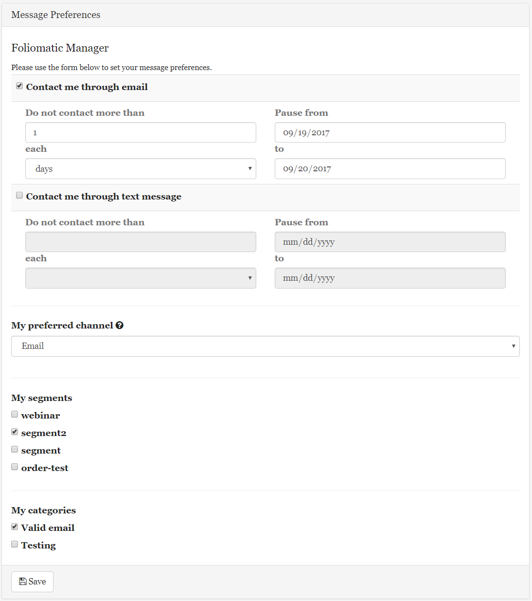

|

自定义偏好中心
***************

您可以使用着陆页构建器自定义个人偏好中心/退订页面、编辑文本标签、格式以及应用主题。

.. vale off

创建偏好中心着陆页
=================================

.. vale on

创建/编辑着陆页时，有一个标记为 *是否为偏好中心* 的切换开关。如果选中，Mautic 会将该页面标记为偏好中心着陆页，并提供相应的令牌。

当在 Mautic 电子邮件中配置为偏好中心时，Mautic 会自动将收件人引导至该偏好中心（当他们点击 ``{unsubscribe_url}`` 链接时）。它还会在构建器中显示或隐藏偏好中心插槽。

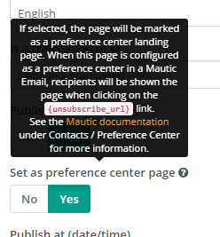

|

偏好令牌
**********

您可以使用 :ref:`偏好中心着陆页令牌` 来插入不同的插槽。这些令牌在 GrapesJS 构建器的编辑器中可用。

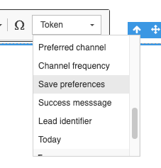

|

请参阅 :ref:`变量<preference center landing page tokens>` 文档，获取可用于偏好中心的完整令牌列表。

此外，如果您希望保存偏好，请添加一个 **保存偏好** 按钮，否则联系人将无法保存其偏好：

保存更改后，偏好中心着陆页即准备就绪。

.. vale off

访问偏好中心页面
*******************

.. vale on

现在，在着陆页列表中，带有齿轮图标的图标表示该页面是偏好中心。

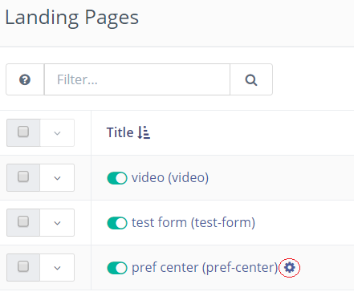

|

查看偏好中心页面时，会有一个标题说明其用途，并且页面 URL 不可用，仅提供预览 URL。

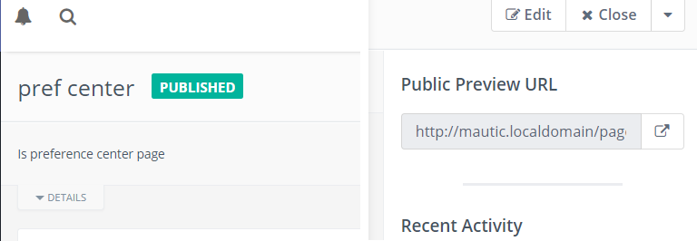

|

.. vale off

在电子邮件中设置偏好中心页面
*******************************

.. vale on

创建或编辑电子邮件时，您可以从列表中选择偏好中心页面，如下所示：

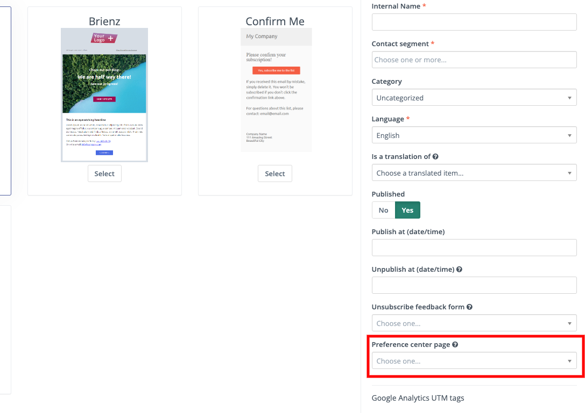

|

请注意，您的邮件必须使用与偏好中心着陆页相同的语言 - 否则，Mautic 会显示默认偏好中心。

现在，发送电子邮件时，所有收件人都可以点击 ``{unsubscribe_text}`` 和 ``{unsubscribe_url}`` 变量中提供的退订链接，从而跳转到新的偏好中心。

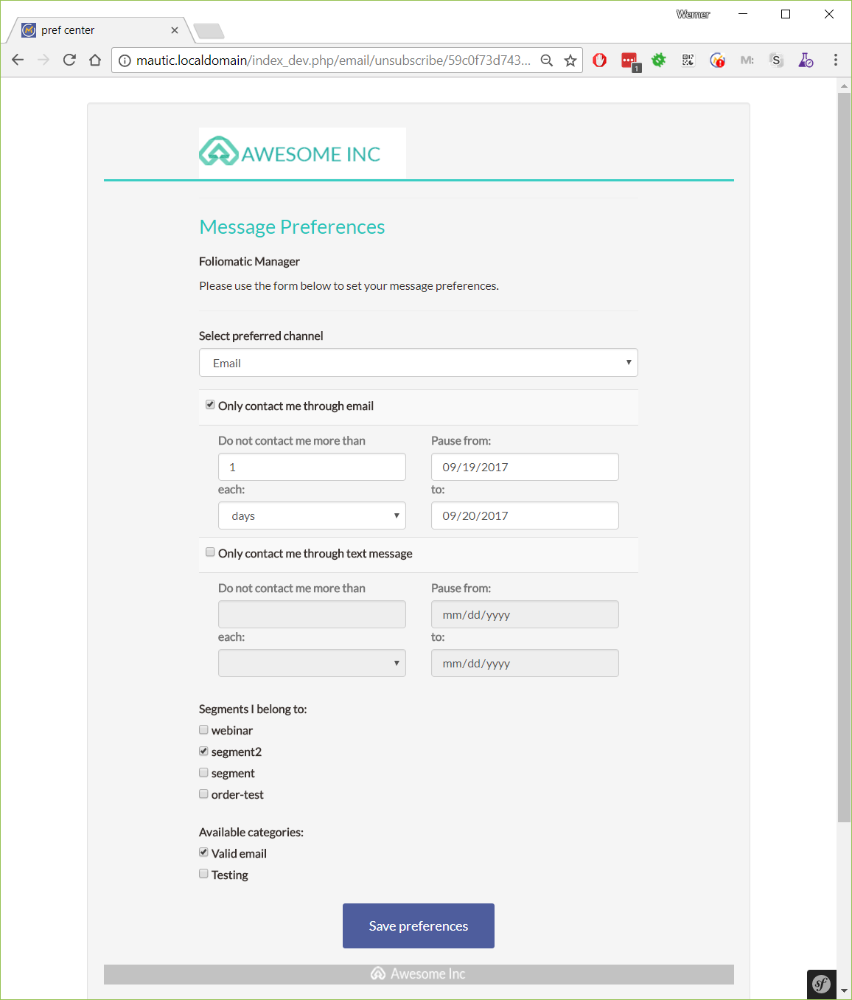

|

如果您未在电子邮件中选择偏好中心，Mautic 会使用以默认主题样式显示的默认偏好中心。

