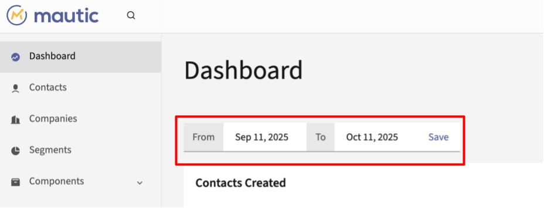

仪表盘
#########

Mautic 1.4.0 引入了可自定义的仪表盘，每个用户都可以在其中组合包含想要跟踪的信息的小组件。Mautic 2.0 为仪表盘带来了许多增强功能。

日期范围筛选器
*****************

所有小组件都显示在组件列表顶部选定的全局日期范围筛选器中的数据。Mautic 将默认日期范围设置为 30 天前到今天。

折线图会根据日期范围筛选器中选择的天数自动更改时间单位，如下所示：

**日期范围等于 1 天：** 数据以小时显示
**日期范围在 1 到 31 天之间：** 数据以天显示
**日期范围在 32 到 100 天之间：** 数据以周显示
**日期范围在 101 到 1000 天之间：** 数据以月显示
**日期范围大于 1001 天：** 数据以年显示

唯一例外的组件是 *即将发送的邮件* 和 *最近活动*，它们显示的信息不受日期范围影响。

小组件
*******

.. warning::

  不要创建太多小组件。这会减慢仪表盘落地页的加载速度。如果遇到性能问题，请减少组件数量。

您可以通过点击"添加组件"按钮向仪表盘添加新的组件。每个组件后出现的"添加组件"表单允许您定义：

- **名称：** 描述组件显示的内容。如果未填写，Mautic 将使用您选择的组件类型名称来命名。

- **类型：** 从预定义的组件类型中选择要显示的信息。

- **宽度：** 选择组件的宽度。选项为 25%、50%、75%、100%。默认选项为 100%。折线图的最佳宽度为 100%，表格为 50%，饼图为 25%。

- **高度：** 每个组件可以有不同的高度。预定义了 5 种高度。如果为同一行中的每个组件选择一致的高度，仪表盘看起来最佳。

某些组件有额外的选项：

**随时间创建的联系人**

- 显示所有联系人：显示一条包含所有已创建联系人的折线。

- 仅已识别：仅显示已创建且已识别联系人的一条折线。

- 仅匿名：仅显示匿名访客的一条折线。

- 全部已识别 vs 匿名：显示 2 条折线，分别表示匿名访客和已知联系人。

- 热门分组：显示最多 6 条折线，表示添加到前 6 个分组的联系人数量。如果在选定的日期范围内没有此类分组，图表将不会显示。

- 热门分组（已识别 vs 匿名）：显示最多 6 条折线，表示选定日期范围内前 3 个分组。每个分组显示 2 条折线，分别表示匿名访客和已知联系人。

**随时间发送的邮件**

- 仅已发送邮件 - 显示 1 条折线表示已发送的邮件。

- 仅已打开邮件 - 显示 1 条折线表示已打开的邮件。

- 仅失败邮件 - 显示 1 条折线表示失败的邮件。

- 已发送和已打开邮件 - 显示 2 条折线表示已发送和已打开的邮件。

- 已发送、已打开和失败邮件 - 显示 3 条折线表示已发送、已打开和失败的邮件。

**随时间访问的落地页**

- 总访问量 - 显示 1 条折线表示所有访问量（落地页点击）。

- 独立访问量 - 显示 1 条折线表示独立访问量（联系人）。

- 总访问量和独立访问量 - 显示 2 条折线表示独立访问量和所有访问量。

组件排序
***************

您可以通过拖放界面在仪表盘上移动每个组件。点击并按住组件名称，将其移动到另一个位置。

仪表盘导出
****************

每个仪表盘配置完成后，可以导出为单个文件并与他人共享。您可以进行备份、发送给同事或在线共享。它只导出组件配置 —— 其拉取的数据不包含在导出文件中。

仪表盘导入
****************

如果您导出了仪表盘，则可以在仪表盘导入页面上上传并再次导入它。

Mautic 安装预装了 3 个预定义的仪表盘。当您的仪表盘不包含任何组件时，Mautic 会自动导入名为 default.json 的那个。其他 2 个预定义仪表盘提供了替代布局的示例。您可以导出和导入任何其他仪表盘，并在它们之间切换。

预定义仪表盘可以：

**预览** - 这将显示仪表盘组件以供预览。仪表盘使用您现有的 Mautic 数据加载，但不会保存或更改任何内容。

**应用** - 这将仪表盘设置为您的主仪表盘。

.. warning::

  这将删除您当前的组件。如果以后想恢复，请导出当前仪表盘。

**删除** - 这将删除预定义的仪表盘。

组件缓存
************

``WidgetDetailEvent`` 会在配置中定义的时间段内自动缓存组件详细数据。默认缓存过期时间为 10 分钟。

仪表盘权限
*********************

如果 Mautic 用户对某个捆绑包没有"查看他人"或"查看自己"的权限，他们将无法为该捆绑包创建组件。但是，该组件仍然可以在他们的仪表盘上可见。

例如，如果用户创建了组件，然后管理员移除了该捆绑包的权限，或者如果用户导入的仪表盘包含其无权访问的捆绑包的组件。

在这些情况下，Mautic 会在仪表盘上显示该组件，但会附带一条消息，提示用户没有权限查看数据。

如果 Mautic 用户只有权限查看捆绑包中自己的数据，则他们在仪表盘组件中只能看到自己的数据。例如，只有他们拥有的联系人、他们创建的落地页的访问量等等。

