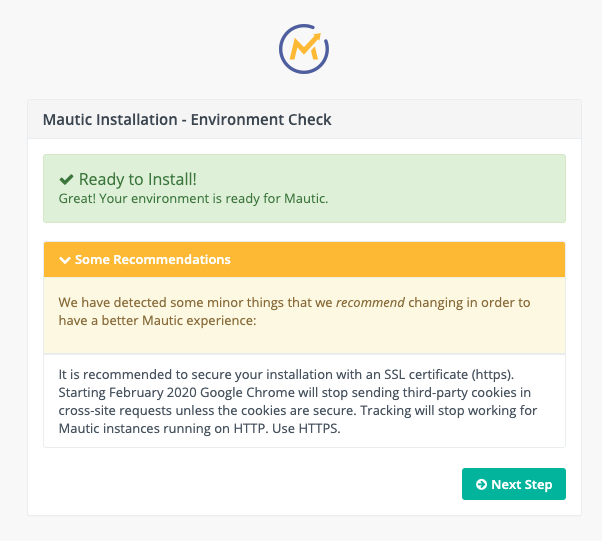
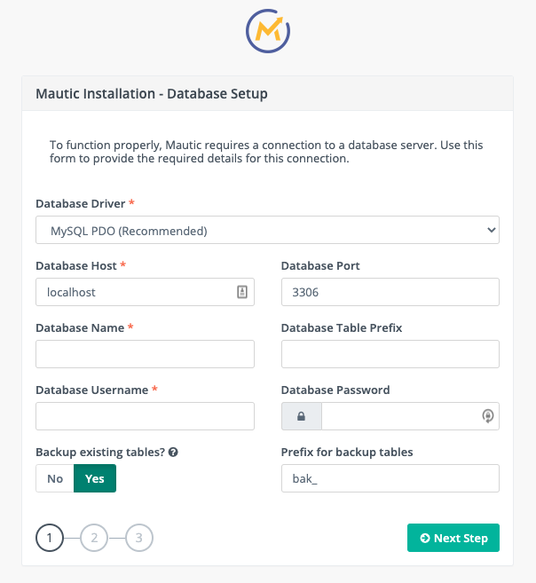
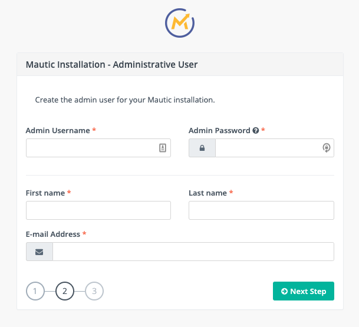
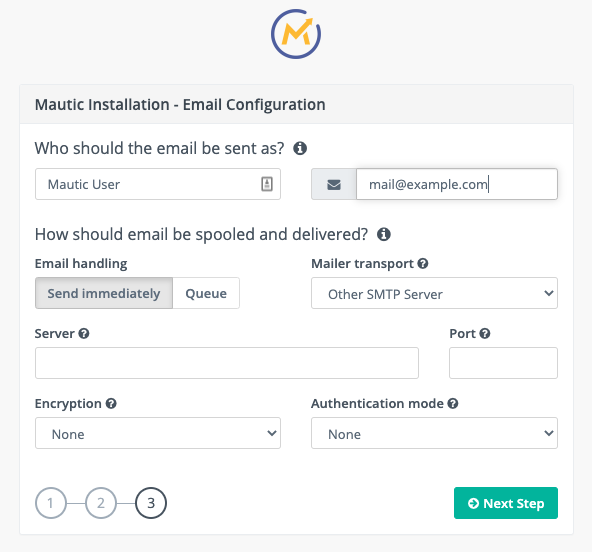

安装
############

Mautic 有多种安装方式，您应根据自身情况和技术水平选择最合适的方法。

- 使用 :ref:`生产包<使用生产包>` 安装，可通过 :ref:`网页安装程序<使用网页安装程序>` 或 :ref:`命令行<通过命令行安装>` 进行。

- 通过 :ref:`从 GitHub 克隆<从 GitHub 安装>` 进行本地安装——适用于测试和本地开发。

- :ref:`使用 Composer 安装`

使用生产包
****************************

您可以通过将压缩的安装包上传到服务器位置，或者使用命令行安装来安装 Mautic 生产包。Mautic 生产包还需要访问数据库服务器。

Mautic 安装是一个三步过程：

1. 将数据库服务器与 Mautic 服务器集成。
   
2. 创建一个管理员帐户以访问 Mautic 服务器。
   
3. 设置用于邮件营销自动化的邮件服务器。

安装前准备
==========================

在安装包之前，请确保：

* 您的服务器环境满足所安装版本的最低要求。更多信息请参见 :xref:`Mautic's Requirements`。
  
* 您的服务器目录对 Mautic 网络服务器是可写的。
  
* 您的数据库满足受支持数据库的最低要求，并且拥有有效的用户权限以访问数据库。更多信息请参见 :xref:`Mautic's Requirements`。
  
* 您的服务器有足够的可用磁盘空间来运行安装。同时也要考虑数据库的大小。
  
* PHP 的 ``max_execution_time`` 至少为 240 秒。

下载生产包
~~~~~~~~~~~~~~~~~~~~~~~~~~~~~~~~

首先，:xref:`Download Mautic` 以获取最新稳定版本的 zip 文件。

有关可用 Mautic 包的更多信息，请访问 :xref:`Mautic Releases` 登陆页面。

上传生产包
~~~~~~~~~~~~~~~~~~~~~~~~~~~~~~~~

下载所需的包后，将包 zip 文件上传到您的网络服务器，并在您计划托管 Mautic 实例的目录中解压缩。

您的网络服务器必须具有访问解压缩文件的权限。

使用网页安装程序
=============================

要从浏览器访问 Mautic 服务器，请在 Web 浏览器中输入与 Mautic 实例对应的 URL（例如 `https://m.example.com`）。建议使用 SSL 证书 (https) 保护您的安装。

执行环境检查
~~~~~~~~~~~~~~~~~~~~~~~~~~~~~

将包加载到服务器后，Mautic 安装程序会验证是否能够在您的服务器环境中成功运行。

您必须解决以红色显示的安装错误，才能成功完成 Mautic 包安装。以橙色显示的警告通常是建议，以获取更好的 Mautic 体验。

如果环境检查成功——以绿色显示——点击 **下一步** 开始安装过程。

集成数据库
~~~~~~~~~~~~~~~~~~~~~~~~

Mautic 假设数据库与 Mautic 位于同一台服务器上。

要在 **Mautic 安装 - 数据库设置** 窗口中设置数据库服务器：

* 选择 **数据库驱动**。
  
* 输入 **数据库主机**。
  
* 输入 **数据库名称**。
  
* 输入 **数据库用户名**。
  
* 如果需要，您还可以输入 **数据库端口**、**数据库表前缀**、**数据库密码** 和 **备份表前缀** 的值。
  
* **是否备份现有表？** 默认开启，但对于全新安装，应将其关闭。

点击 **下一步**。

创建管理员帐户
~~~~~~~~~~~~~~~~~~~~~~~~~~~~~~~~

要为您的 Mautic 实例创建一个管理员帐户，请在 **Mautic 安装 - 管理员用户** 窗口中为不同字段输入值。

点击 **下一步**。

.. vale off

配置邮件设置
~~~~~~~~~~~~~~~~~~~~~~~~~~

.. vale on

要为您的 Mautic 实例配置邮件设置，请在 **Mautic 安装 - 邮件配置** 窗口中输入您的邮件提供商详细信息。您可以使用 :xref:`Mailhog` 等工具来配置本地实例进行测试。

要配置您的邮件发件人设置：

* 输入默认用于所有外发邮件通信的名称和电子邮件地址。验证提供的电子邮件地址已成功获得您的邮件提供商授权。
  
* **队列** 邮件并通过 cron 作业发送——以触发队列处理——而不是立即发送，适用于处理大量邮件的情况。
  
* 选择 **邮件传输方式**。如果您的提供商未列出，请选择 **其他 SMTP 服务器** 并提供 SMTP 凭证。基于 API 的发送速度明显快于 SMTP。根据您选择的提供商，会出现其他字段，允许您输入 API 密钥和选择区域。
  
* 为您的邮件提供商输入 **服务器** 和 **端口**。
  
* 为您的邮件提供商选择 **加密** 和 **身份验证模式**。

点击 **下一步** 登录 Mautic 服务器。

登录 Mautic
~~~~~~~~~~~~~~~~~~~

在 Mautic 登录窗口，输入您的 Mautic 管理员凭证以登录您的 Mautic 实例。

点击 **登录** 以继续在您的 Mautic 实例上工作。

通过命令行安装
============================

您也可以使用命令行安装 Mautic。您可以在命令中传递设置参数，或者创建一个包含数据库设置的本地 PHP 文件。您还可以使用命令行选项期望的语法在此文件中定义属性。请注意，Mautic 从 5.1 版本开始要求使用复杂密码。

使用命令 ``path/to/php bin/console mautic:install --help`` 查看可用选项和标志列表。

.. code-block:: php

     --db_driver=DB_DRIVER                    数据库驱动。 [默认值: "pdo_mysql"]
      --db_host=DB_HOST                        数据库主机。
      --db_port=DB_PORT                        数据库端口。
      --db_name=DB_NAME                        数据库名称。
      --db_user=DB_USER                        数据库用户。
      --db_password=DB_PASSWORD                数据库密码。
      --db_table_prefix=DB_TABLE_PREFIX        数据库表前缀。
      --db_backup_tables=DB_BACKUP_TABLES      如果表存在则备份数据库表；否则删除它们。 [默认值: true]
      --db_backup_prefix=DB_BACKUP_PREFIX      数据库备份表前缀。 [默认值: "bak_"]
      --admin_firstname=ADMIN_FIRSTNAME        管理员名字。
      --admin_lastname=ADMIN_LASTNAME          管理员姓氏。
      --admin_username=ADMIN_USERNAME          管理员用户名。
      --admin_email=ADMIN_EMAIL                管理员邮箱。
      --admin_password=ADMIN_PASSWORD          管理员密码。
      --mailer_from_name[=MAILER_FROM_NAME]    从 Mautic 发送邮件时的发件人名称。
      --mailer_from_email[=MAILER_FROM_EMAIL]  从 Mautic 发送邮件时的发件人邮箱。
      --mailer_transport[=MAILER_TRANSPORT]    邮件传输方式。
      --mailer_host=MAILER_HOST                SMTP 主机。
      --mailer_port=MAILER_PORT                SMTP 端口。
      --mailer_user=MAILER_USER                SMTP 用户名。
      --mailer_password[=MAILER_PASSWORD]      SMTP 密码。
      --mailer_encryption[=MAILER_ENCRYPTION]  SMTP 加密 (null|tls|ssl)。
      --mailer_auth_mode[=MAILER_AUTH_MODE]    SMTP 认证模式 (null|plain|login|cram-md5)。
      --mailer_spool_type=MAILER_SPOOL_TYPE    队列模式 (file|memory)。
      --mailer_spool_path=MAILER_SPOOL_PATH    队列路径。

在 ``local.php`` 文件中使用以下语法：

.. code-block:: php

  <?php
  // 示例 local.php 用于测试安装（当然需要调整）
  $parameters = array(
    // 不要设置 db_driver 和 mailer_from_name，因为它们用于假定 Mautic 已安装
    'db_host' => 'localhost',
    'db_table_prefix' => null,
    'db_port' => 3306,
    'db_name' => 'mautic',
    'db_user' => 'mautic',
    'db_password' => 'mautic',
    'db_backup_tables' => false,
    'db_backup_prefix' => 'bak_',
    'admin_email' => 'admin@example.com',
    'admin_password' => 'Maut1cR0cks!',
    'mailer_transport' => null,
    'mailer_host' => null,
    'mailer_port' => null,
    'mailer_user' => null,
    'mailer_password' => null,
    'mailer_api_key' => null,
    'mailer_encryption' => null,
    'mailer_auth_mode' => null,
  );

使用本地 PHP 文件安装
~~~~~~~~~~~~~~~~~~~~~~~~~~~~~~~~ 

运行以下命令，并替换 PHP 二进制文件和 Mautic 实例 URL 的路径。

``path/to/php bin/console mautic:install https://m.example.com``

如果需要，您还可以在安装命令中添加参数：

.. code-block:: php

  path/to/php bin/console mautic:install https://m.example.com
  --mailer_from_name="示例发件人名称" --mailer_from_email="mautic@localhost"
  --mailer_transport="smtp" --mailer_host="localhost" --mailer_port="1025"
  --db_driver="pdo_mysql" --db_host="db" --db_port="3306" --db_name="db" --db_user="db" --db_password="db" 
  --db_backup_tables="false" --admin_email="admin@mautic.local" --admin_password="Maut1cR0cks!"

当安装过程开始时，它会标记警告，并在出现任何严重错误时中止。

.. code-block:: shell

  Mautic 安装
  ==============

  解析选项和参数...
  0 - 检查安装要求...
  缺少可选设置：
    - [0] 您的 PHP 配置中的 <strong>memory_limit</strong> 设置低于建议的最小限制 %min_memory_limit%。处理大数据集时，内存不足可能导致 Mautic 出现性能问题。
  准备安装！
  1 - 创建数据库...
  1.1 - 创建模式...
  1.2 - 加载数据...
  2 - 创建管理员用户...
  3 - 邮件配置和最终步骤...

  ================
  安装完成
  ================

您现在可以使用 Mautic 管理员凭证登录您的 Mautic 实例。

从 GitHub 安装
**********************

在测试 Mautic 或为其贡献代码时，有必要从 GitHub 仓库获取所有本地文件——包括自动化测试。这些文件中的许多并未包含在生产构建过程中。

从 GitHub 克隆 Mautic
==========================

1. 安装 :xref:`GitHub CLI` 工具。

2. 点击 Mautic GitHub 仓库右上角的 **Fork** 以创建个人分支。如果您已有分支，也可以直接点击进入；如果没有，GitHub 会提供创建选项。

3. 分支创建完成后，点击绿色的 **Code** 按钮获取用于克隆仓库的命令。

4. 切换到终端，在希望安装 Mautic 的目录中，使用 :xref:`GitHub CLI` 工具粘贴命令，格式如下：

.. code-block:: shell
  
  gh repo clone 用户名/mautic

.. note:: 

  请始终选择将分支创建到 **个人账户** 而不是组织中。后者会阻止 Mautic 维护者处理您的 Pull Request。

使用 DDEV 安装 Mautic
==========================

您可以使用 :xref:`DDEV`，Mautic 推荐将其用于测试和开发。开始步骤：

#.  安装 :xref:`DDEV`。

#.  安装并确保系统上已运行 :xref:`Docker`。

#.  现在可以切换到 Mautic 目录并使用以下命令启动 DDEV 快速启动：
   
.. code-block:: shell
  
    ddev start

.. note:: 

  故障排除请参阅 :xref:`DDEV Troubleshooting`。

  有关更详细的说明，请参阅 Mautic 的 :xref:`Handbook`。

.. vale off

这将启动一个 DDEV 实例（包含 Mailhog、PHPMyAdmin 和 Redis Commander）——默认地址为 ``https://mautic.ddev.site``——并提供设置 Mautic 以供使用的选项。
.. vale on

该过程会运行 Composer 安装流程，并通过命令行安装 Mautic，默认用户名为 ``admin``，密码为 ``Maut1cR0cks!``（注意：在 Mautic 5.1 之前，密码仅为 `mautic`。

使用 Composer 安装
************************

自 :xref:`Mautic 4` 起，可以充分利用 Composer 的功能来安装和管理 Mautic。Mautic 使用最新版本的 :xref:`Composer`。

Mautic 正在将插件和主题与核心解耦，但目前虽然它们已从技术层面镜像到单独的仓库，源文件仍保留在主要的 :xref:`Mautic GitHub repository` 中。

当您从 GitHub 克隆后，运行 ``composer install`` 将安装所有依赖项。在安装和管理 Mautic 时，还可以利用一些其他便捷功能。

.. vale off

使用推荐项目
=============================

.. vale on

Mautic :xref:`Recommended Project` 是一个模板，提供了一个入门套件，用于使用 Composer 管理 Mautic 依赖项。

.. note::
  以下说明指的是全局 Composer 安装。您可能需要根据您的设置将 Composer 替换为 ``php composer.phar`` 或类似命令。

使用推荐项目的基本命令如下：

.. code-block:: shell

  composer create-project mautic/recommended-project:^5 some-dir --no-interaction

使用 Composer，您可以添加新的依赖项与 Mautic 一起安装：

.. code-block:: shell

  cd your-directory
  composer require mautic/mautic/helloworld-bundle

.. note::

  由于这种安装方式会将核心应用文件移动到一个名为 ``docroot`` 的文件夹中，Mautic 将从该文件夹运行，因此您应确保配置网络服务器从此目录提供文件。这可能意味着更新您的虚拟主机和/或 NGINX 配置，将根目录设置为 ``<您的目录>/docroot``。如果不这样做，尝试访问 Mautic 实例时很可能会看到错误。

Composer 的 ``create-project`` 命令会将所有文件的所有权传递给创建的项目。您应创建一个新的 git 仓库，并提交所有未被 .gitignore 文件排除的文件。

.. vale off

推荐项目模板具体做了什么？
~~~~~~~~~~~~~~~~~~~~~~~~~~~~~~~~~~~~~~~

.. vale on

安装给定的 ``composer.json`` 时，会发生以下情况：

- 将 Mautic 安装到 ``docroot`` 目录中。请参阅前面关于更新托管配置的说明。
- 自动加载器使用在 ``vendor/autoload.php`` 中生成的 Composer 自动加载器，而不是 Mautic 在 ``docroot/vendor/autoload.php`` 中提供的自动加载器。
- 插件——类型为 ``mautic-plugin`` 的包——位于 ``docroot/plugins/``。
- 主题——类型为 ``mautic-theme`` 的包——位于 ``docroot/themes/``。
- 创建 ``docroot/media`` 目录。
- 基于您的 ``.env`` 文件创建环境变量。请参阅 ``.env.example``。

.. vale off

Composer 常见问题
=============

.. vale on 

是否应该提交下载的第三方插件？
~~~~~~~~~~~~~~~~~~~~~~~~~~~~~~~~~

Composer 建议 :xref:`Composer commit dependencies`。他们提供了反对的理由，但如果项目决定这样做，也提供了变通方法。

是否应该提交脚手架文件？
~~~~~~~~~~~~~~~~~~~~~~~~~~~~~~~~~~~~~~~~

:xref:`Mautic Composer scaffold` 插件可以将脚手架文件（例如 ``index.php``、``.htaccess``）下载到项目的 ``docroot/`` 目录中。

如果您没有自定义这些文件，可以选择不将它们提交到版本控制系统（例如 git）中。如果您的项目属于这种情况，那么在每次安装或更新项目后自动运行 Mautic Scaffold 插件可能会很方便。

.. vale off

可以通过在 composer.json 中注册 ``@composer mautic:scaffold`` 作为安装后和更新后命令来实现：

.. vale on

.. code-block:: json

  "scripts": {
      "post-install-cmd": [
          "@composer mautic:scaffold",
          "..."
      ],
      "post-update-cmd": [
          "@composer mautic:scaffold",
          "..."
      ]
  },

如何对下载的插件应用补丁？
~~~~~~~~~~~~~~~~~~~~~~~~~~~~~~~~~

如果您需要应用补丁——取决于插件，提交 Pull Request 通常是更好的解决方案——您可以使用 ``composer-patches`` 插件。

要为 Mautic 插件 foobar 添加补丁，请在 ``composer.json`` 的 extra 部分插入 patches 部分：

.. code-block:: json

  "extra": {
      "patches": {
          "mautic/foobar": {
              "补丁描述": "补丁的 URL 或本地路径"
          }
      }
  }

.. vale off

如何指定 PHP 版本？
~~~~~~~~~~~~~~~~~~~~~~~~~~~~~~~~~~

.. vale on

此项目目前最低支持 PHP 7.4——请查阅 :xref:`Mautic's Requirements`——然而，Composer 更新可能会升级某些包，从而可能需要 PHP 7+ 或 8+。

为了防止这种情况，您可以在 ``composer.json`` 的 config 部分添加以下代码来指定要使用的 PHP 版本：

.. code-block:: json

  "config": {
      "sort-packages": true,
      "platform": {
          "