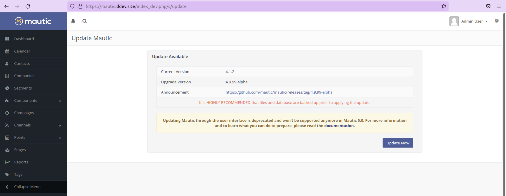

.. vale off

如何更新 Mautic
####################

.. vale on

更新 Mautic 有两种方式：

1. 使用命令行（推荐）
2. 通过用户界面

.. note::
    如果使用 Composer 安装 Mautic，或已切换至基于 Composer 的安装方式，请直接跳转至下方 :ref:`更新 Mautic（基于 Composer 安装）` 章节。

若实例处于生产环境、拥有大量联系人或部署在共享主机上，**强烈**建议通过命令行进行更新。

.. warning::
    通过用户界面更新需要大量资源，若服务器限制资源分配，极易出错。失败的更新或数据损坏皆可能由此引发。此功能计划在 Mautic 5.0 中移除，届时仅支持命令行更新。

通过命令行更新（非基于 Composer 安装）
***************************************************************

开始更新 Mautic 前，**请确保已对 Mautic 实例进行可恢复的备份**。

这意味着已下载 Mautic 实例的文件与数据库，并在测试环境中重建后验证一切正常。这是应对更新问题的唯一补救措施。切勿在无有效且最新备份的情况下进行更新。

通过命令行检查更新
========================================

从 Mautic 6 起，安装、更新和管理 Mautic 的默认方式变更为 Composer。

自 Mautic 4.2 弃用用户界面内的更新功能后，在此功能移除前，新版本发布时仍会收到通知，但建议通过命令行更新。

.. warning::
    开始升级前，强烈建议备份实例。若有可用更新，将显示更新通知，随后命令行界面会提供分步指导以完成流程。

.. vale off

以具有 sudo 权限的普通用户身份登录命令行。避免以 root 用户运行命令，防止文件权限问题。

.. vale on

切换到 Mautic 目录：

.. code-block:: shell

    cd /your/mautic/directory

例如，若将 Mautic 安装在 ``/var/www/html/mautic/``，则使用该路径。

通过命令行安装更新
======================================

若有可用更新，请按以下步骤应用：

#. 查找可用更新：

   .. code-block:: bash

      php bin/console mautic:update:find

   输出将显示是否有待应用更新。通知包含发布内容的公告链接及推荐环境要求（如更高 PHP 版本或必需插件更新）。

   .. note::
    
     查看公告链接了解发布详情。其中可能包含更新前需执行的重要信息或步骤。

#. 确认系统就绪后，应用更新：

   .. code-block:: shell

       php bin/console mautic:update:apply

#. 系统提示需附加参数重新执行命令以完成流程：

   .. code-block:: shell

      php bin/console mautic:update:apply --finish

.. vale off

以 Web 服务器用户身份运行更新命令
----------------------------------------------

.. vale on

.. vale off

在 Linux 上使用 Apache 时，请以 Web 服务器用户（通常为 ``www-data``）运行以下命令，确保文件所有权和权限正确：

.. vale on

#. 查找更新：

   .. code-block:: shell

      sudo -u www-data php bin/console mautic:update:find

#. 应用更新：

   .. code-block:: shell

      sudo -u www-data php bin/console mautic:update:apply

#. 完成更新：

   .. code-block:: shell

      sudo -u www-data php bin/console mautic:update:apply --finish

#. 清除缓存：

   .. code-block:: shell

      sudo -u www-data php /var/www/html/mautic/bin/console cache:clear

修复文件权限问题
-----------------------------

设置所有者为 Apache
~~~~~~~~~~~~~~~~~~~~~~~

.. vale off

此命令将 Mautic 目录的所有者设置为 Apache 服务器用户：

.. vale on

.. code-block:: shell

    sudo chown -R www-data:www-data /var/www/html/mautic

设置文件权限
~~~~~~~~~~~~~~~~~~~~

将 Mautic 文件夹内所有文件的权限设置为 644，确保其可读但不可执行：

.. code-block:: shell

    sudo find /var/www/html/mautic -type f -exec chmod 644 {} +

设置目录权限
~~~~~~~~~~~~~~~~~~~~~~~~~

将 Mautic 文件夹内所有目录的权限设置为 755，允许服务器打开和列出文件夹内容：

.. code-block:: shell

    sudo find /var/www/html/mautic -type d -exec chmod 755 {} +

为特定目录设置写入权限
~~~~~~~~~~~~~~~~~~~~~~~~~~~~~~~

为特定目录设置 Apache 写入权限，允许系统任务运行：

.. code-block:: shell

    sudo chmod -R g+w /var/www/html/mautic/var/cache \
        /var/www/html/mautic/var/logs \
        /var/www/html/mautic/app/config \
        /var/www/html/mautic/media/files \
        /var/www/html/mautic/media/images \
        /var/www/html/mautic/translations

更新 Mautic（基于 Composer 安装）
*****************************************

推荐项目会尝试保持所有 Mautic 核心文件的最新状态。

项目 ``mautic/core-composer-scaffold`` 会在 ``mautic/core-lib`` 更新时同步更新脚手架文件。

若自定义了任何“脚手架”文件（通常为 ``.htaccess``），当 Mautic 新版本导致文件变更时，可能需要解决冲突。

按以下步骤更新核心文件：

1. 备份 ``composer.lock`` 和 ``composer.json`` 文件。若 ``composer update`` 命令执行异常，可恢复这两个文件并运行 ``composer install`` 回滚代码库至更新前状态。

2. 编辑 ``composer.json`` 文件，将所有 Mautic 包的版本号修改为目标版本。

    * 若当前运行 ``5.0.4`` 并希望更新至 ``5.1.0``，将所有以 ``mautic/`` 开头且当前版本为 ``5.0.4`` 的包替换为 ``5.1.0``。
    * 可能还需升级通过 :ref:`Mautic Marketplace` 手动添加或额外添加的其他包版本。
    * 若未添加额外包，也可从 `仓库 <https://github.com/mautic/recommended-project>`_ 下载匹配目标版本的新 ``composer.json`` 文件直接替换。

3. 运行 ``composer update --with-dependencies`` 更新所有包。

4. 运行 ``git diff`` 检查脚手架文件是否有变更。审查文件变更并恢复对 ``.htaccess`` 等文件的自定义内容。

5. 将所有变更合并为一次提交，确保切换分支或运行 ``git bisect`` 时 ``docroot`` 与核心保持同步。

6. 若第二步出现复杂冲突，建议在分支上执行操作，并通过 ``git merge`` 将更新后的核心文件与自定义文件合并。可借助 :xref:`kdiff3` 等三方合并工具。若自定义内容简单（如将所有修改集中在文件开头或结尾），则无需此设置即可轻松合并。

7. 运行以下命令，应用发布版本中的数据库变更：

.. code-block:: shell

    bin/console cache:clear
    bin/console mautic:update:apply --finish
    bin/console doctrine:migration:migrate --no-interaction
    bin/console cache:clear

在浏览器中更新
***********************

更新 Mautic 时，部分任务耗时较长，具体取决于实例规模。

.. warning::
    
    若拥有大量联系人或使用共享主机，在旧版 Mautic 中点击通知“铃铛”图标更新时可能遇到问题。

在浏览器中更新通常会出现更新中途挂起或崩溃报错的问题，多源于资源限制（尤其在共享主机环境中）。

因此，**始终建议**尽可能 :ref:`通过命令行更新<通过命令行安装更新>`。自 Mautic 5.0 起彻底移除了浏览器更新功能，必须使用命令行更新。

开始更新前，**请确保已对 Mautic 实例进行可恢复的备份**。

这意味着已下载 Mautic 实例的文件与数据库，并在测试环境中重建后验证一切正常。这是应对更新问题的唯一补救措施。切勿在无有效且最新备份的情况下进行更新。

在浏览器中检查更新
===================================

当 Mautic 发布新版本时，实例中会出现通知。

通知链接至发布公告，其中说明发布内容。

.. note::
    建议阅读公告链接了解发布详情。其中可能包含更新前需执行的重要信息或步骤。

仔细阅研发布说明并测试备份实例后，可点击通知完成更新。

更新需一定时间完成，每个步骤会在浏览器中实时更新进度。请耐心等待直至完成。更新成功后，系统会显示确认消息。

更新未成功
~~~~~~~~~~~~~~~~~~~~~~~~~~~~

若遇到此问题，请前往“故障排除”章节，按分步指南完成更新。下次可考虑使用命令行。

稳定性等级
****************

默认情况下，Mautic 仅接收稳定版本的用户界面和命令行通知。

若希望在开发环境中协助测试早期发布版本，请执行以下操作：

- 编辑配置，将稳定性等级设置为 Alpha、Beta 或 Release Candidate。这将允许接收早期发布版本的通知。
- 更新至早期发布版本前务必阅读发布说明。
- 切勿在生产实例中启用早期发布版本。

更新 Mautic 需帮助时的应对方法
*******************************************

如需帮助，可通过多种渠道寻求。请注意，社区论坛、Slack 和 GitHub 的大多数成员均为志愿者。

- :xref:`Mautic Community Forums`：若认为配置是问题根源，可在此提问。请先搜索，确认问题未被解答后再发帖。

- :xref:`Mautic Community Slack`：也可使用，但所有支持请求必须先在论坛创建。在论坛发帖后，若需在 Slack 讨论，请附上链接。

无论通过何种渠道，提供问题详情及已采取的解决步骤至关重要。至少需包含以下内容：

- 复现问题的步骤——已执行操作的逐步说明
- 服务器 PHP 版本
- 当前 Mautic 版本及目标更新版本
- 看到的错误信息——若未直接显示，请搜索 Mautic 目录下的 ``var/logs`` 文件夹和服务器日志。服务器日志位置因环境而异。Ubuntu 服务器通常位于 ``/var/log/apache2/error.log``。部分托管商提供控制面板图形界面查看日志。

若未提供上述最低要求信息，帮助者需额外询问。请主动提供信息，避免他人麻烦。同时，务必保持礼貌——Mautic 是开源项目，帮助者正无偿付出时间。

.. vale off

若确认发现漏洞并需向开发者报告，可在 GitHub 上 :xref:`Mautic Github New Issue`。GitHub 不适合请求支持或配置错误求助。不确定时请先在论坛发帖，若需提交漏洞报告可关联论坛帖子。

.. vale on