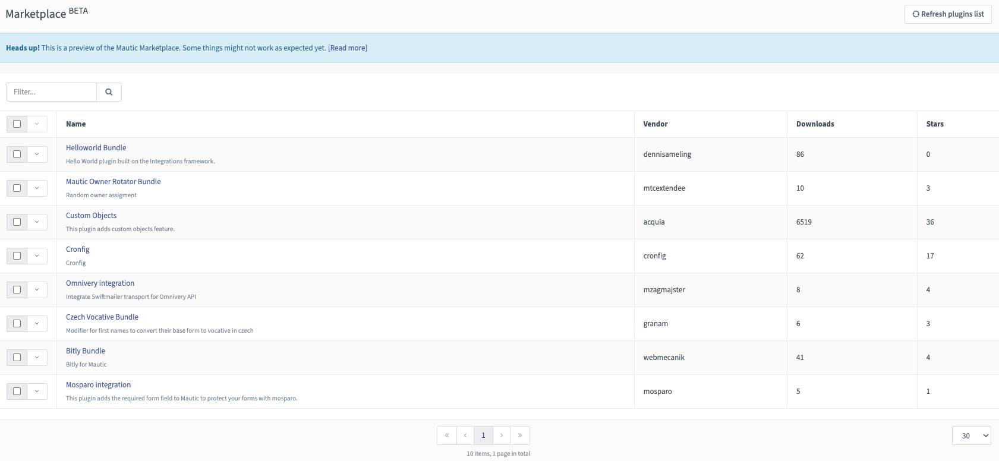
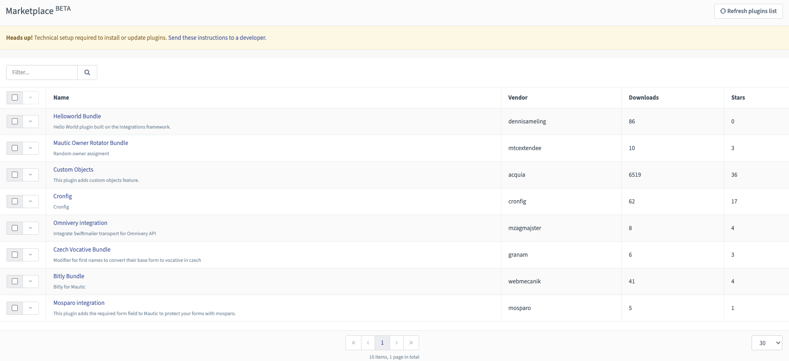
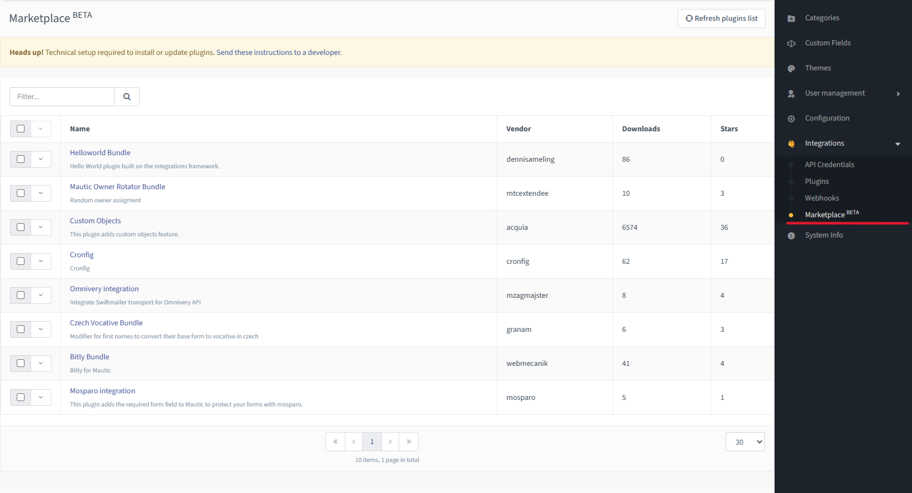
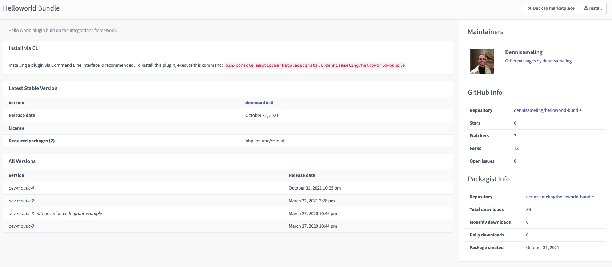

.. vale off

Mautic Marketplace
##################

.. vale on

.. warning::

    当前 Marketplace 版本尚未验证插件的 Mautic 版本兼容性，因为这需要每个现有插件进行更改。

    请不要盲目地手动安装 Mautic Marketplace 中看到的插件，因为它们可能与您的 Mautic 版本不兼容。在安装之前，请始终验证插件是否支持您的 Mautic 版本。开发者可以参考开发者文档中的 :xref:`Marketplace` 部分，了解如何使您的插件与 Mautic Marketplace 兼容。

.. vale off

使用 Mautic Marketplace
****************************

.. vale on

从 Mautic 4.2 开始，Mautic 配置中的一个设置指定实例使用 Composer，这允许在 Mautic Marketplace 中安装、更新和移除插件。这是支持 Mautic Marketplace 的底层技术所必需的要求。

.. image:: images/switch-enable-composer.png
  :width: 800
  :alt: Screenshot of switch enable Composer

配置完成后，您可以使用筛选器搜索 Marketplace，并通过从下拉菜单中选择选项来安装插件。

如果您未正确设置 Composer 设置，Mautic 会显示警告，提示 Mautic Marketplace 仅以只读模式可用，并提供链接说明如何过渡到 :doc:`Composer 管理的</getting_started/switching_composer>` 安装。

.. vale off

插件列表
***************

.. vale on

Marketplace 中可用的插件列表可从您的 Mautic 管理菜单访问。点击右上角的 **齿轮图标** 以显示菜单。

列表视图允许您搜索特定关键词。它显示快速统计信息，包括插件下载量和在 :xref:`Packagist` 上获得的星数。它还显示开发插件的供应商。遗憾的是，目前无法按列排序，因为 Packagist API 不支持此功能。计划在未来的版本中添加此功能。

* 点击插件名称查看详情。

插件详情页面
******************

详情页面为您提供足够的信息以及附加资源链接，帮助您决定是否要安装该插件。

最新稳定版本
=====================

您看到的第一个信息是最新稳定版本。*从 Mautic 4.2 开始，这包括当前已安装的版本（如果有）以及升级能力。*

所有插件应遵循 :xref:`semantic versioning`，因此您可以一目了然地看到它是破坏性变更版本、功能版本还是错误修复（补丁）版本。简而言之，安装破坏性变更版本风险更高，安装错误修复版本风险较低。

许可证应主要为 GPLv3，因为 Mautic 使用此许可证，并且它是一种传染性许可证。这意味着任何使用 Mautic 代码库的内容也应使用相同的许可证。

必需包是依赖项。依赖项列表越大，插件的体积就越大。更多的依赖项也意味着更多的安全风险和未来升级的兼容性问题。

所有版本
============

下一个表格显示所有版本的列表。*在 Marketplace 的未来版本中，应该可以选择要安装或升级到哪个版本*。

从列表中，您可以看到插件版本和发布节奏。当您点击特定版本时，会打开一个新窗口，插件维护者应在此提供变更日志。这告诉您特定版本中添加了什么或修复了哪些错误。

维护者
===========

本节列出了插件在 Packagist 上的维护者列表。GitHub 仓库中可能有更多贡献者。还提供了一个指向维护者 Packagist 详情页面的链接，您可以在其中浏览同一维护者的其他 PHP 包。

GitHub 信息
==================

:xref:`github` 是许多开发者托管代码的地方。大多数 Mautic 插件都在 GitHub 上可用。本节中直接提供了一些统计信息，但如果您点击仓库链接，可以找到更多信息。

Packagist 信息
=====================

:xref:`Packagist` 是一个 PHP 包仓库。它不仅与 Mautic 社区相关，还与 PHP 社区相关。

所有在 Packagist 中列出的 PHP 包都可以通过 Composer 安装，Composer 是一个依赖管理工具，在您安装 Mautic 插件时在底层使用。Packagist 部分显示不同时间范围内的插件安装下载统计信息。

上下文菜单
============
上下文菜单显示您可以采取的操作。

* 关闭将您带到列表视图

* 安装安装插件

* 问题跟踪器打开一个新窗口，其中包含插件的问题跟踪器。仅当插件有此信息可用时才显示。使用此选项搜索插件存在的问题并向维护者报告新问题。

命令行（CLI）命令
**************************

Marketplace 为那些更喜欢使用命令行而非用户界面的人，或用于流程自动化提供了命令。

.. vale off

列出插件
============

.. vale on

``bin/console mautic:marketplace:list`` 列出可用插件的第一页，如下所示：

.. code:: shell

  +-------------------------------------------------------+-----------+--------+
  | name                                                  | downloads | favers |
  +----------------------------------------------------+--------+-----+
  | mautic/mautic-saelos-bundle                           | 11623     | 11     |
  | koco/mautic-recaptcha-bundle                          | 2662      | 24     |
  |     This plugin brings reCAPTCHA integration to       |           |        |
  |     mautic.                                           |           |        |
  | thedmsgroup/mautic-extended-field-bundle              | 3069      | 25     |
  |     Extends custom fields for scalability and         |           |        |
  |     HIPAA/PCI compliance.                             |           |        |
  | mtcextendee/mautic-sql-conditions-bundle              | 190       | 6      |
  | maatoo/mautic-referrals-bundle                        | 1063      | 5      |
  |     This plugin enables referrals in mautic.          |           |        |
  | thedmsgroup/mautic-health-bundle                      | 2139      | 11     |
  |     Checks the health of the Mautic instance.         |           |        |
  | thedmsgroup/mautic-dashboard-warm-bundle              | 1921      | 12     |
  |     Improves the performance of the dashboard by      |           |        |
  |     sharing/extending/warming caches.                 |           |        |
  | thedmsgroup/mautic-contact-source-bundle              | 2852      | 43     |
  |     Creates API endpoints for receiving contacts from |           |        |
  |     external sources.                                 |           |        |
  | thedmsgroup/mautic-contact-client-bundle              | 4035      | 70     |
  |     Create custom integrations without writing code.  |           |        |
  | thedmsgroup/mautic-campaign-watch-bundle              | 1817      | 14     |
  |     Visual improvements for campaigns.                |           |        |
  | raow/mautic-rss-to-email-bundle                       | 971       | 69     |
  | mtcextendee/mautic-random-smtp-bundle                 | 101       | 10     |
  | kuzmany/mautic-recommender-bundle                     | 250       | 30     |
  | kuzmany/mautic-custom-tags-bundle                     | 119       | 20     |
  | dazzle/mautic-sendinblue-bundle                       | 73        | 5      |
  |     Allows to send E-mails with Sendinblue            |           |        |
  +-------------------------------------------------------+-----------+--------+
  Total packages: 69
  Execution time: 388 ms

有一些选项允许您筛选或转到下一页。要显示完整列表，请在命令后添加 ``--help``，与其他 Mautic 命令中的用法一样。

.. code:: shell

  -p, --page[=PAGE]      Page number [default: 1]
  -l, --limit[=LIMIT]    Packages per page [default: 15]
  -f, --filter[=FILTER]  Filter the packages [default: ""]
  -h, --help             Display this help message

搜索 ``Captcha`` 插件的示例用法：``bin/console mautic:marketplace:list --filter=captcha``

计划中的功能
================

请关注未来版本中的更多功能，包括：

* 自动插件更新 - 一个配置，允许您全局设置是否要自动升级插件，并且还可以在插件级别进行配置。自动升级仅对错误修复版本有意义。其他版本风险太高，需要手动更新。:xref:`API reference`

* 列出安全公告 :xref:`API reference`，

* 关于新版本和识别到的安全漏洞的通知，

* 也支持主题的安装和更新。

.. vale off

如何让您的插件在 Mautic Marketplace 上列出
*******************************************************

.. vale on

请查看开发者文档中 :xref:`Marketplace` 部分的资源以获取更多信息。