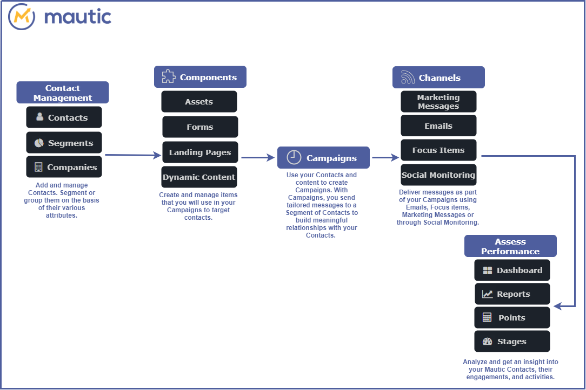

Mautic 概览
===============

Mautic 平台帮助您为业务创建强大的营销策略。使用 Mautic，您可以：

- 通过邮件、短信、社交媒体和焦点项目等渠道与您的联系人建立联系。

  - 根据业务需求对联系人进行分组，并为每个分组个性化您的营销策略。
  - 创建个性化的营销活动与您的联系人互动。
  - 使用仪表盘、报告、积分和阶段中的绩效指标来衡量您的营销策略效率。

工作原理
************

首先，了解 Mautic 的各个部分如何协同工作，为您提供整体的营销平台体验，这将很有帮助。

联系人管理
******************

为您的业务构建丰富且功能齐全的联系人数据库，根据您的业务需求或基于共享属性将他们组合在一起。

- :doc:`/contacts/manage_contacts` - 访问过您的网站或以某种方式与您的业务互动的已知或未知个人。联系人是营销自动化平台的主要因素。

- :doc:`/segments/manage_segments` - 共享某些属性的一组联系人。例如，您可以根据联系人的位置对联系人进行分组。这可以帮助您轻松地向这组特定的联系人发送基于位置的优惠或促销活动。

- :doc:`/companies/companies_overview` - 基于其公司分配的一组联系人。

组件
**********

创建和管理用于营销活动以吸引联系人的各种类型的内容。

- :doc:`/components/assets` - 联系人在完成表单后获得的宝贵项目。白皮书、可下载的应用程序/文件、文档或视频是资产的一些示例。

- :doc:`/components/forms` - 表单是客户互动的主要接触点。它们用于收集联系信息，通常作为提供资产访问权限的交换，例如下载、活动注册或邮件通讯。

- :doc:`/components/landing_pages` - 一个强大的功能，不仅允许您快速轻松地推广内容，还允许您快速创建为特定目的（例如广告活动）量身定制的落地页。

- :doc:`/components/dynamic_web_content` - 一个可以用于为您的联系人个性化 Web 体验的功能。营销人员可以在网页的特定区域向不同的人显示不同的内容。

营销活动
*********

- :doc:`/campaigns/campaigns_overview` - 在拥有联系人信息和组件之后，您可以开始为您的联系人创建定制的营销活动。您主要在营销活动中创建这些营销活动。

渠道
********

选择一个或多个渠道向您的联系人传递内容和消息。

- :doc:`/channels/marketing_messages` - 一种个性化与联系人沟通的方式。通过营销消息，联系人在他们设置为首选的渠道上接收您的内容。

- :doc:`/channels/emails` - 使用内置邮件模板向一组联系人发送消息，或向特定联系人发送个性化消息。

- :doc:`/channels/focus_items` - 一种 Web 个性化类型，使营销人员能够根据联系人的行为在网页上嵌入弹出消息和表单、通知栏和启动画面。通过使用焦点项目，您可以轻松地将访客转化为已知联系人。

- :doc:`/channels/social_monitoring` - 营销人员可以通过 Twitter 提及和标签将联系人添加到 Mautic。

评估绩效
******************

使用各种工具分析趋势并评估营销策略的绩效。

- :doc:`/dashboard/dashboard` - 联系人数据、营销活动和活动的高级表示。您可以基于想要跟踪的信息创建高度个性化的仪表盘。

- :doc:`/reports/reports` - 衡量营销活动、邮件、表单或落地页点击效果的工具。报告还可以帮助您故障排除或找出改进领域以增强您的营销策略。

- :doc:`/points/points` - 一个分数，是联系人或客户进度的指标。积分是营销人员根据互动和行为衡量哪些联系人最活跃的一种方式。

- :doc:`/stages/stages` - 一个可自定义的功能，使您能够跟踪联系人在其营销/销售旅程中所处的阶段。