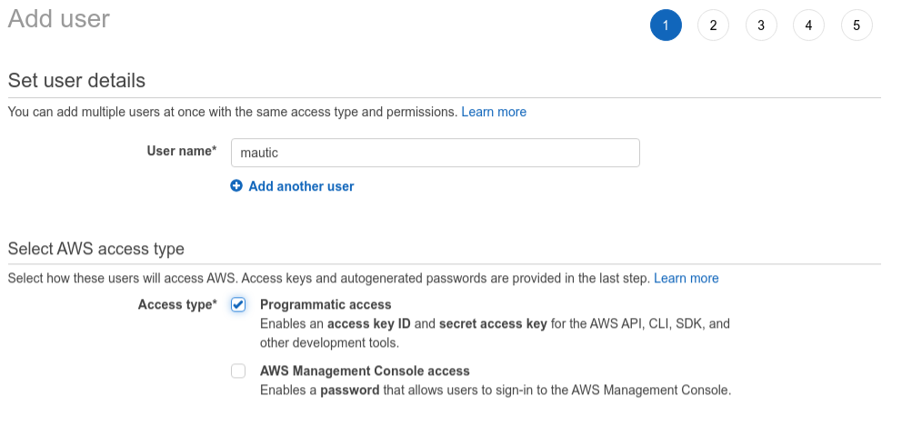
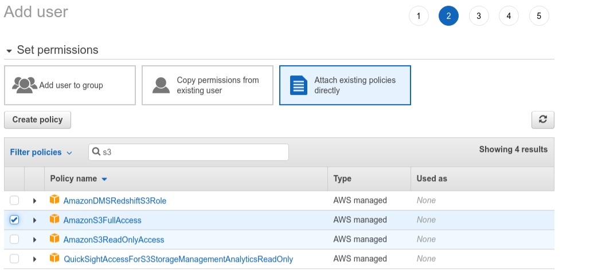
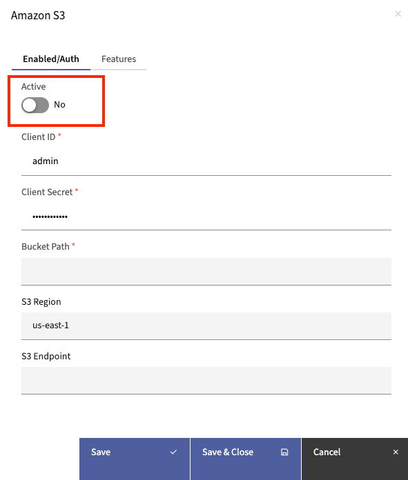
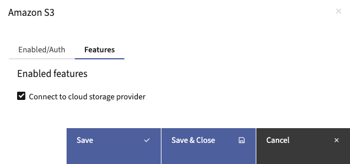

.. vale off

Amazon S3
#########

.. vale on

Amazon S3 插件允许您将 :doc:`资源</components/assets>` 托管在 Amazon S3 存储桶上，而非托管在本地服务器上。创建资源时，您可以从 S3 存储桶中选择，而非从本地计算机上传。

设置 S3 存储桶
***********************

按照以下步骤 :xref:`set up Amazon S3` 并创建存储桶：

.. vale off

#. 如果您还没有 AWS 账户，请 :xref:`Create an AWS account`。在承诺使用 S3 之前，请确保您了解 :xref:`pricing tiers for S3`。
#. 如果您已有账户，请 :xref:`access AWS account` 并选择 **IAM 用户** 作为用户类型。

   .. important::

      请确保不要在日常操作中使用根账户。

#.  :xref:`Create a bucket`。

   .. note::

      您为存储桶选择的区域对数据保护至关重要，您需要复制此值并在设置 Mautic 时使用。请查阅您的隐私政策并据此操作。

.. vale on

现在您已经创建了存储桶，接下来创建一个可以访问该存储桶的用户。不要使用您的主账户凭据（一旦泄露将带来重大风险），而是在 Mautic 中使用此用户的凭据。

1. 选择右上角的 **账户名称**。
2. 从下拉列表中选择 **安全凭据**。
3. 选择 **用户** > **添加用户** 并输入名称。
4. 选择 **编程访问**。

5. 选择直接附加现有策略，在搜索框中输入 S3 进行筛选，然后选择 AmazonS3FullAccess。

6. 点击 **下一步** 按钮继续，您无需分配任何标签。
7. 在审核提交的信息后创建用户。

.. image:: images/screenshot-consoleawsamazoncom-20200413-214631-35da93f9.png
  :alt: Screenshot of Amazon S3

8.  接下来，您可以查看 **访问密钥 ID** 和 **秘密访问密钥**。

.. note::

     您必须复制这些凭据，因为之后将无法再次访问。请下载并/或安全保存它们。

在 Mautic 中设置 S3
***********************

有了存储桶详情和具有正确凭据的用户，现在可以设置 Mautic 使用此存储桶了。

1. 前往 **设置** > **插件**
2. 点击 **Amazon S3** 插件。
3. 如果您没有看到 Amazon S3 插件，请点击 **安装/升级插件**。
4. 切换 **启用** 开关按钮以启用插件。
5. 输入您的用户的 **ID**、秘密以及存储桶名称。

6. 输入在 Amazon S3 中配置的 **存储桶位置**。
7. 点击 **保存** 以保存更改
8. 点击下一个标签 **功能**，确保已选择使用云提供商存储资源的选项。

9. 点击 **保存并关闭**，然后刷新插件页面 - Amazon S3 插件图标将变为彩色而非 ``灰度``，这表示它已启用。

当您将资源上传到 S3 存储桶时，可以通过创建新资源并选择 远程文件 > S3 来选择它。
