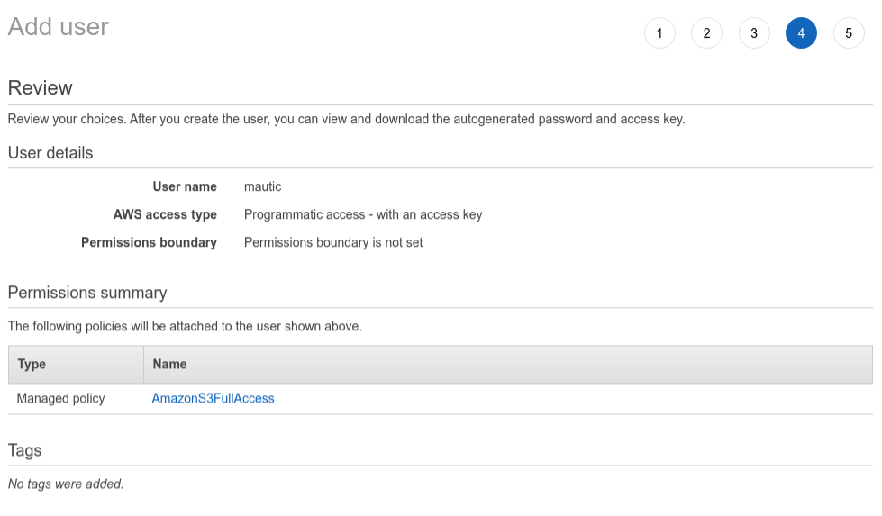

Clearbit
########

此插件可以：

* 通过 API 从 Clearbit 拉取联系人和公司的数据到 Mautic 中。

Clearbit 插件要求
****************************

* Mautic 需安装在可公开访问的 URL 上。由于 Clearbit 需要向 Mautic 发送回调，此插件无法在 localhost 上运行。

* 获取 Clearbit API 密钥

授权插件
********************

Clearbit 插件使用
*********************

联系人和公司页面顶部均有一个下拉菜单和一个工具栏：

.. image

点击其中一个按钮后会弹出一个确认窗口：

找到信息后，联系人/公司的详细信息会在稍后更新。

