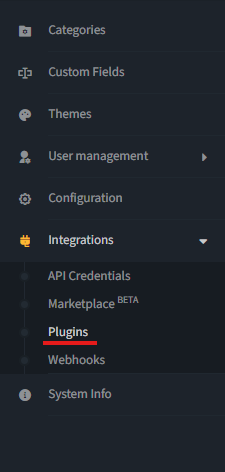
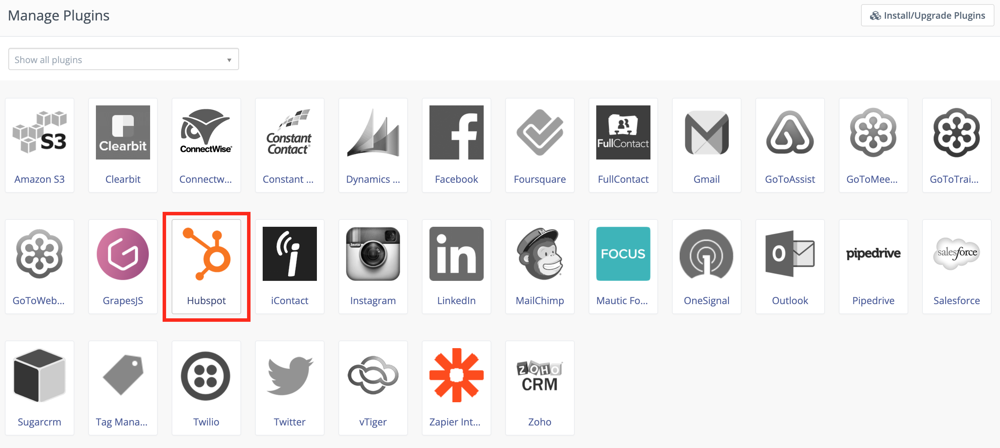

HubSpot
########

.. vale off

Mautic - HubSpot CRM 插件
***************************

.. vale on

Mautic 可以基于 :ref:`联系人操作<testing integrations>` 或 :doc:`积分触发器</points/points>` 将联系人推送到 :xref:`HubSpot CRM`。

HubSpot API 密钥
===============

将 Mautic 连接到 HubSpot 需要集成并配置具有正确凭据的 HubSpot API 密钥。

1. 登录您的 HubSpot CRM 账户，如果还没有，请先创建一个账户。

2. 创建一个私人应用以获取 :xref:`HubSpot Credentials`。您需要为私人应用授予适当的权限，以便 Mautic 能够处理联系人、公司等。

3. 复制生成的 HubSpot 密钥并将其保存在安全的地方。

.. vale off

配置 HubSpot CRM 插件
================================

.. vale on

.. note::

    在激活插件之前，请确保完成所有步骤。

1. 登录 Mautic 实例。

2. 前往 **设置**。

3. 点击 **插件** 选项。

4. 选择 **HubSpot** 插件配置。

5. 在配置框中，将您的 **API 密钥** 粘贴到 HubSpot API 密钥输入字段中。

6. 配置 **功能特定设置** 以从 HubSpot 同步联系人、公司或两者。

7. 点击 **保存并关闭**，然后编辑插件以配置字段映射。

.. note::

    默认设置下此项已勾选。如果取消选择，插件将不会将联系人推送到 HubSpot CRM。

8. 配置 :ref:`字段映射<field mapping>`。

9. 点击 **保存** 以保存插件配置。

   * 如果您想使用该插件，请将 *启用* 开关设置为 **是**。仅在完全配置好插件设置后才执行此操作。

10. 如果尚未配置，请设置 :ref:`定时任务<configure Mautic integration cron jobs>`。

.. tip::

    要在定时任务中配置的脚本：``php $PATH_TO_MAUTIC_DIRECTORY/bin/console mautic:integration:fetchleads --integration=Hubspot --fetch-all``

.. vale off

测试插件
***************

.. vale on

按照 :ref:`这些步骤<testing integrations>` 测试集成。

.. vale off

HubSpot 集成故障排除
***********************************

.. vale on

创建联系人时，请确保您用于测试的邮件地址是有效的。HubSpot 仅在邮件地址有效时才会创建新联系人。

请注意，尽管有 ``--fetch-all`` 标志，Mautic 中使用的 HubSpot API 端点主要利用以下端点：

* ``/companies/v2/companies/recent/modified/``

* ``/contactslistseg/v1/lists/recently_updated/contacts/recent``

如果您打算对 HubSpot 联系人进行完全同步，则需要修改每个联系人的某个属性，使其出现在 HubSpot 的 recent/modified 端点中。
当连接到长期存在的 HubSpot 实例时，这些端点仅拉取最近 30 天内修改过的联系人，导致同步不完整。:xref:`Source`。
