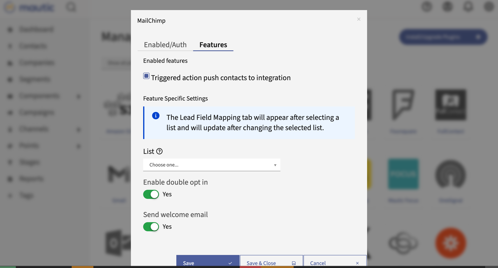

MailChimp
#########

此插件可以根据联系人操作或积分触发器将联系人发送到 MailChimp 列表。

授权
*********

获取 MailChimp API 密钥
=====================

1. 创建 MailChimp 账户。
2. 前往 *账户* / *附加功能* / *API 密钥* 并创建一个新密钥。
3. 复制创建的 API 密钥。

  .. image:: images/plugins-mailchimp-create-api-key-1-and-2.png
   :alt: Screenshot of MailChimp dashboard with arrows pointing at the Extras tab and the API Keys section
   :align: center

  .. image:: images/plugins-mailchimp-create-api-key-3a.png
     :alt: Screenshot of MailChimp dashboard with an arrow pointing at the Create API Key button
     :align: center

  .. image:: images/plugins-mailchimp-create-api-key-3b-and-3c.png
     :alt: Screenshot of the Name New API Key section with arrows pointing at the test and Generate Key button
     :align: center

.. vale off

授权 Mautic - MailChimp 插件
===================================
1. 填写您 MailChimp 账户的 **用户名**
2. 添加 **API 密钥**
3. 点击 ***保存并关闭***

配置插件
********************

.. vale on

导航到插件配置模态框中的 *功能* 标签。您应该会看到以下提示：

.. vale off

.. note::
   联系人字段映射标签将在选择分组后出现，并在更改所选分组后更新。

   .. vale on

1. 选择分组。

   如果您尚未在 MailChimp 中创建分组，请前往 *MailChimp 仪表盘* / *分组* / *创建列表* 并创建一个。

2. 保存插件配置
3. 再次打开。

   *联系人字段映射* 标签现在应该出现了。

4. 配置字段映射。

其他配置选项
===========================

- **推送联系人到此集成**

Mautic 默认启用这些选项。如果关闭它们，插件将不会将联系人推送到 MailChimp。

- **启用双重确认** - MailChimp 是否应向此插件添加的联系人发送确认邮件。联系人必须确认他们确实想加入该分组。
- **发送欢迎邮件** - MailChimp 是否应发送欢迎邮件。