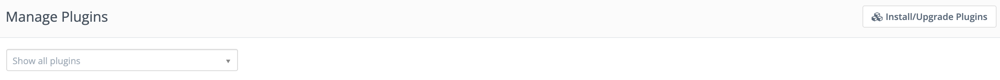
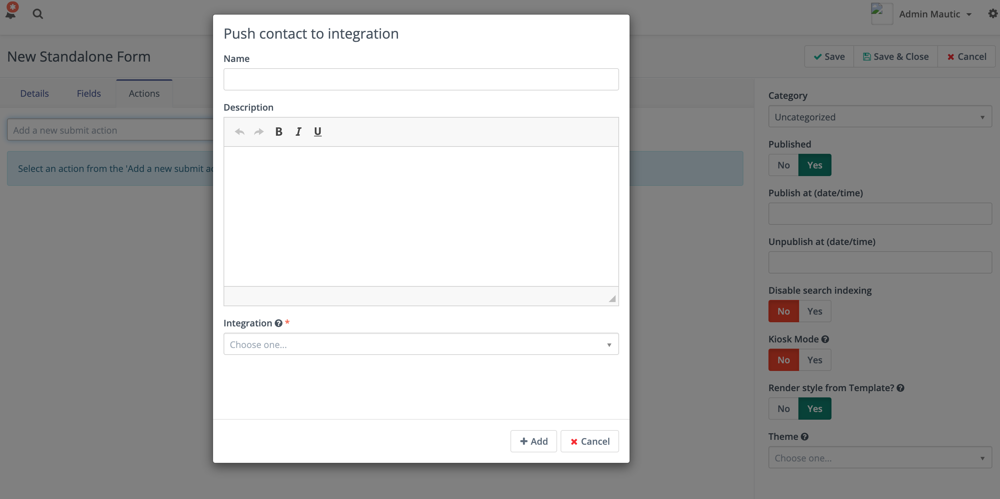

插件资源
################

Mautic 插件是可安装的软件包，可以扩展 Mautic 功能或将其与另一个系统集成。您可以在开发者文档的 :xref:`Mautic Plugins` 部分找到有关如何创建 Mautic 插件的更多信息。

您可以在右侧管理菜单中找到插件。

.. image:: images/plugins.png
  :width: 800
  :alt: Screenshot of Plugins settings

.. vale off

安装插件
***************

.. vale on

如果您使用的是全新安装的 Mautic 实例，默认插件可能尚未安装。点击右上角的 **安装/升级插件** 按钮，所有插件应该就会出现。

如果您尝试安装的插件不是 Mautic 原始安装文件中的，且点击安装/升级插件后仍未出现，请清除 Mautic 缓存 - 使用 :doc:`命令行</configuration/command_line_interface>` 中的命令 - 然后再次尝试点击安装/升级插件按钮。

.. vale off

测试集成
********************

如何测试集成
==========================

.. vale on

如果您想测试集成插件以确保其配置正确，有三种方式可供选择。集成可以通过以下操作推送联系人：

* **营销活动构建器** 包含 *推送联系人到集成* 操作，可在营销活动配置中使用。

* **表单** 包含 **推送联系人到集成** 操作，在表单提交后触发。

* **积分触发器** 包含 *推送联系人到集成* 操作，可在联系人达到配置的积分上限时触发。

使用以上任一操作测试插件，查看联系人是否出现在集成中。以下是如何配置表单操作的示例：

1. 创建一个包含若干字段的表单。例如，一个 ``email`` 字段和一个 ``firstname`` 字段。

2. 添加推送联系人到集成操作。例如，``Hubspot CRM``。

3. 浏览表单的公开 URL：``https://example.com/form/[formID]``

4. 使用示例联系人信息填写字段并提交

5. 确认集成已创建新联系人。

插件故障排除
-----------------------

如果 ``firstname`` 值未保存到集成中：

1. 确认表单常规配置标签中启用了 ``保存结果`` 选项。

2. 在表单联系人字段配置标签中，确认字段为：``ContactFirst Name``。

3. 仔细检查集成字段映射。

.. vale off

字段映射
*************

.. vale on

在 *联系人字段映射* 标签中，列出了集成中可用的字段。

您必须选择相应的 Mautic 联系人字段，以便每个字段获得正确的值。

.. note::

    您不必映射每个字段。只映射您希望推送到集成中的字段。