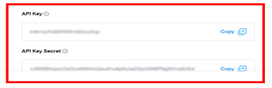
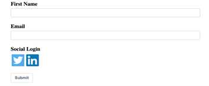

社交登录
############

使用 Mautic 的社交登录功能，用户可以轻松通过他们喜爱的社交平台（如 Twitter、Facebook 或 LinkedIn）登录。社交登录功能会自动使用个人资料数据预填表单，并在 Mautic 中更新或创建新联系人，从而简化用户体验。

开始之前：设置要求
************************************

在配置社交登录之前，请确保您已在要集成的社交媒体开发者平台上创建了应用：

- :xref:`X-developer`
- :xref:`Facebook developer`
- :xref:`LinkedIn developer`

创建完成后，您就可以将它们连接到 Mautic 了。

第 1 步 - 授权社交媒体插件
*****************************************

在您可以使用社交登录之前，每个社交媒体插件都需要授权。操作方法如下：

1. **复制回调 URL**：前往 Mautic 的插件配置窗口，复制其中提供的回调 URL。将其粘贴到您开发者应用设置中的相应字段。

 .. image:: images/Call_back.png
    :width: 400
    :alt: Screenshot of a callback URL input field.

2. **添加您的 API 密钥**：从社交平台复制 API 密钥 - 客户端密钥 - 和 API 秘密 - 客户端秘密。将这些密钥粘贴到 Mautic 插件配置中的相关字段。

3. **授权插件**：在 Mautic 插件配置中，点击 **授权**。您必须 **开启** 插件 - 通过将选项切换为"是"来完成。最后，保存配置以完成设置。

.. Tip:: 您可以在 Mautic 插件设置中各个社交网络对应的标签下管理每个网络。确保通过添加所需的 API 凭据来完全授权每个网络。

第 2 步：向表单添加社交登录按钮
********************************************

配置好社交插件后，您便可以将社交登录按钮添加到 Mautic 表单中。

1. 前往 Mautic 中的表单部分，创建新表单或编辑现有表单。

2. 从表单构建器中选择 **社交登录** 字段。所有已授权社交平台的按钮 - 例如 Twitter、Facebook、LinkedIn - 将自动出现。

3. 当用户使用其社交账户登录时，Mautic 会尝试根据其社交个人资料自动填写 **姓名** 或 **邮件** 等字段。

.. note::
   只有您已授权的插件按钮才能在表单中使用。请确保正确配置所有集成，以获得顺畅的用户体验。

第 3 步：配置功能和映射联系人字段
*******************************************************

在配置和授权插件之后，您可以自定义 Mautic 如何处理传入的社交个人资料数据。在插件设置的 **联系人字段映射** 标签下，将用户社交个人资料中的字段 - 例如 邮件、姓名 - 映射到相应的 Mautic 联系人字段。

- 您只需映射与表单相关的字段。

- 未映射的字段不会被用于更新或创建 Mautic 中的联系人。

示例：将 Facebook 的 **名** 映射到 Mautic 联系人字段中的 **名**。

支持的社交个人资料字段
*******************************

每个平台提供不同的用户数据字段。以下是您可以映射的字段快速参考：

- **Twitter**：个人资料名称、姓名、位置、描述、URL、时区、语言、邮件地址。

- **Facebook**：名、姓、姓名、性别、语言区域、邮件地址、个人资料链接。

- **LinkedIn**：名、姓、婚前姓、格式化姓名、头衔、位置、摘要、专长、职位、公开个人资料 URL、邮件地址。
