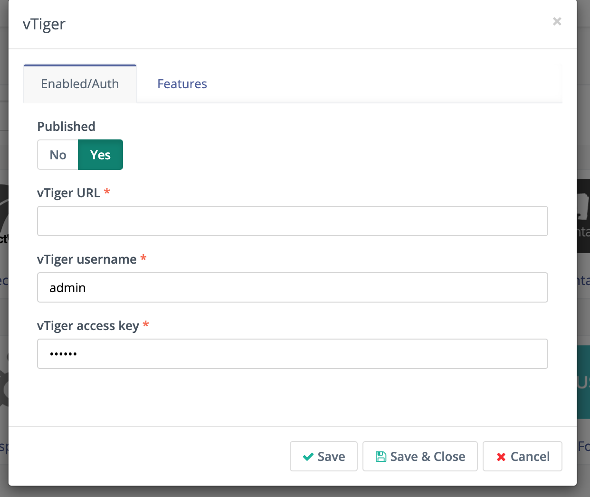
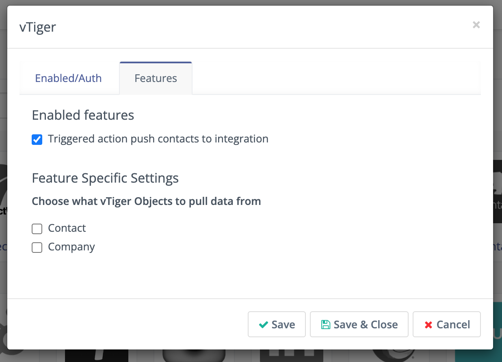

Vtiger
######

.. vale off

Mautic - Vtiger CRM 插件
**************************

.. vale on

此插件可以在联系人执行某些操作时将联系人推送到 Vtiger CRM。

如果您还没有，请创建一个 :xref:`Vtiger` CRM 账户。

.. warning::

    云端的 Vtiger 实例默认关闭了联系人模块。这会导致在插件编辑表单上出现错误消息 ``Permission to perform the operation is denied``。启用联系人模块后，插件将加载自定义字段映射表单。

.. vale off

认证 Vtiger 插件
******************************

.. vale on

要认证 Mautic 插件使其能够与 Vtiger CRM 通信，您需要以下凭据：

* Vtiger 云端 URL - 您的 Vtiger 实例运行的基础（根）URL，以 ``http://`` 或 ``https://`` 开头。例如，``https://your_Vtiger.od2.Vtiger.com.``

* Vtiger 开源 URL - 如果您使用的是开源版本的 Vtiger，必须使用以 ``http://`` 或 ``https://`` 开头并后跟 ``/webservice.php`` 的基础（根）URL。例如 ``https://your_Vtiger.od2.Vtiger.com/webservice.php``。

* Vtiger 用户名 - 您用于登录 Vtiger 的用户名，通常是邮件地址。

* Vtiger 访问密钥 - 在您的 Vtiger 个人资料中激活的访问密钥。要获取它，请前往 Vtiger 的 **我的偏好设置**。访问密钥哈希值位于页面底部。

|

将这 3 个凭据填写到 Mautic 插件中，然后点击 **保存**。

.. vale off

配置 Vtiger CRM 插件
*******************************

.. vale on

如果您想使用该插件，必须激活它。

1. 将 *启用* 开关设置为 **是**。

2. 在 **功能标签** 中，有推送联系人到此集成的复选框，默认已勾选。

|

3. 您还可以配置是否要将 Vtiger 的线索映射到 Mautic 的联系人和/或将 Vtiger 的组织映射到 Mautic 的公司。

4. 配置 :ref:`字段映射<field mapping>`。

5. 点击 **保存并关闭**。

.. vale off

测试 Vtiger CRM 插件
**************************

.. vale on

按照 :ref:`这些步骤<testing integrations>` 测试集成。