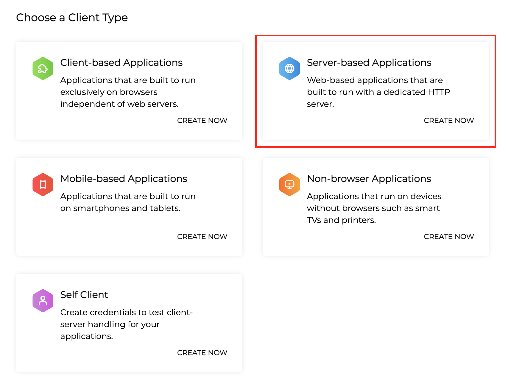
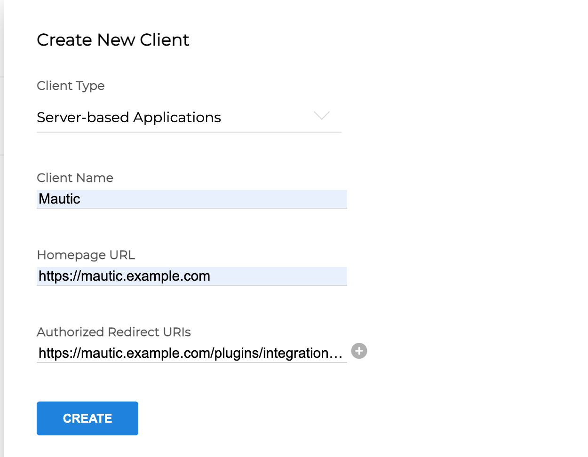
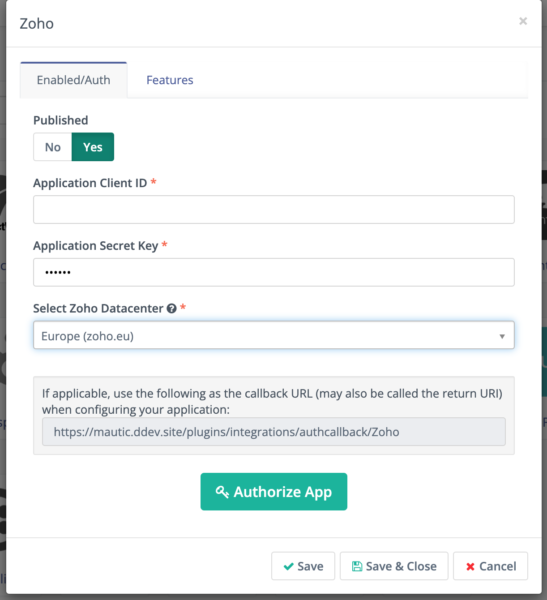
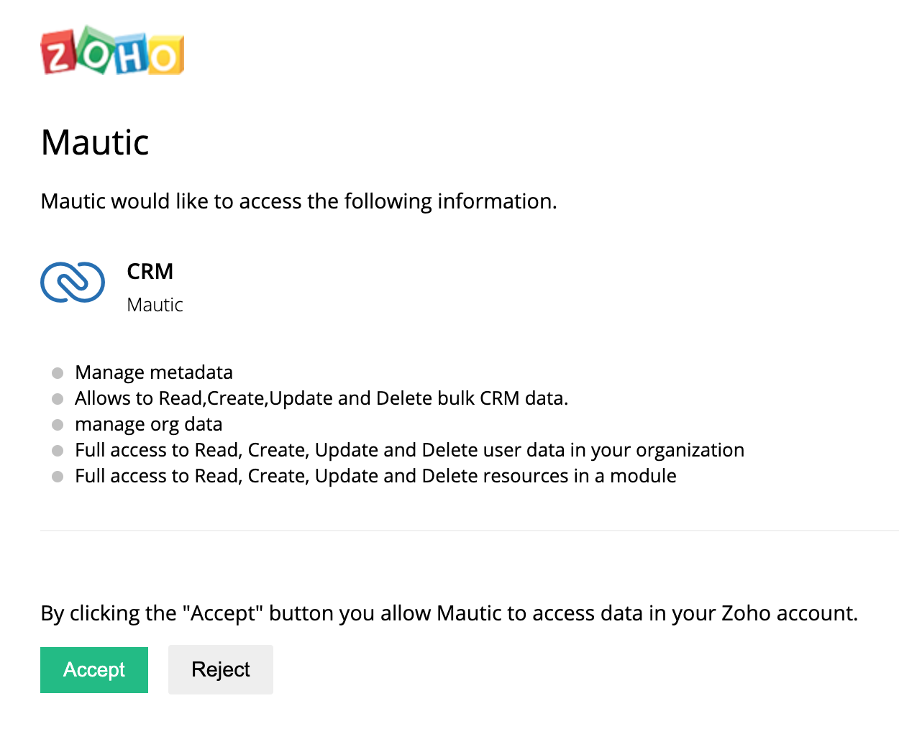
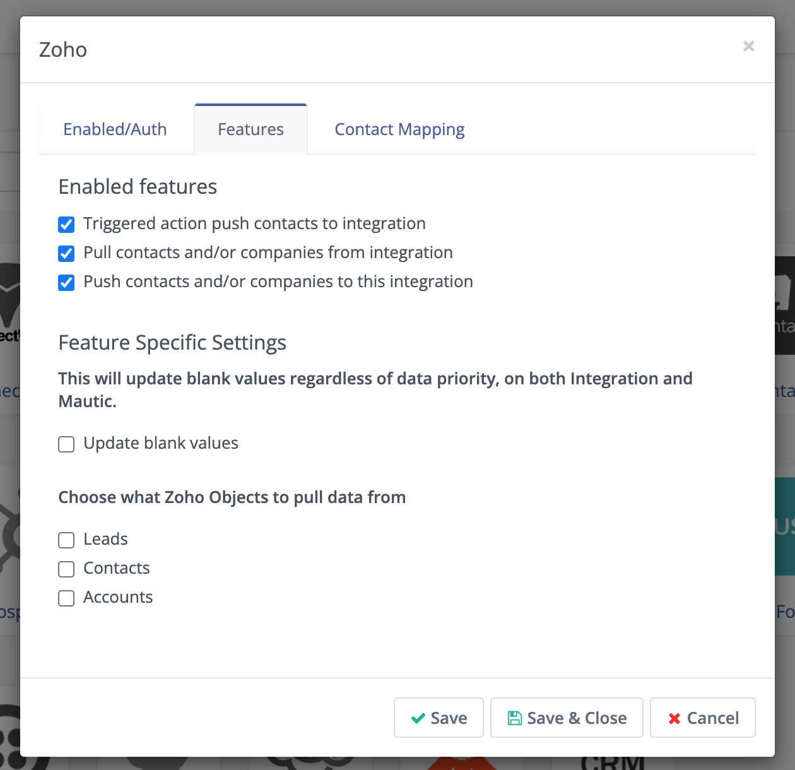

.. vale off

Zoho CRM
#########

.. vale on

Mautic 可以基于营销活动 :ref:`操作` 或 :ref:`积分触发器` 将联系人推送到 :xref:`Zoho CRM`。

语言配置警告
******************************

.. warning::

    您必须 **将 Zoho 和 Mautic 账户配置为** 英文，同步才能正常工作。Zoho 会根据语言更改每个联系人字段的别名，这会导致字段不匹配和同步错误。

.. vale off

配置 Zoho CRM 插件
*****************************

.. vale on

1. 如果还没有，请创建一个 :xref:`Zoho CRM` 账户。
2. 通过前往 :xref:`Zoho API Console` 生成密钥对。
3. 选择 **基于服务器的应用程序**，并为客户端提供名称、您的 Mautic 实例 URL 以及回调 URL（您可以通过在 Mautic 中前往 插件 > ZohoCRM 并复制回调 URL 来获取，通常格式为 ``https://mautic.example.com/plugins/integrations/authcallback/Zoho``）。

4. 将在 Zoho API 控制台中创建的客户端 ID 和客户端秘密输入到 Mautic Zoho 集成插件中。

|

.. note::

    您必须选择与您的 CRM 实例对应的正确数据中心 - 例如，如果您通过 ``crm.zoho.com`` 访问您的 CRM，则应在下拉菜单中选择 .com 选项。

|

1. 根据您的 Zoho CRM 实例 URL 选择正确的数据中心，然后点击按钮授权插件访问您的实例。弹出窗口将提示您登录 Zoho 并授权访问 - 选择 接受。

授权成功后，按钮将更新为显示"重新授权"。

6. 在功能标签中，您可以选择希望此集成执行的操作：

   * 触发的操作推送联系人到集成 - 触发时，Mautic 将联系人推送到 Zoho
   * 从集成拉取联系人和/或公司 - 从 ZohoCRM 拉取所有联系人和/或公司到 Mautic
   * 推送联系人和/或公司到此集成 - 将所有联系人和/或公司从 Mautic 推送到 ZohoCRM

请注意，这仍然需要 :ref:`定时任务<cron jobs>` 才能运行

您还可以配置其他选项：

* 更新空值 - 无论数据优先级如何，都会在 ZohoCRM 和 Mautic 上更新空值。
* 选择从 Zoho 的哪些对象拉取数据 - 您可以在此指定要从 ZohoCRM 拉取哪些对象 - 线索、联系人和/或账户

|

7. 配置 :ref:`字段映射<field mapping>`。

|

.. note::

    如果 Mautic 对象的值是空的，则发送值"未知"。如果 ZohoCRM 字段是选择列表，请确保 Mautic 字段的列表值与 ZohoCRM 中该字段的值匹配。

8. 将启用开关设置为 **是**。
9. 点击 **保存并关闭**。

.. vale on

测试 Zoho CRM 插件
************************

.. vale off

按照 :ref:`这些步骤<testing integrations>` 测试集成。