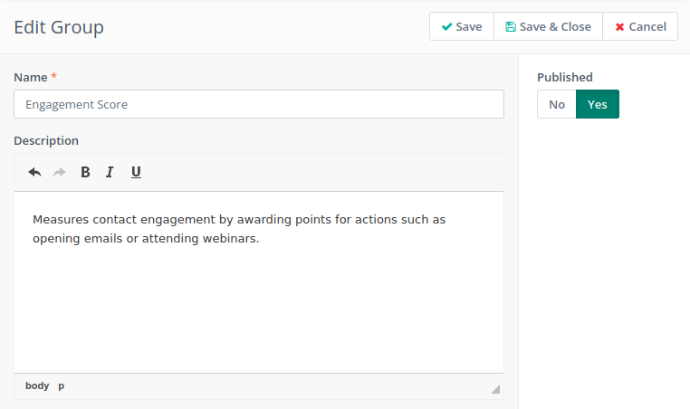
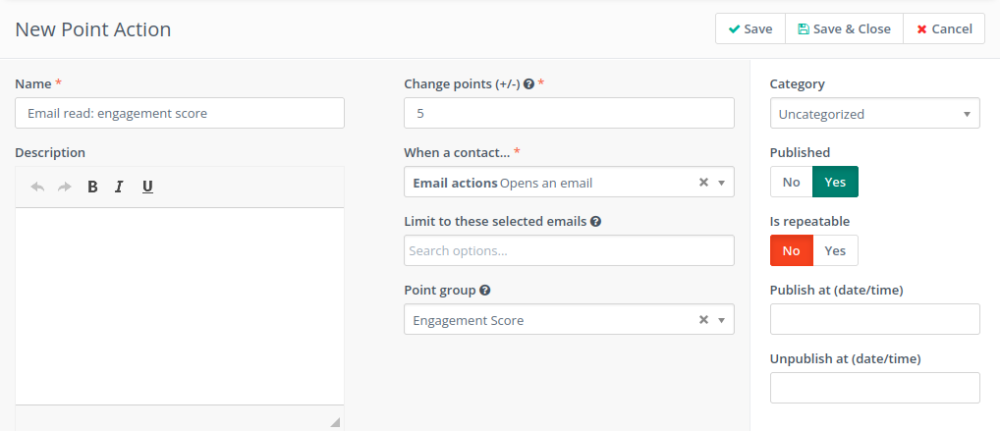
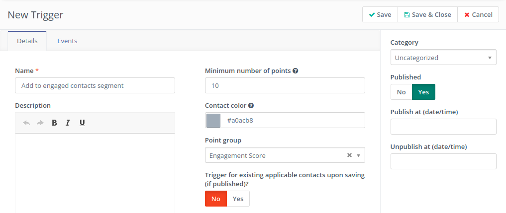
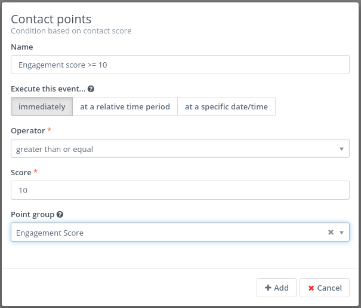
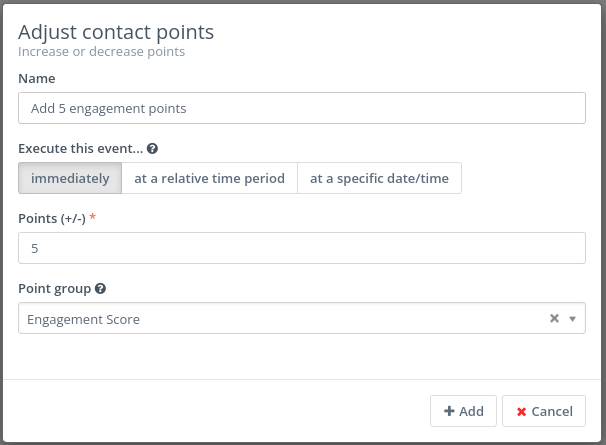
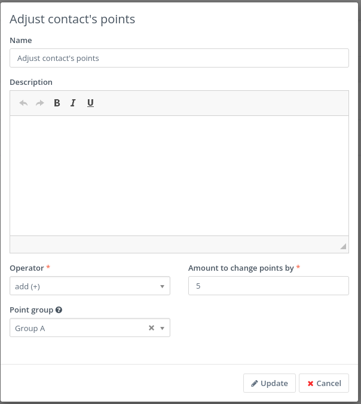
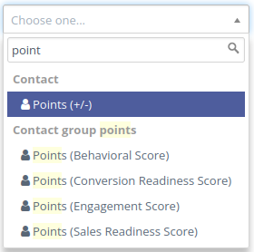
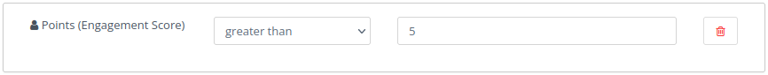
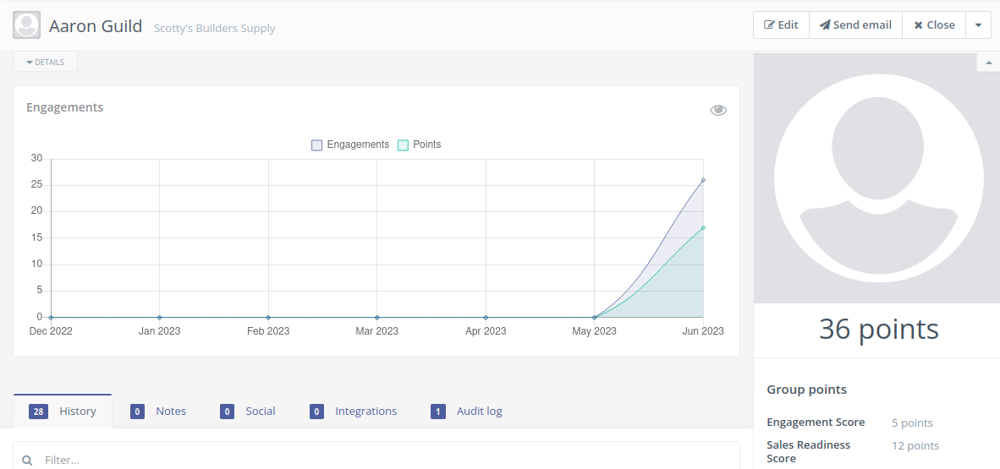
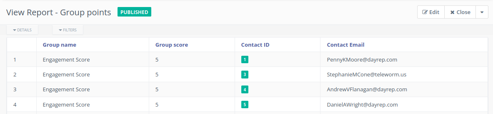

.. vale off

积分组
#############

.. vale on

积分组是一项功能，允许用户对其联系人的得分进行分类。通过设置积分组，用户可以为联系人执行的每个操作（例如打开邮件、访问落地页或下载资源）分配特定数量的积分。

.. vale off

管理积分组
======================

.. vale on

要访问 Mautic 中当前定义的积分组，请导航至积分菜单并点击"管理分组"链接。要创建新分组，只需点击"新建"按钮。

输入分组的名称和描述，然后点击"保存并关闭"按钮创建分组。

.. vale off

积分组的用途
===================

使用积分操作
-------------------
您可以通过积分操作更改联系人在积分组中的积分。

使用积分触发器
--------------------
您可以使用基于积分组的积分触发器来自动触发系统内的特定事件。

营销活动条件
------------------
您可以在营销活动中使用基于分组联系人积分的条件。

营销活动操作
---------------
您可以使用营销活动操作来增加或减少分组联系人的积分。

表单操作
---------------
您可以使用表单操作来增加或减少分组联系人的积分。

分组筛选器
---------------
每个积分组都会添加一个新的筛选器用于配置分组。

联系人详情
---------------
您可以在联系人详情中显示积分组。

.. vale off

分组报告
-------------

.. vale on

您可以生成包含联系人积分组信息的报告。

Webhook
--------
更改联系人分组积分不会触发联系人积分变更事件的 Webhook