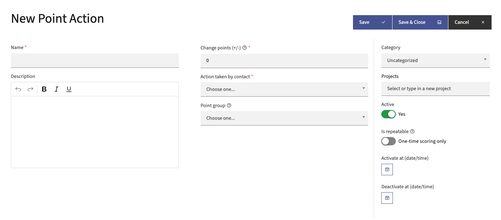
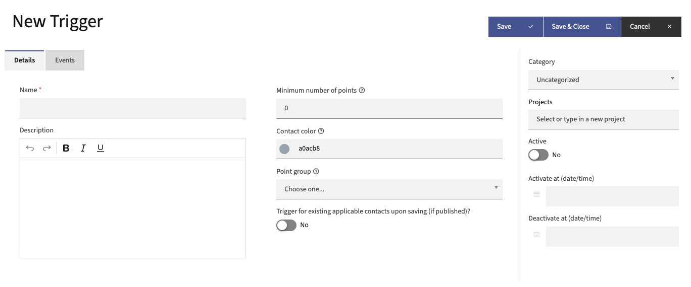
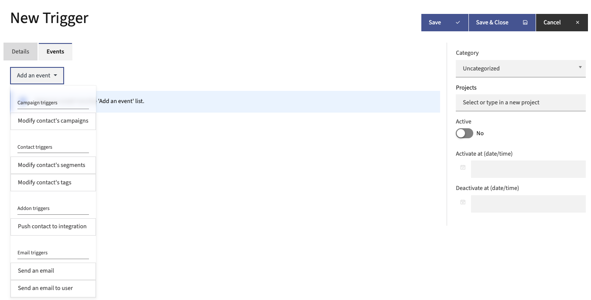
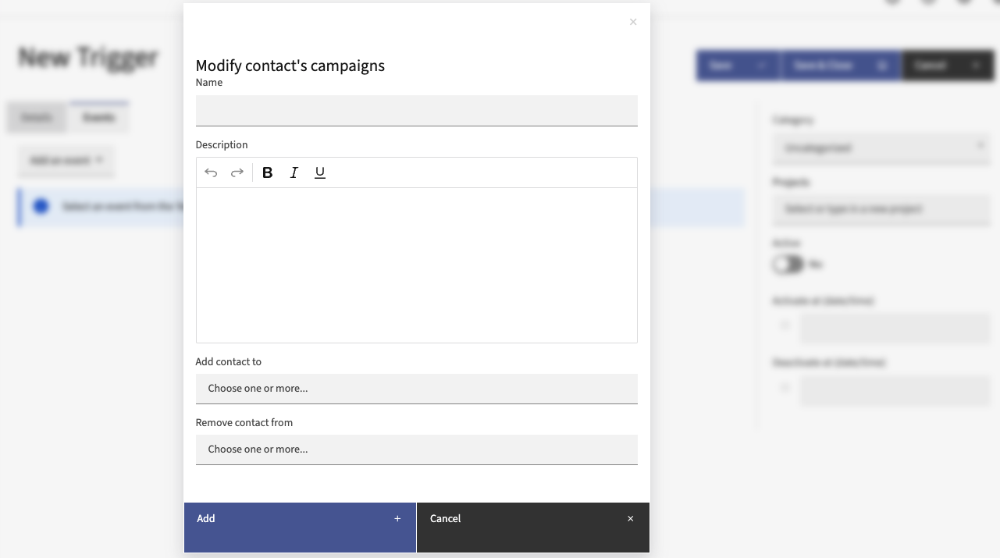
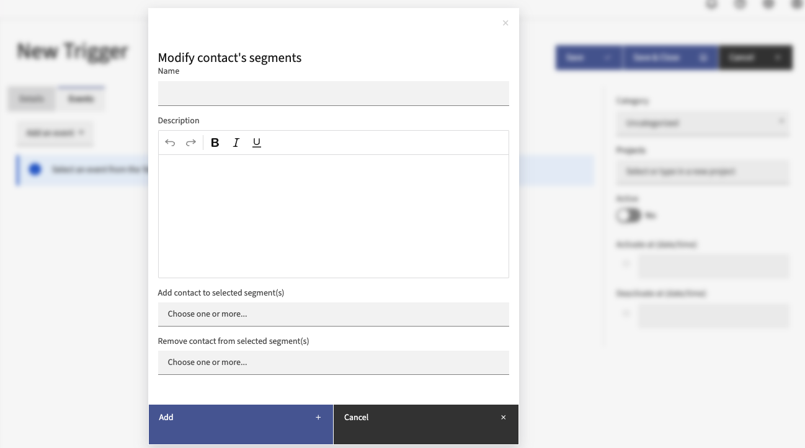
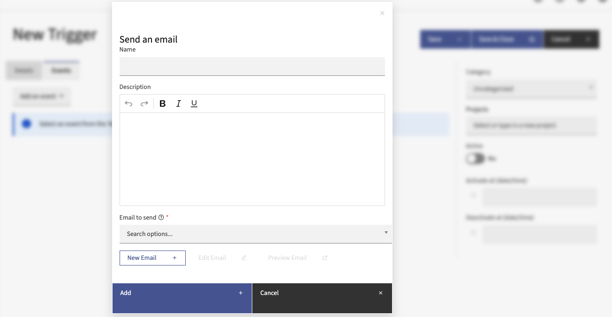
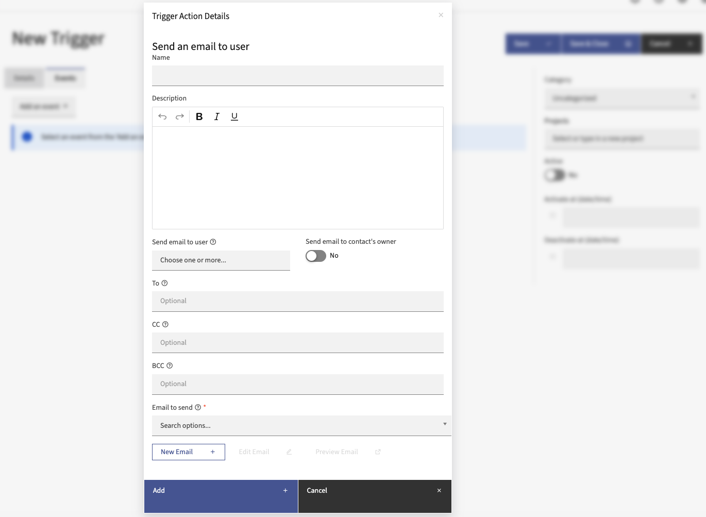

积分
######

积分为正确衡量联系人提供了一种方式。这些积分既有触发器也有操作。以下部分概述了所有相关的术语定义，以及对积分功能的透彻理解。这有助于使用积分使您的整体营销自动化过程取得成功。

.. vale off

积分操作
*************

.. vale on

积分操作是指联系人积分总值发生变化的那些时刻。这些操作可以是正向或负向的积分变化，并根据您确定的特定操作而发生。

要添加新的操作：

1. 点击 **积分 > 积分操作 > + 新建** — 位于右上角。

2. 在主面板中，有四个用于关键信息的方框。输入适当的信息。

   * **名称** — 您操作的名称。这是操作在操作列表中的显示方式，因此请选择一个可识别的名称。

   * **描述** — 添加描述以帮助您查找特定操作。可能会有更多类似或更深入的操作。

   * **积分变更（+/-）** — 要为此操作设置的值变化。添加积分时不需要 ``+``。减去积分时，请添加 ``-`` 符号。

   * **用户执行的操作** — 这是联系人必须完成以触发操作的行为或操作。

3. 右侧有更多信息：

   * **分类** — 根据目标、营销活动等来组织您的积分操作。有关更多信息，请参见 :doc:`分类</categories/categories-overview>`。所有积分都累积在联系人记录上，无论分类如何。每个联系人只有一个积分分数。

   * **活动与激活/停用日期/时间** — 一旦建立了积分操作，Mautic 会在联系人完成该操作时奖励积分。非活动操作不会奖励积分。如果您有想要在特定时间段内奖励积分的定向行为，可以设置激活和停用日期

   * **可重复** — 要在联系人每次完成操作时都奖励积分，请选择 **是**。如果您只想在有人 **首次** 完成操作时奖励积分，请选择 **否** — 这是默认值。

4. 点击 **保存** 或 **保存并关闭**。

.. vale off

积分触发器
**************

.. vale on

一旦联系人累积了一定的积分总数，您可能希望对联系人触发一个操作。您可以为不同的积分值创建多个触发器。

创建积分触发器类似于创建积分操作。**名称**、**描述**、**分类** 和 **活动** 选项都是相同的。触发器基于最低积分数来触发。设置一个数字，并决定是否要 **保存时对现有的适用联系人触发——如果已激活**。

在决定并输入这些选项后，转到 **事件** 选项卡。在这里，一旦联系人达到您预设的积分总数，您可以触发一个或多个事件。这些积分触发器及相关事件也是完全可自定义的。

营销活动触发器
=================

**修改联系人的营销活动** — 将联系人添加到您已激活的任何营销活动中或从中移除。

联系人触发器
================

**修改联系人的分组** — 将联系人添加到您已激活的任何分组中或从中移除。

**修改联系人的标签** — 添加或删除联系人记录上的任何标签。如果标签不存在，您可以在此事件的编辑窗口中创建一个新标签。

附加触发器
===============

**将联系人推送到集成** — 要仅在达到最低积分总数后将联系人推送到集成，请使用此选项。您必须在集成中选择了 **触发操作推送联系人到集成** 选项。选择此事件后，系统会显示一个对话框，您可以从中选择将联系人推送到哪个集成。例如，如果您根据积分值定义营销合格线索（MQL），您可能决定只将身为 MQL 的联系人推送到您的 CRM。一旦联系人满足成为 MQL 的积分要求，使用此操作将联系人推送到您的 CRM。

.. note::

    将联系人推送到集成操作不支持 Salesforce 插件。

邮件触发器
==============

**发送邮件** — 根据联系人的参与度向其发送模板邮件。这可能是某种特别优惠、祝贺等。

**向用户发送邮件** — 告知团队成员某个联系人已达到最低积分数。此事件中有一个选项可以将邮件发送给联系人的所有者。您可以在编辑器中使用基本邮件，也可以使用模板邮件。
  * 选择一个用户并选择 **将邮件发送给联系人所有者** 的选项会通知双方。

  * 如果用户没有所有者，或者所有者与 Mautic 用户相同，则只会发送一封邮件。

  * 您可以在"收件人"、"抄送"和"密送"字段中添加更多邮件地址——以逗号分隔。如果需要，可以在每个逗号后添加空格。

  * 向所有地址发送通知——用户邮件、所有者邮件、收件人、抄送和密送。

