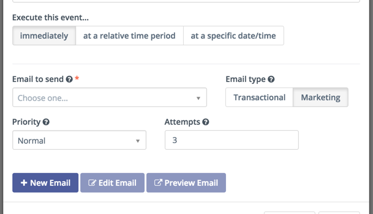

.. vale off

消息队列
#############

.. vale on

您可以触发营销活动 **营销** 邮件，或将其作为邮件广播（分组邮件）发送。当超出频率规则时——无论是在联系人级别定义的，还是在配置中设置的默认规则——所有邮件都会进入队列等待后续处理。

优先级与尝试次数
*******************************

* 您可以选择 **高** 或 **普通** 优先级。在处理指定日期的消息时，Mautic 会将高优先级消息置于队列顶部。广播始终按普通优先级处理。

* 达到指定的尝试次数后，Mautic 会在重新调度时尝试再次发送邮件。即使消息处于待处理状态，超过尝试次数意味着 Mautic 不会发送该消息。

处理消息队列
**************************

此命令会处理所有尚未达到最大尝试次数且处于待处理队列中的消息。

按如下方式设置您的 :ref:`定时任务<processing a message queue>`：``php bin/console mautic:messages:send``

