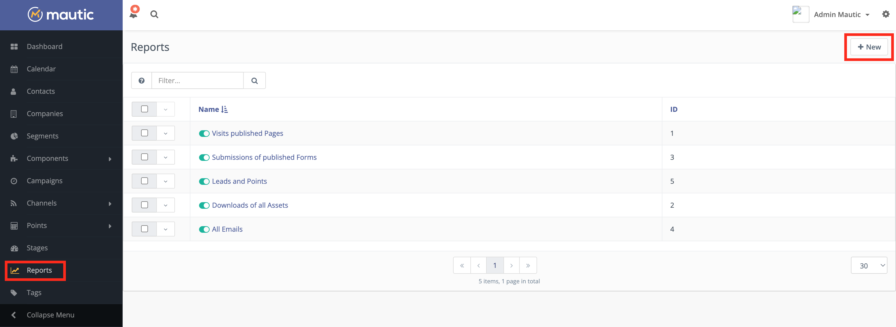
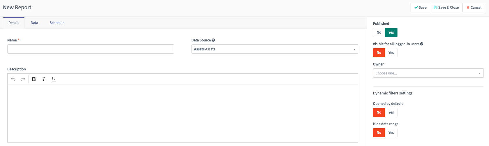
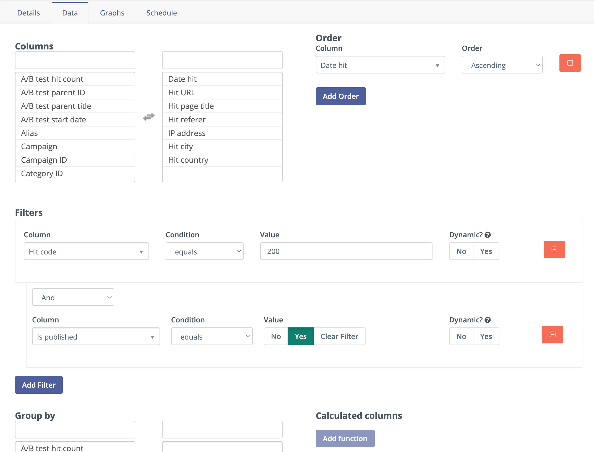
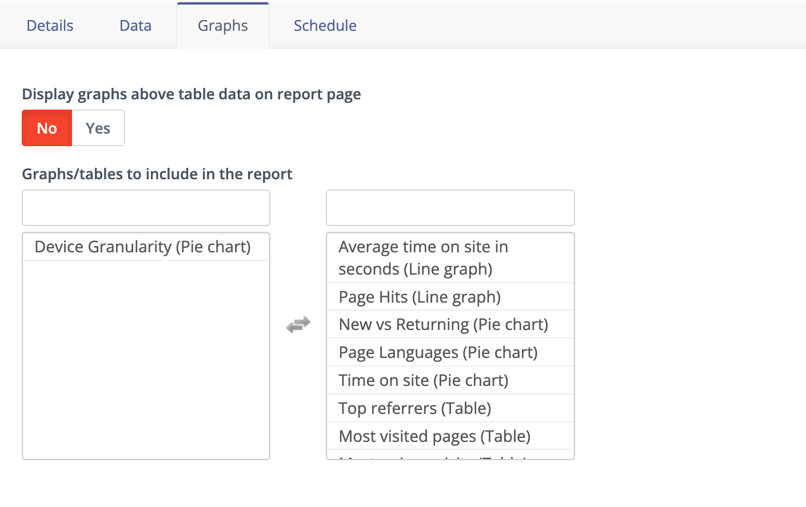
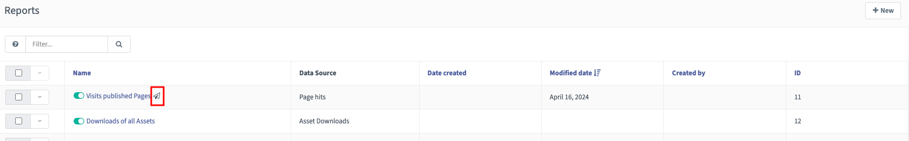
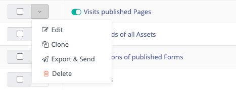
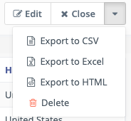

报告
#######

Mautic 的报告菜单使您能够生成高度可自定义的报告。

您可以使用报告工具来跟踪营销指标、识别有效或需要改进的营销活动，以及进行故障排除或调查您好奇为什么会发生某事的原因。

要进入报告，点击实例左侧菜单中的报告链接。要创建新报告，点击右上角的 **+新建** 按钮。

|

数据源
============

报告的 **详情** 选项卡在所有报告中都包含相同的选项，并为您的报告提供了一些通用选项。

* **名称** — 指定一个让您和其他用户容易识别报告用途的报告名称。

* **数据源** — 选择适合您正在构建的报告的数据源。请注意，每个数据源都有一组不同的可用列、筛选器和图表。可用的数据源有：

1. :doc:`资源</components/assets>`

   * 资源
   * 资源下载

2. :doc:`营销活动</campaigns/campaigns_overview>`

   * 营销活动事件

3. :doc:`渠道消息</queue/message_queue>`

   * 消息队列

4. :doc:`邮件</channels/emails>`

   * 邮件
   * 已发送的邮件

5. :doc:`表单</components/forms>`

   * 表单
   * 表单提交

6. :doc:`联系人</contacts/manage_contacts>`

   * 联系人
   * 多点归因
   * 首次接触归因
   * 最后接触归因
   * 联系人积分日志
   * 频率规则
   * 分组成员
   * 不联系
   * UTM 代码
   * 分组积分

7. :doc:`公司</companies/companies_overview>`

   * 公司

8. :doc:`移动通知</channels/marketing_messages>`

   * 移动通知
   * 已发送的移动通知

9. :doc:`页面</components/landing_pages>`

   * 落地页
   * 页面访问

10. 视频

    * 视频观看

如上所示，Mautic 以格式：``<父级数据源> <子级数据源>`` 显示数据源。

父级数据源提供了数据的高级摘要，而子级数据源提供了更细粒度的联系人行为视图，包括您的自定义字段和值。

* **描述 - 可选** — 添加有关报告的详细信息，帮助您和其他用户更好地理解报告的用途。您可能希望包含关于筛选器、人员或部门的更多信息。

* **已发布** — 选择 **是** 以确保报告处于活动状态，并可以在报告选项中调度发送。

* **对所有已登录用户可见** — 选择 **是**，以便所有用户都可以访问该报告。如果设置为否，只有报告的所有者和有权查看他人报告的用户才能看到该报告。

* **所有者** — 选择报告的所有者，以确定谁可以在"对所有已登录用户可见"设置为否时看到该报告。

* **动态筛选器设置**

  - 默认打开 — 如果您希望确保日期筛选器和任何其他报告筛选器的筛选选项在报告详情页面上可见，而无需打开筛选器下拉菜单，请选择是。例如，对于邮件报告，您可能希望查看主题或发送日期的动态筛选器。
  - 隐藏日期范围 — 要隐藏日期范围筛选器，使用户无法更改报告显示数据的日期，请选择 **是**。

.. vale off

邮件报告列
--------------------

.. vale on

使用"邮件"作为数据源时，您可以添加以下列来衡量邮件互动情况：

.. vale off

* **发送数：** 发送给联系人的邮件数量。
* **阅读数：** 联系人打开的邮件数量。
* **阅读率：** 已发送邮件中被联系人打开的百分比。
* **点击次数：** 点击邮件中任何链接的独立联系人数。
* **点击率：** 已发送邮件中至少产生一次点击的百分比。
* **点击打开率：** 已打开邮件中至少产生一次点击的百分比。这有助于您了解邮件内容对已打开邮件的收件人的吸引力。
* **退订数：** 收到邮件后退订的联系人数量。
* **退订率：** 已发送邮件中导致退订的百分比。
* **退订打开比：** 退订联系人相对于打开邮件联系人的百分比。这有助于您了解邮件内容如何影响活跃收件人中的退订率。
* **退信数：** 退信的邮件数量。
* **退信率：** 已发送邮件中退信的百分比。
* **点击总次数：** 所有收件人所有链接点击的总次数——非独立。
* **点击总次数率：** 已发送邮件中产生点击的百分比，基于总点击数而非独立联系人。
* **独立点击数：** 所有可跟踪链接的独立点击总数。每个链接单独计算，因此一个联系人点击多个不同的链接会产生多个独立点击。如果您需要点击任意链接的独立联系人数，请改用 **点击次数**。
* **独立点击率：** 已发送邮件中产生独立点击的百分比，基于各链接的独立点击总和。
* **不联系偏好设置：** 联系人在所有渠道和邮件中的"不联系"偏好设置摘要。

.. vale on

.. tip::

   使用退订打开比来比较不同邮件的退订影响。高比率可能表明邮件内容未达到收件人预期，而低比率则表明邮件内容与阅读者产生了共鸣。

数据
====

您可以自定义每个报告，包含所选择的列、基于设定条件筛选数据和/或设置特定的数据排序。此外，您还可以按特定字段进行分组，并选择不同的函数运算符来计算字段。请注意，当您选择函数运算符时，Mautic 会在报告中添加一个合计行。选择导出报告时 **不会** 包含这个合计行。

* **列** — 选择您想要在报告的数据表中显示的列。点击左侧列中的列名可使其在报告中显示。您可以通过点击右侧列中的列来从报告中移除一列。该列会返回其在左侧的原始位置。例如，如果您选择 ID，它指的是您之前选择的父级数据源分类的 **ID**——联系人 ID、邮件 ID、资源 ID 等。建议在所有报告中包含 **ID**。
* **排序** — 用于对报告中的数据进行排序，选择数据点。可用的排序选项有 **升序** 和 **降序**。要添加多列，请点击 **添加排序**。对于使用文本的字段，**升序** 排序将 B 开头的值列在 A 开头的值之后，以此类推。对于数字或日期字段，数字越大或日期越晚，该行在列表中的位置越低。降序则相反。

.. note::

   添加多个排序字段时，排序列表中的最后一个字段优先使用。例如，按 **名字升序** 排序并添加 **邮件升序**，会首先对邮件列排序，然后对重复行按名字升序排序。

* **筛选器** — 使用条件和值来筛选数据。这允许生成非常细粒度的报告。此选项帮助您缩小报告中包含的数据范围。用于筛选器的数据点不必是出现在报告表中的列。对于包含联系人记录数据的任何报告，常用筛选器是"邮件不为空"，它仅在报告中显示已识别的联系人。其他用例包括匹配特定值的联系人或项目、在特定日期范围内发生的事件等。

.. note::

   将 **动态** 选项设置为 **是** 可以让查看报告的用户更容易地更改他们看到的数据，而不必实际编辑报告。用户可以从报告页面顶部打开 **筛选器** 下拉菜单来查看筛选器。

* **分组依据** — 选择您要分组数据的列。默认情况下，报告会单独显示所有项目。在许多报告中，您可能会看到相同的联系人、公司或项目多次出现。要只看到每个记录列出一次，您可以基于记录的某些属性添加分组。

您可以使用邮件或联系人 ID 来为每个联系人记录显示单行。例如，您可以按 **联系人 ID** 分组来查看单个表单的资源下载或表单提交的唯一数量，而不是总资源下载或表单提交数，后者可能包含重复项。

* **计算列** — 选择您要应用于单个列的函数。计算列显示所选字段的计数、平均值、总和或最小值/最大值。它们仅在使用分组来显示该分组的计算时才可用。继续前面的按联系人 ID 号或邮件地址分组的示例，``COUNT`` 计算会显示该联系人记录在报告中的出现次数（如果不分组的话）。

图表
======

某些报告类型会显示图表以用于可视化目的。您可以在报告中包含这些图表，并在仪表盘小组件中使用它们。

* 要选择可用的图表并将其添加到报告，请点击图表名称将其从左侧列移动到右侧列。
* 要从报告中移除图表，请点击右侧列中的名称将其移动到左侧。

图表的可用性和类型因报告类型而异。

调度
========

Mautic 允许调度发送包含 ``.csv`` 文件格式报告数据的可下载链接的邮件。

使用切换开关来打开或关闭通过邮件发送报告。

* 邮件报告 — 选择 **是** 以查看其他选项。

* 收件人 — 指定应接收报告的邮件地址。要发送给多个收件人，请用逗号分隔他们的邮件地址。例如，``example1@example.com``, ``example2@example.com``。

* **频率** — 选择您希望自动发送报告的频率：

  - **立即** — 保存时发送一次报告。
  - **天** — 在您所在时区的午夜每天发送报告。
  - **周** — 选择周后，选择您希望发送报告的星期几。Mautic 在您所在时区的午夜，每周在选定的一天发送报告。
  - **月** — 选择月后，选择"第一个"或"最后一个"和星期几。例如，将您的报告设置为在每月的第一个星期一或最后一个星期五自动发送。

或者，您可以选择"工作日"来在每月的第一个或最后一个工作日发送报告。

在所有 **详情**、**数据**、**图表** 和 **调度** 选项卡中设置了所有选项后，点击 **保存并关闭** 以保存报告。点击 **应用** 会保存在构建报告上所做的进度，并将您保持在编辑模式中。

从 Mautic 5.1 及更高版本开始，您可以通过报告名称旁边的纸飞机图标在报告列表中识别已调度的报告。

.. vale off

调度报告的定时任务
~~~~~~~~~~~~~~~~~~~~~~~~~~~~

.. vale on

Mautic 需要以下定时任务命令才能发送已调度的报告：

``php /path/to/mautic/bin/console mautic:reports:scheduler [--report=ID]``

``--report=ID`` 参数允许您在需要时按 ID 指定报告。有关更多信息，请参见 :ref:`定时任务<send scheduled reports cron job>`。

报告选项
==============

一旦保存了报告，它会列在 Mautic 的报告部分下。

要查看报告的其他选项，请点击复选框旁边的下拉菜单。

* **编辑** 直接将您带到编辑模式，而不是在查看页面点击并从那里编辑。

* **克隆** 复制报告，使您可以在保持原始报告的同时，在类似但新的报告中做小幅调整。

* **导出并发送** 将包含 ``.csv`` 文件报告数据的链接发送到您用户资料中的邮件地址。

* **删除** 立即删除报告。

.. vale off

导出报告
=================

.. vale on

除了 **调度** 和 **导出并发送** 功能外，Mautic 还支持以 ``.csv``、Excel 或 HTML 格式导出报告。从报告列表中，点击任何报告。打开右上角的下拉菜单，选择偏好的导出格式。

要立即下载报告：

1. 在调度选项卡上，执行以下操作之一：

   * 选择 **否**。
   * 在 **频率** 字段中，将值设置为"立即"。

2. 点击 **保存并关闭**。

3. 在报告详情页面上，点击右上角的下拉菜单并点击 **导出为 CSV**。

4. 根据需要重新设置调度。

报告数据也可以通过 API 导出。有关更多信息，请参见 :xref:`Reports API documentation`。