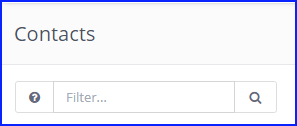

.. vale off

搜索 Mautic
################

.. vale on

搜索运算符和过滤器
****************************

Mautic 提供了多种搜索运算符和过滤器，用于深入查找相关资源。您可以通过点击搜索输入框旁边的问号按钮来查看可用的搜索过滤器和运算符。

如果缺少该按钮，则表示该实体没有可用的搜索过滤器。

|

Mautic 还提供"全局搜索"功能。点击左上角 Mautic 标志/通知图标旁边的放大镜图标，即可打开一个搜索输入框，在其中可以跨多个不同实体进行搜索。

|

搜索运算符
================

以下是您可以使用的一些搜索运算符：

* ``+`` 加号 - 精确搜索指定字符串，例如搜索 ``+admin`` 时 ``administrator`` 不会匹配。

* ``!`` 感叹号 - 不等于该字符串

* ``" "`` 双引号 - 按短语搜索

* ``( )`` 圆括号 - 将表达式组合在一起。

* ``OR`` - 默认情况下表达式以 ``AND`` 语句连接。使用 OR 运算符可以改变这一点。

* ``%`` - 使用 % 作为通配符来搜索短语中的特定名称或值，例如要查找所有名称中包含"Technologies"的公司，请输入 %technologies%

搜索过滤器
========================

以下是您可以使用的一些搜索过滤器：

联系人搜索过滤器
-----------------------

.. code-block::

    is:anonymous
    is:unowned
    is:mine
    email:*
    segment:{segment_alias}
    name:*
    company:*
    owner:*
    ip:*
    ids:ID1,ID2 (comma separated IDs, no spaces)
    common:{segment_alias} + {segment_alias} + ...
    tag:*
    stage:*
    email_sent:EMAIL_ID
    email_read:EMAIL_ID
    email_queued:EMAIL_ID
    email_pending:EMAIL_ID

公司搜索过滤器
------------------------

.. code-block::

    ids:ID1,ID2 (comma separated IDs, no spaces)
    is:published
    is:unpublished
    is:mine
    is:uncategorized
    category:{category alias}

分组搜索过滤器
-----------------------

.. code-block::

    ids:ID1,ID2 (comma separated IDs, no spaces)
    is:global
    name:*
    category:category-alias

资源搜索过滤器
---------------------

.. code-block::

    ids:ID1,ID2 (comma separated IDs, no spaces)
    is:mine
    is:published
    is:unpublished
    name:*
    is:uncategorized
    category:{category alias}

表单搜索过滤器
--------------------

.. code-block::

    ids:ID1,ID2 (comma separated IDs, no spaces)
    is:mine
    is:published
    is:unpublished
    has:results
    name:*
    is:uncategorized
    category:{category alias}

.. vale off

落地页搜索过滤器
----------------------------

.. vale on

.. code-block::

    ids:ID1,ID2 (comma separated IDs, no spaces)
    is:published
    is:unpublished
    is:mine
    is:uncategorized
    is:prefcenter
    category:{category alias}
    lang:{lang code}

.. vale off

动态内容搜索过滤器
------------------------------

.. vale on

.. code-block::

    ids:ID1,ID2 (comma separated IDs, no spaces)
    is:published
    is:unpublished
    is:mine
    is:uncategorized
    is:prefcenter
    category:{category alias}
    lang:{lang code}

邮件搜索过滤器
---------------------

.. code-block::

    ids:ID1,ID2 (comma separated IDs, no spaces)
    is:published
    is:unpublished
    is:mine
    is:uncategorized
    category:{category alias}
    lang:{lang code}

焦点项目搜索过滤器
--------------------------

.. code-block::

    ids:ID1,ID2 (comma separated IDs, no spaces)
    is:published
    is:unpublished
    is:mine
    is:uncategorized
    category:{category alias}

管理操作搜索过滤器
-----------------------------

.. code-block::

    ids:ID1,ID2 (comma separated IDs, no spaces)
    is:published
    is:unpublished
    is:mine
    is:uncategorized
    category:{category alias}

管理触发器搜索过滤器
------------------------------

.. code-block::

    ids:ID1,ID2 (comma separated IDs, no spaces)
    is:published
    is:unpublished
    is:mine
    is:uncategorized
    category:{category alias}

阶段搜索过滤器
---------------------

.. code-block::

    ids:ID1,ID2 (comma separated IDs, no spaces)
    is:published
    is:unpublished
    is:mine
    is:uncategorized
    category:{category alias}

报告搜索过滤器
----------------------

.. code-block::

    ids:ID1,ID2 (comma separated IDs, no spaces)
    is:published
    is:unpublished
    is:mine
    Categories
    ids:ID1,ID2 (comma separated IDs, no spaces) is:published is:unpublished

用户搜索过滤器
--------------------

.. code-block::

    ids:ID1,ID2 (comma separated IDs, no spaces)
    is:admin
    is:active
    is:inactive
    email:*
    name:*
    position:*
    role:*
    username:*
    Roles
    ids:ID1,ID2 (comma separated IDs, no spaces)
    is:admin
    name:*

Webhook 搜索过滤器
-----------------------

.. code-block::

    ids:ID1,ID2 (comma separated IDs, no spaces)
    is:published
    is:unpublished
    is:mine
    is:uncategorized
    is:prefcenter
    category:{category alias}
    lang:{lang code}
