管理分组
#################

Mautic 中的分组是联系人的列表或群体。使用分组来发送邮件、触发营销活动或进行分析。您可以从 **静态** 和 **动态** 分组类型中添加和移除联系人。

分组提供了轻松组织联系人的方式。有各种各样的字段可用于配置这些分组。

.. vale off

创建分组
******************

.. vale on

#. 要创建新分组，请导航至菜单中的分组，然后点击 **新建** 按钮。

#. 在 **详情** 选项卡中，为您的分组添加 **名称**、**公开名称** 和 **描述**。

   |

   .. image:: images/create-segment.png
      :width: 700
      :alt: Screenshot showing creating a Segment.

   |

#. 填写其他选项：

   * **对其他用户可见** — 此选项决定分组是对所有用户可见和使用，还是仅对创建该分组的用户可见和使用。
   * **在偏好中心中可用** — 如果设置为 **是**，联系人可以在 **偏好中心** 界面上看到并选择加入或退出该分组。如果偏好中心具有 **分组列表** 插槽类型，分组会显示出来。
   * **活动** — 如果设置为 **否**，该分组将不能在其他分组的筛选器中使用、不能作为营销活动中的联系人来源、不能用于修改分组操作等。您仍然可以在分组列表中看到该分组，但它不会出现在 Mautic 的其他任何地方。

   * **公开名称** — 用户可以为分组设置不同的名称，该名称在偏好中心选项中对联系人可见。

     在 **详情** 选项卡上，静态和动态分组也有显示分组不同公开名称的选项。

.. vale off

查看联系人分组
************************

.. vale on

.. vale off

查看所有分组时，**# 联系人** 列显示每个特定分组中包含的联系人数量。**构建中** 或 **构建中（X 个联系人）** 标签会在创建新分组或修改现有分组的筛选器时出现，并在构建过程完成之前一直显示。

.. vale on

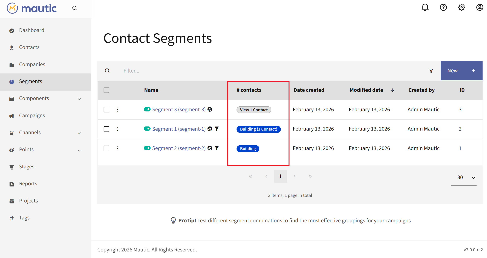

.. vale off

导出分组中的联系人
*******************************

.. vale on

要导出分组中的联系人：

#. 点击您要导出的分组的 **查看 X 个联系人** 标签。这会打开联系人界面。

   |

   .. image:: images/segments_view_contacts_label.png
      :width: 700
      :alt: Highlight of view 1 Contact label at Mautic Contact Segments interface.

   |
#. 点击搜索栏旁边的上下箭头图标以打开 **导入/导出** 选项。
#. 点击 **导出为 CSV** 或 **导出为 Excel** 以偏好的格式导出联系人。

   |

   .. image:: images/import_export_contacts_segment.png
      :width: 700
      :alt: Screenshot showing Contacts matching that particular Segment.

.. vale off

静态分组
***************

.. vale on

静态分组不是基于筛选器的。将联系人添加到分组可以通过以下方式之一完成：

.. vale off

手动移动联系人
========================

.. vale on

将联系人移入静态分组的两种手动选项是：

.. vale off

批量更新联系人
-----------------------
  .. vale on

1. 使用 Mautic 联系人部分的搜索筛选器来找到要更改的联系人。

2. 选中这些联系人旁边的复选框。

3. 点击列顶部出现的绿色箭头。

4. 从列表中选择 **更改分组**。

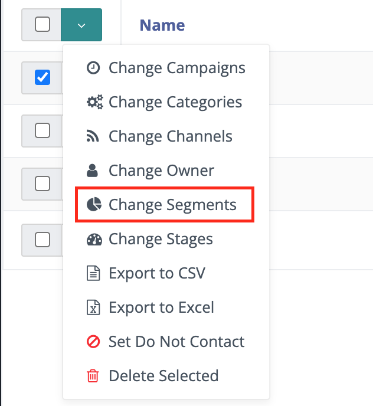

5. 选择要添加或移除联系人的 **分组**。

6. 点击 **保存**。

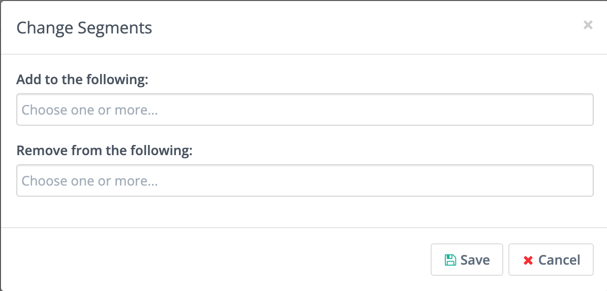

.. vale off

添加单个联系人
--------------------------

.. vale on

1. 导航至您要更改的联系人记录。

2. 点击右上角 **编辑/发送邮件/关闭** 旁边的箭头。

3. 选择 **偏好设置**。

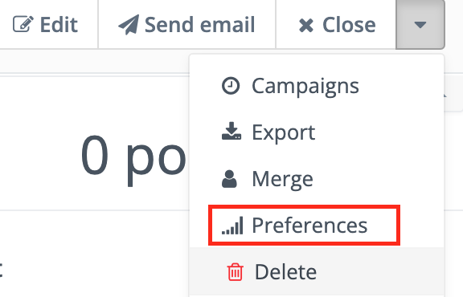

4. 点击 **分组**。

5. 选择您要将联系人添加到或从中移除的分组。

6. 点击 **保存**。

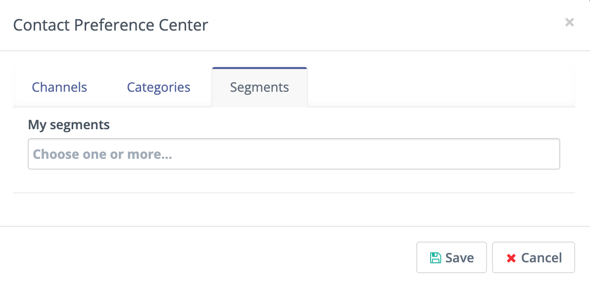

.. vale off

使用营销活动操作
=======================

.. vale on

在 :ref:`营销活动<campaigns overview>` 内部，您可以使用 **修改联系人的分组** 操作将联系人添加到分组或从中移除。要将联系人添加到分组，您必须已经创建了该分组并将其设置为 **公开分组 = 是**。

1. 在营销活动构建器中，点击底部的连接器。

  .. image:: images/campaign-builder-connector.png
    :alt: Screenshot Campaign builder connector.

2. 选择 **操作**。

3. 在操作列表中，选择 **修改联系人的分组**。

4. 从现有分组列表中选择您要添加或移除联系人的分组。

  .. image:: images/modify-segments.png
    :alt: Screenshot showing list of existing Segments.

5. 点击保存并关闭。

.. vale off

表单提交操作
==================

.. vale on

.. vale off

**修改联系人的分组** 可作为 :ref:`表单<creating a new form>` 的提交操作使用。

.. vale on

1. 点击 **操作**。

2. 从 **添加新提交操作** 菜单中，选择 **修改联系人的分组**。

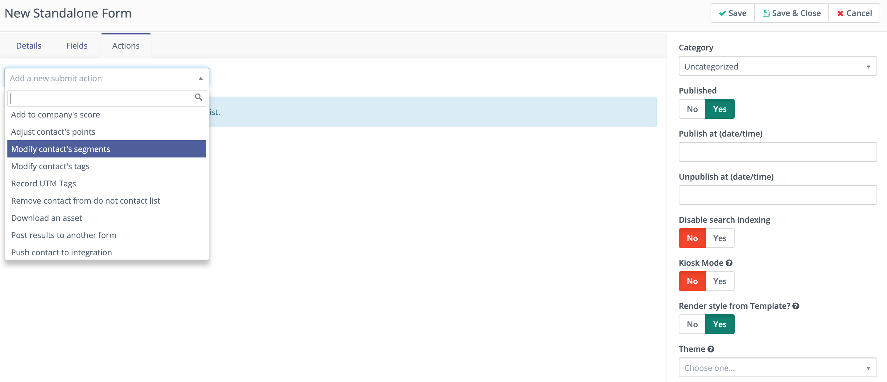

3. 为提交操作添加标题，并添加 **描述** - 可选。

4. 选择您要将联系人添加到或从中移除的分组。

5. 点击 **添加**。

.. vale off

积分触发器
==============

.. vale on

一旦联系人累积了指定数量的积分，系统可以将其添加到分组中。这可能是您最活跃联系人的分组，他们有资格获得特别优惠，或者是您的销售团队查看以找到潜在客户的分组。

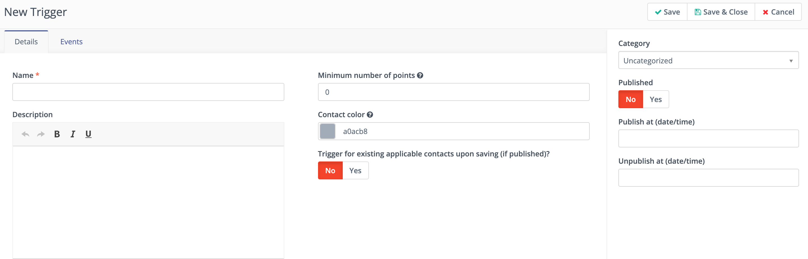

1. 在平台的 **积分** 部分，选择 **管理触发器**。

2. 点击 **+新建**。

3. 为您的触发器提供 **名称** 和 **描述**。

4. 输入将联系人添加到您的分组所需的 **最低积分数**。

5. 决定是否要将所有至少拥有该积分数的联系人添加到该分组：

.. tip::

    * 如果您只想将达到该阈值的新联系人添加到此分组，请选择 **否** — 默认值。

    * 要将所有至少拥有一定积分数的现有联系人添加到该分组，请将开关切换为 **是**。

1. 点击 **事件**。

2. 点击 **添加事件** 菜单并选择 **修改联系人的分组**。

3. 为事件添加 **标题** 和 **描述** - 可选。

4. 选择您要将联系人添加到或从中移除的分组。

5. 点击 **添加**。

6. 点击 **保存并关闭**。

这与创建带有积分筛选器、">= 运算符"和最低积分数的动态分组效果相同。区别在于，如果您只想将在此触发器创建后达到该积分值的联系人添加到分组，您可以这样做。

.. vale off

CSV 上传
===========

.. vale on

如果您在 Mautic 之外有一个列表，保存为 UTF-8 编码的 CSV 文件，您可以直接将列表上传到 Mautic 分组中。

1. 点击 **联系人**。

2. 点击右上角的菜单并选择 **导入**。

3. 确保文件是 UTF-8 CSV 格式。选择您的文件然后点击 **上传**。

4. 在下一屏幕的顶部，选择您要将联系人添加到的分组。

5. 映射文件中的相应字段。请记住始终映射唯一标识符，这样您就不会创建重复项。

6. 点击 **导入**。

如果您的文件超过 1,000 行，系统会切换屏幕并在文件上传完成后通知您。上传完成后，点击平台的分组部分查看添加的联系人。

.. vale off

动态分组
****************

.. vale on

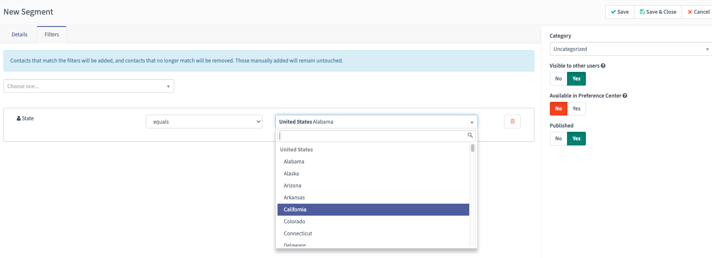

Mautic 根据应用于分组的筛选器将联系人移入和移出动态分组。随着与联系人关联的数据更新，包括公司关联和行为，Mautic 会更新分组成员资格。

配置分组筛选器
===========================

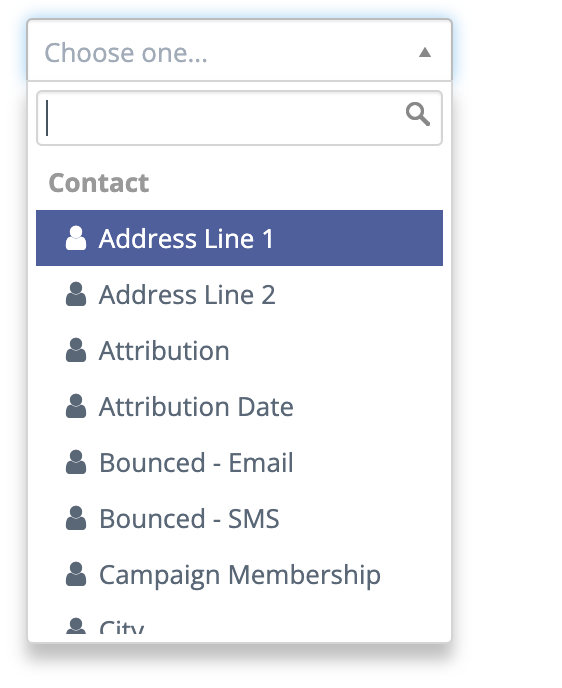

1. 点击 **+新建** 按钮创建新分组。

2. 在 **详情** 选项卡中，为您的分组添加 **名称**、**公开名称** 和 **描述**。

3. 点击 **筛选器** 选项卡以添加筛选器。

4. 点击 **选择一项**... 菜单，搜索您要用于分组的字段。

.. attention::

  下面列出了三种类型的字段：

  * 联系人字段

    * 将字段设置为 **可用于分组 = 是** 以使其在您的自定义字段管理器中显示在此处。

  * 联系人行为与操作
  * 主公司字段

    * 将字段设置为 **可用于分组 = 是** 以使其在您的自定义字段管理器中显示在此处。

    * 联系人会与多个公司关联，但 Mautic 基于主公司字段将其添加到分组。

5. 使用 **与** 和 **或** 运算符添加更多筛选器。**或** 运算符创建一个新的筛选器组，其中可以包含"与"运算符。

6. 点击 **保存并关闭**。

.. note::

    分组会根据您触发 :ref:`定时任务<segment cron jobs>` 的频率来重建。

    * 如果分组在预定时间内未能重建，Mautic 会显示一个通知，提醒您发生了错误。有关定义此时间段的信息，请参见 :ref:`分组设置<segment settings>`
    * Mautic 在分组筛选器的文本字段类型中支持使用管道分隔的 ``|`` 值进行包含/排除操作。您可以从电子表格中粘贴值。

.. vale off

使用日期筛选器
==================

.. vale on

您可以使用日期筛选器来创建动态分组。

.. note::

  数据库中存储的值的日期格式是 ``YYYY-MM-DD``。例如，2020 年 12 月 11 日存储为 2020-12-11，2020 年 11 月 12 日存储为 2020-11-12。要更新日期的显示格式，请前往 **设置 > 配置 > 系统设置 > 系统默认值**。但请注意，这不会更改数据库中的存储格式。

.. vale off

运算符
=========

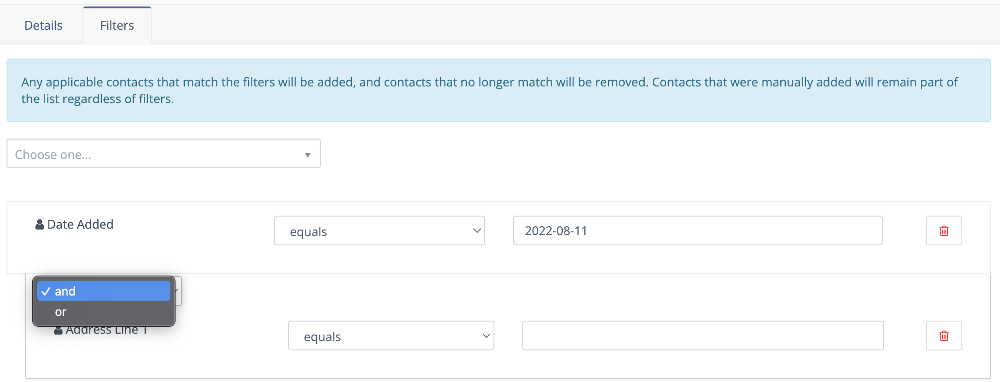

.. vale on

您必须确保使用正确的运算符和时间框架来构建有效的分组。

一旦您选择了日期字段作为筛选器，例如默认的 **最后活跃日期** 字段或自定义的 **生日** 字段，您将有一系列运算符可供选择：

* **等于** — 联系人记录上的值与筛选器值完全匹配。

* **不等于** — 联系人记录上的值是任何与筛选器值不匹配的值。

* **大于** — 联系人记录上的值在时间上晚于 X 日期。例如，``大于`` 今天意味着从明天起直到永远。

* **大于或等于** — 联系人记录上的值在时间上晚于或等于 X 日期。例如，``大于或等于`` 今天意味着从今天起直到永远

* **小于** — 联系人记录上的值在时间上早于 X 日期。例如，``小于今天`` 意味着从时间开始到昨天。

* **小于或等于** — 联系人记录上的值在时间上早于或等于 X 日期。例如，``小于或等于今天`` 意味着从时间开始到今天。

* **为空** — 联系人记录上的该字段中没有值。

* **不为空** — 联系人记录上的该字段中有值。

* **Like** — 此运算符在日期或日期时间字段中不支持，请勿使用。

* **Not like** — 此运算符在日期或日期时间字段中不支持，请勿使用。

* **Regexp** — 分组包含值与指定正则表达式模式匹配的联系人。如果您不精通正则表达式，请勿使用此运算符。

* **Not regexp** — 分组包含值与指定正则表达式模式不匹配的联系人。如果您不精通正则表达式，请勿使用此运算符。

* **Starts with** — 分组包含字段值以指定数字开头的联系人。这些筛选器值通常引用年份，或年份和月份。

  *例如，值为 19 匹配字段值中年份在 1900 年代的任何联系人。值为 200 匹配年份值在 2000 年到 2009 年之间的联系人，值为 2020-11 匹配字段值为 2020 年 11 月的联系人。*

* **Ends with** — 分组包含字段值以指定数字结尾的联系人。这些筛选器值通常引用日，或月和日。

  *例如，值为 1 匹配字段值在任何月份的 1 日、21 日或 31 日的任何人，但值为 01 匹配一个月的 1 日。值为 01-01 找到其值为任何年份 1 月 1 日的联系人。*

* **Contains** — 分组包含指定筛选器值出现在字段值中任何位置的联系人。

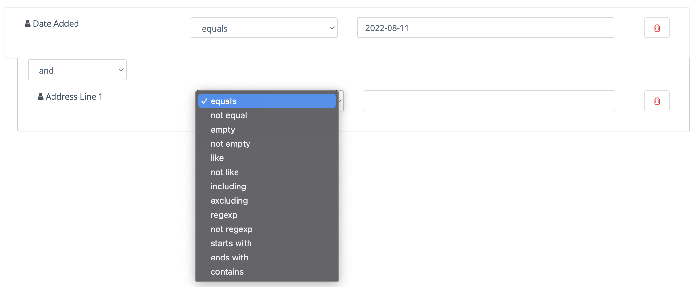

选择字段后，您可以选择要执行的操作类型。这些操作因您筛选联系人的方式而异。

下拉字段的运算符
===========================

单选字段，如国家、时区、地区、区域设置和自定义下拉字段，提供以下运算符：

* **等于** — 联系人的值与所选选项完全匹配。
* **不等于** — 联系人的值与所选选项不匹配。
* **为空** — 联系人在此字段中没有值。
* **不为空** — 联系人在此字段中有值。
* **Regexp** — 联系人的值与指定正则表达式模式匹配。
* **Not regexp** — 联系人的值与指定正则表达式模式不匹配。
* **包含任意** — 联系人的值与至少一个所选选项匹配。
* **排除任意** — 联系人的值与所有所选选项都不匹配。

多选字段一次可以保存多个值，因此它提供一组不同的运算符：

* **包含任意** — 联系人的值中至少包含一个所选选项。
* **排除任意** — 联系人的值中不包含任何所选选项。
* **包含全部** — 联系人的值中包含所有所选选项。
* **排除全部** — 联系人的值中不包含所有所选选项。
* **为空** — 联系人在此字段中没有值。
* **不为空** — 联系人在此字段中有值。

这两组并不相同。多选字段不提供 **等于**、**不等于**、**Regexp** 或 **Not regexp**，因为这些运算符是与单个值进行比较。相反，它添加了 **包含全部** 和 **排除全部** 来对每个选定的值进行匹配。

.. note::

   ``包含全部`` 和 ``排除全部`` 运算符仅出现在多选字段中，因为它们要求联系人拥有多个值。单选字段（如国家、时区、地区和区域设置）仅保存单个值，因此这些运算符不适用。

.. vale off

匹配字符串的一部分
=========================

.. vale on

有 5 个筛选器可用于匹配字符串的一部分——``starts with``、``ends with``、``contains``、``like`` 和 ``regexp``。前三个筛选器按您输入的方式匹配字符串。``like`` 筛选器适用于高级用户——您可以使用 ``%`` 字符指定要使用的类型：

* ``My string%`` 与值为 ``My string`` 的 ``starts with`` 筛选器相同。

* ``%My string`` 与值为 ``My string`` 的 ``ends with`` 筛选器相同。

* ``%My string%`` 与值为 ``My string`` 的 ``contains`` 筛选器相同。

* ``My string`` 与值为 ``My string`` 的 ``contains`` 筛选器相同。

关于文本筛选器的几点说明：

* 您应该使用 ``starts with``、``ends with``、``contains`` 而不是 ``like``，因为它们更具体，因此可能更有效。

* 字符串中间的 ``%`` 字符没有特殊含义。值为 ``my % string`` 的 ``contains`` 筛选器搜索中间带有 ``%`` 的字符串。对于值为 ``%my % string%`` 的 ``like`` 筛选器也是如此。无需转义此字符。

* Mautic 在 ``like`` 筛选器的值中搜索 ``%`` 字符，如果找到至少一个 ``%``，Mautic 不会执行任何修改。

您可以在 ``regexp`` 筛选器中使用正则表达式。Mautic 识别所有常用运算符，如 ``|`` 表示 OR —— 例如 ``first string|second string``，字符集包括 ``[0-9]``、``[a-z0-9]`` 等等，重复符（``+``、``*``、``?``）等等。

如果您想将它们用作匹配字符，必须用 ``\`` 转义特殊字符。

了解更多关于 :xref:`Regex` 的信息。

.. note::

  MySQL（和 Mautic）使用 ``POSIX`` 正则表达式，其行为可能与其他类型的正则表达式不同。

.. vale off

日期选项
============

.. vale on

日期筛选器允许您通过日期选择器选择日期：

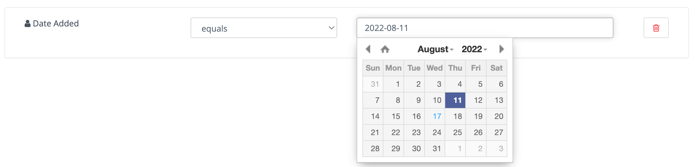

然而，您可以在这里指定更多的内容。Mautic 也识别相对格式——这些字符串不可翻译：

* ``+1 day`` — 您也可以使用 ``1 day``
* ``-2 days`` — 您也可以使用 ``2 days ago``
* ``+1 week`` / ``-2 weeks`` / ``3 weeks ago``
* ``+5 months`` / ``-6 months`` / ``7 months ago``
* ``+1 year`` / ``-2 years`` / ``3 years ago``

示例——假定今天是 ``2022-03-05``：

* ``Date identified equals -1 week`` 返回所有在 2022-02-26 识别的联系人。
* ``Date identified less than -1 week`` 返回所有在 2022-02-26 之前识别的联系人。
* ``Date identified equals -1 months`` 返回所有在 2022-02-05 识别的联系人。
* ``Date identified greater or equal -1 year`` 返回所有在 2021-03-05 及之后识别的联系人。
* ``Date identified greater than -1 year`` 返回所有在 2021-03-05 之后识别的联系人。

除此之外，您还可以使用文本指定日期。这些公式是 **可翻译的** — Mautic 以您当前的语言设置显示它们。

* ``birthday`` / ``anniversary``
* ``birthday -7 days`` / ``anniversary -7 days``
* ``today`` / ``tomorrow`` / ``yesterday``
* ``this week`` / ``last week`` / ``next week``
* ``this month`` / ``last month`` / ``next month``
* ``this year`` / ``last year`` / ``next year``
* ``first day of previous month`` / ``first day of January 2022``
* ``last day of previous month`` / ``last day of January 2022``

.. tip::

   像 ``today``、``tomorrow`` 和 ``this week`` 这样的相对日期值无论您的 Mautic 语言设置如何都能正常工作。切换语言不会影响分组对这些筛选器的评估方式。

示例（假定今天是 ``2022-03-05``）：

* ``Date identified equals last week`` 返回在指定日期范围内识别的所有联系人，例如 2022-03-01 至 2022-03-07。
* ``Date identified less than last week`` 返回在 2022-02-22 之前识别的所有联系人。
* ``Date identified equals last month`` 返回在指定日期范围内识别的所有联系人，例如 2022-02-01 至 2022-02-28。
* ``Date identified greater or equal last year`` 返回 2021-01-01 及之后识别的所有联系人。
* ``Date identified greater than last year`` 返回在 2021-12-31 之后识别的所有联系人。
* ``Date identified greater than first day of previous month`` 返回在 2022-02-01 之后识别的所有联系人。
* ``Date identified greater than last day of previous month`` 返回在 2022-02-28 之后识别的所有联系人。
* ``Custom Contact date field equal birthday -1 day`` 返回每年 03-04（3 月 4 日）识别的所有联系人。
* ``Custom Contact date field equal anniversary -1 month`` 返回每年 02-04（2 月 4 日）识别的所有联系人。

创建分组后，任何符合条件的联系人都会通过执行 :ref:`定时任务<import contacts cron job>` 自动添加。这就是分组的本质。

为了保持分组的最新状态，请创建一个定时任务，以期望的间隔执行 :ref:`命令<segment cron jobs>`。

通过执行该命令，Mautic 添加匹配筛选器的联系人，并移除不再匹配的联系人。任何手动添加的联系人无论筛选器如何都保留在列表中。

.. vale off

删除分组中的所有联系人
********************************

.. vale on

可以手动删除分组中的所有联系人，而不是通过营销活动操作。为此，首先创建一个带有筛选器的分组，该筛选器选出您要删除的所有联系人。

这是一项性能预防措施，因为一次删除过多的联系人可能会导致问题。但是，您可以多次删除每批 100 个联系人来处理较大的列表。

1. 选中这些联系人旁边的复选框。

2. 点击列顶部出现的绿色箭头。

3. 从列表中选择 **删除所选**。

4. 点击 **删除**。

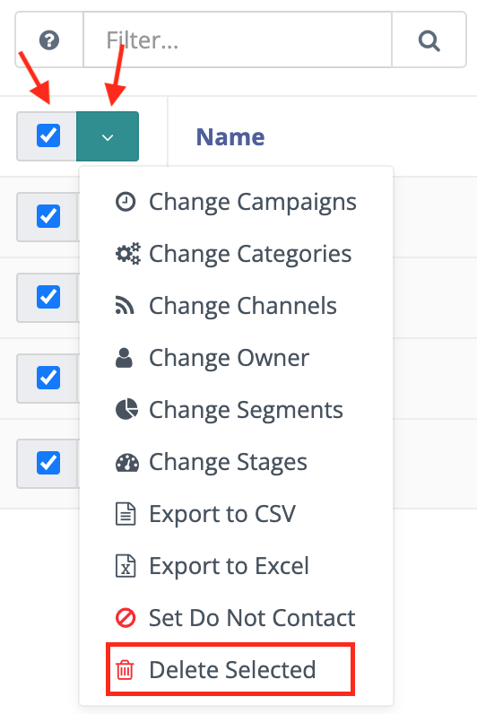

以这种方式在一个分组中删除成千上万个联系人是件繁琐的任务。幸运的是，有一个技巧可以让后台工作进程为您完成这项工作。

1. 创建一个以该分组为来源的营销活动

2. 使用 :ref:`删除联系人操作<using the campaign builder>`。

这样，``mautic:campaign:update`` 和 ``mautic:campaign:trigger`` 命令会删除分组中的所有联系人，以及将来添加到该分组的所有联系人。这一切都在后台自动完成。需要配置 :ref:`定时任务<segment cron jobs>`。

.. danger::

  除非恢复您的整个 Mautic 数据库备份，否则您无法恢复已删除的联系人。**使用时要极其小心**。

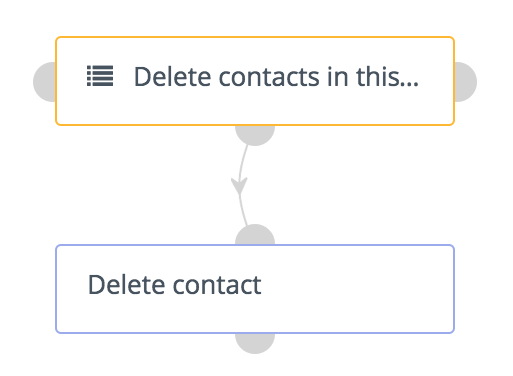

.. vale off

删除或停用分组
**********************************

.. vale on

从 :xref:`Mautic 4` 开始，在删除或停用分组时有一个步骤，用于确保现有分组不需要将其作为筛选器。

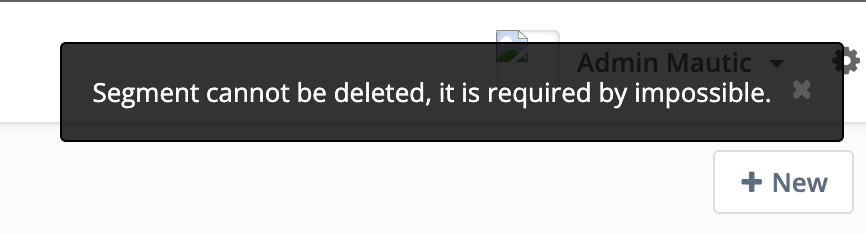

如果您试图删除或停用被另一个分组的筛选器所使用的分组，系统会弹出一个警告，提示您编辑另一个分组，在删除该分组之前移除依赖关系。