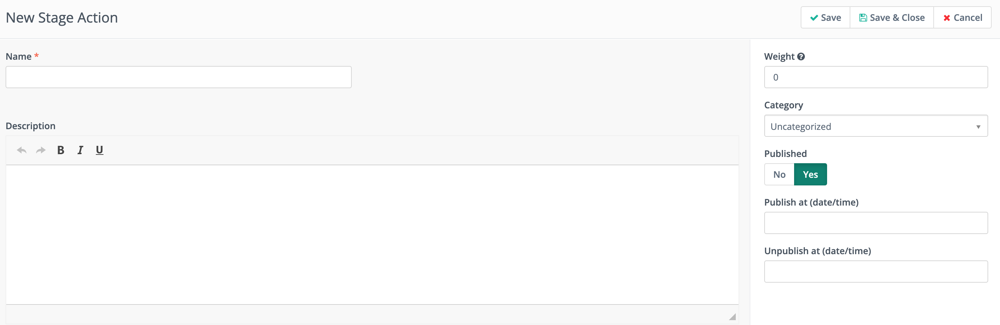
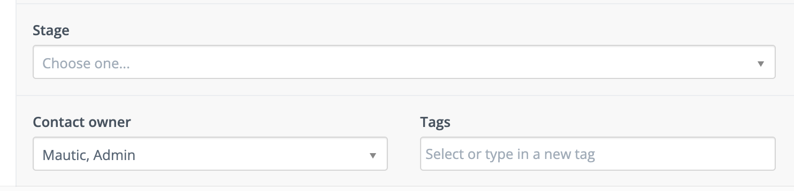
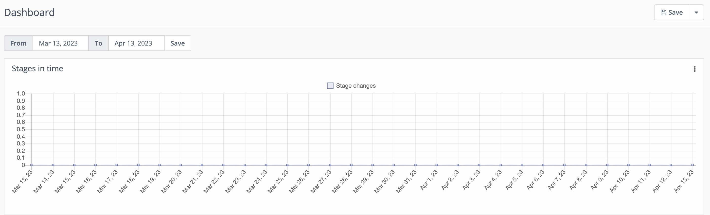

阶段
######

Mautic 阶段为用户提供了一种跟踪和管理联系人在营销生命周期或漏斗各阶段进展的方式。

通过将联系人归入不同的阶段，您可以更好地了解他们与品牌的互动情况，并相应地调整您的营销策略。

创建好阶段之后，您可以根据联系人的行为或其他条件，轻松地将联系人从一个阶段移动到另一个阶段。

.. vale off

创建阶段
***************

.. vale on

导航到左侧菜单中的 **阶段** 部分，然后点击 **+新建**。

|

**名称** - 虽然大多数公司有相似的阶段结构，但每家公司的使用方式各不相同。请根据您想要追踪的营销漏斗的不同部分来设计阶段名称。

**描述** - 为了帮助您和其他用户轻松识别联系人符合某个阶段的条件，建议添加描述。

**权重** - 用于决定阶段的推进顺序。阶段的权重数值越大，表示联系人在漏斗中的位置越靠后。联系人无法倒退到权重更低的阶段。

**分类** - 分配一个分类以帮助您组织阶段。更多信息请参见 :ref:`categories`。

**激活选项** - 仪表盘小部件不会显示未激活阶段的数据。此外，分组过滤器或营销活动条件也不会显示该阶段。为了避免在构建阶段时使用它，可以设置未来的激活日期和时间。如果您希望阶段在特定时间后不可用，请设置停用日期和时间。

.. vale off

在阶段之间移动联系人
******************************

.. vale on

在阶段之间移动联系人需要使用营销活动操作。

根据您定义的联系人生命周期和阶段的不同，将联系人移动到不同阶段可能会有不同的触发条件。例如，在营销活动中的行为，或者在不同分组之间的移动，这些分组已为每个阶段设置了条件。

在任何您希望将联系人在新阶段之间移动的营销活动中：

|

1. 添加一个新的 **操作**。

2. 选择 **更改联系人阶段** 作为操作类型。

3. 选择您希望联系人移动到的目标阶段。您可以基于之前的事件，也可以基于联系人所在的分组（该分组根据与某个阶段匹配的要求设置了过滤器）。

有关设置营销活动的更多信息，请参见 :ref:`triggering campaign events`

.. note::

    您可以拥有多个带有不同阶段的漏斗，以及跨这些漏斗的多个权重相同的阶段。一个联系人同一时间只能处于一个阶段。无法将联系人移动到权重低于其当前阶段的阶段。例如，如果联系人当前处于权重为 50 的阶段 B，则无法将其移动到权重为 25 的阶段 A。

.. vale off

可视化阶段移动
**************************

.. vale on

Mautic 仪表盘提供两个小部件，帮助用户查看联系人在各阶段之间的移动情况。

|

阶段时间线小部件显示联系人更改阶段的频率。更多的变化表示漏斗中的推进速度更快。

生命周期
*********

生命周期小部件使营销人员能够查看指定分组中联系人在每个阶段的数量。您可以在小部件中包含多个分组。可以使用多个生命周期小部件将信息分解为单独的图表，同时仍然在仪表盘上显示多个分组的数据。