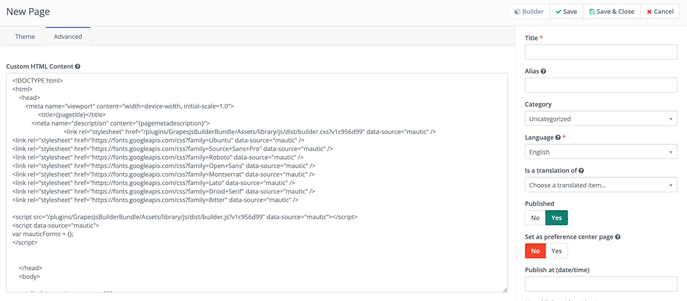

.. vale off

代码模式
##########

.. vale on

代码模式是邮件和落地页编辑表单中提供的一个选项。它允许您以 HTML 代码形式创建/插入/编辑内容。这对于您不想使用 Mautic 主题而想使用从第三方主题构建器复制的 HTML 主题，或者您更偏好直接编辑 HTML 代码的情况非常有用。

编辑落地页/邮件内容的另一个选项是使用内置的拖放式 GrapesJS 构建器。请阅读 :doc:`/builders/email_landing_page` 部分了解更多。

选择代码模式
********************

如果您想使用现有的 HTML，请从主题选择器中选择代码模式。要打开代码模式构建器，点击出现的高级选项卡。

局限性
===========

如果您使用 Mautic 主题创建了落地页/邮件，然后想编辑 HTML 代码，您应该仔细考虑是否要这样做。

一旦您从主题切换到代码模式，内容就会变成 HTML，您将无法再切换回主题。

选择主题会用默认主题的内容替换当前内容，因此您将丢失所做的修改。

相反，要对现有主题进行小幅代码更改，建议使用 GrapesJS 构建器内置的代码模式。

.. image:: images/theme-list.png
    :width: 600
    :alt: Screenshot of code mode

.. vale off

在代码模式构建器中编辑 HTML 内容
==============================================

.. vale on

在代码模式下，您可以在高级选项卡下的文本区域中查看 HTML 内容。目前没有预览功能。

Mautic 令牌
=============

您可以直接在代码中输入令牌来在代码模式构建器中使用它们。例如，输入 ``{contactfield=firstname}``。